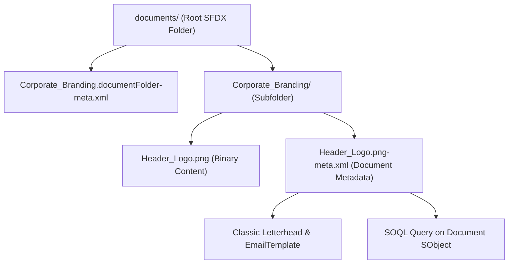

## Overview

The `Document` metadata type represents a binary or text file stored in the legacy Salesforce Classic **Documents** tab. Although Salesforce Files (`ContentVersion` / `ContentDocument`) and [ContentAsset](/docs/metadata/content-asset-metadata-type/) have superseded `Document` in Lightning Experience, `Document` remains architecturally relevant in enterprise orgs for three reasons:
1. Classic Letterhead and HTML [EmailTemplate](/docs/metadata/email-template-metadata-type/) headers and footers reference `Document` records by folder and developer name.
2. Unauthenticated external image links using `/servlet/servlet.ImageServer?id=<DocId>&oid=<OrgId>` rely on `Document` with `<public>true</public>`.
3. Legacy managed packages and custom Visualforce PDF generators frequently query the `Document` object via SOQL to load dynamic branding logos or XML configuration files.



## Directory and File Suffix Reference

`Document` is a folder-based metadata type (`inFolder: true`). Every document must reside inside a named `DocumentFolder` subdirectory under `force-app/main/default/documents/`.

| Property | Value |
| :--- | :--- |
| **Metadata Type Name** | `Document` (paired with `DocumentFolder`) |
| **SFDX Source Directory** | `force-app/main/default/documents/<FolderName>/` |
| **Content File Naming** | `<DocumentDeveloperName>.<ext>` (or `<DocumentDeveloperName>.document`) |
| **Metadata File Suffix** | `.document-meta.xml` (or `.<ext>-meta.xml` in SFDX source format) |
| **Supports Wildcard (`*`)** | No (must list folder and folder/document paths explicitly) |
| **API Version Introduced** | v10.0 (Verified through `68.0` in Winter '27) |

## Key Metadata Fields

| Field Name | Field Type | Required | Architectural Description |
| :--- | :--- | :--- | :--- |
| `internalUseOnly` | `boolean` | Yes | Marks the document as confidential for internal Salesforce users only. Defaults to `false`. |
| `public` | `boolean` | Yes | Exposes the document on the externally available image server (`servlet.ImageServer`) for HTML email templates without requiring login. |
| `name` | `string` | No | The user-facing display title of the document (up to 255 characters). |
| `contentType` | `string` | No | MIME type of the file (for example, `image/png`, `application/pdf`, or `text/html`). Automatically inferred in SFDX when file extension is preserved. |
| `description` | `string` | No | Architectural notes explaining where the document is referenced (up to 255 characters). |
| `keywords` | `string` | No | Search keywords used by global search to index the document metadata. |
| `content` | `base64Binary` | No | Raw binary payload stored in the companion file alongside the `-meta.xml` file. |

## Querying Document Records via SOQL

Unlike purely declarative XML settings, `Document` maps directly to the standard `Document` SObject and can be queried via SOQL in Apex or the Salesforce CLI:

```soql
SELECT Id, DeveloperName, Name, Folder.DeveloperName, ContentType,
       BodyLength, IsPublic, IsInternalUseOnly, Url, LastModifiedDate
FROM Document
WHERE Folder.DeveloperName = 'Corporate_Branding'
ORDER BY DeveloperName ASC
```

> [!WARNING]
> Avoid selecting the `Body` base64 field in bulk SOQL queries over `Document`. Including `Body` restricts the query to returning one or a few rows before hitting the 6 MB synchronous / 12 MB asynchronous Apex heap size limit.

## Declarative XML and Package.xml Examples

### 1. Parent Folder Metadata (`Corporate_Branding.documentFolder-meta.xml`)

```xml title="force-app/main/default/documents/Corporate_Branding.documentFolder-meta.xml"
<?xml version="1.0" encoding="UTF-8"?>
<DocumentFolder xmlns="http://soap.sforce.com/2006/04/metadata">
    <accessType>Public</accessType>
    <name>Corporate Branding Assets</name>
    <publicFolderAccess>ReadOnly</publicFolderAccess>
</DocumentFolder>
```

### 2. Document Metadata (`Invoice_Header_Logo.png-meta.xml`)

```xml title="force-app/main/default/documents/Corporate_Branding/Invoice_Header_Logo.png-meta.xml"
<?xml version="1.0" encoding="UTF-8"?>
<Document xmlns="http://soap.sforce.com/2006/04/metadata">
    <description>Official 600x120 PNG header logo used in Classic billing email templates.</description>
    <internalUseOnly>false</internalUseOnly>
    <keywords>logo, header, billing, letterhead</keywords>
    <name>Invoice Header Logo</name>
    <public>true</public>
</Document>
```

### 3. Package Manifest (`package.xml`)

Because `Document` does not support the `*` wildcard, you must include both the `DocumentFolder` name and the slash-delimited `FolderName/DocumentName` member in `<types>`:

```xml title="manifest/package.xml"
<?xml version="1.0" encoding="UTF-8"?>
<Package xmlns="http://soap.sforce.com/2006/04/metadata">
    <types>
        <members>Corporate_Branding</members>
        <members>Corporate_Branding/Invoice_Header_Logo.png</members>
        <name>Document</name>
    </types>
    <version>68.0</version>
</Package>
```

```bash
# List all documents in a specific folder using the Salesforce CLI
sf org list metadata --metadata-type Document --folder Corporate_Branding

# Retrieve the folder and the document together
sf project retrieve start --metadata "Document:Corporate_Branding,Document:Corporate_Branding/Invoice_Header_Logo.png"
```

## Architect Best Practices and Gotchas

- **File Extension Preservation in SFDX:** In modern SFDX source format, if a `Document` has its file extension included in its `DeveloperName` or filename (`Invoice_Header_Logo.png`), both the binary file and the `-meta.xml` file include `.png`. Ensure your `package.xml` member matches the exact `DeveloperName` stored in Salesforce.
- **Migrate App Logos to `ContentAsset`:** Lightning Apps (`CustomApplication`) require [ContentAsset](/docs/metadata/content-asset-metadata-type/) rather than `Document` for app branding logos. When modernizing a Classic app to Lightning, convert its `Document` logo into a `ContentAsset`.
- **Hardcoded ImageServer URLs Across Sandboxes:** External HTML templates that hardcode `/servlet/servlet.ImageServer?id=015...&oid=00D...` break after sandbox refreshes or deployments to new orgs because both `015` (Document ID) and `00D` (Organization ID) change when created via Metadata API deployment. Use dynamic merge fields or convert to `ContentAsset` / CDN delivery.

