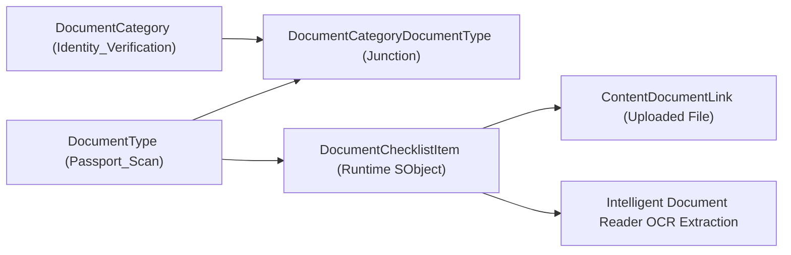

## Architectural Overview

The `DocumentType` metadata type defines standardized classification definitions for business documents across Financial Services Cloud (FSC), Health Cloud, Public Sector Solutions, and Core CRM. It forms the core taxonomy layer for **Document Checklist Items**, **Action Plan Templates**, and **Intelligent Document Reader (IDR)** OCR extraction pipelines.

In regulated enterprise onboarding, loan origination, patient intake, and permit application workflows, organizations must collect and verify diverse customer documents (such as Passports, W-2 Tax Statements, Medical Clearances, and Proof of Address). Architecturally, `DocumentType` separates document classification and compliance rules from runtime files:

1. **Taxonomy & Categorization:** `DocumentType` components represent canonical document definitions. They link to higher-level categories via `DocumentCategoryDocumentType` junction metadata.
2. **Runtime Association:** When a customer or service representative initiates an onboarding process, business logic instantiates `DocumentChecklistItem` records pointing to specific `DocumentType` definitions.
3. **Automated Verification:** Uploaded files (`ContentVersion`) linked to the checklist item can be routed to Amazon Textract or Salesforce OCR models configured to extract metadata specific to that `DocumentType`.



## Directory and File Suffix Reference

In modern Salesforce DX source format, each `DocumentType` component is stored as an individual XML file in the `documentTypes` directory.

| Property | Value |
| :--- | :--- |
| **Metadata Type Name** | `DocumentType` |
| **SFDX Source Directory** | `force-app/main/default/documentTypes/` |
| **Metadata File Suffix** | `.documentType-meta.xml` |
| **Package Manifest Type** | `DocumentType` |
| **Supports Wildcard (`*`)** | Yes |
| **API Version Introduced** | v49.0 (Verified through `68.0` in Winter '27) |

## Key Metadata Fields

`DocumentType` components extend `Metadata` and define the following schema properties:

| Field Name | Field Type | Required | Architectural Description |
| :--- | :--- | :--- | :--- |
| `masterLabel` | `string` | Yes | The user-facing label displayed in onboarding portals, reviewer consoles, and intake checklists (up to 80 characters). |
| `description` | `string` | No | Architectural guidance, regulatory references, or intake rules describing valid formats, acceptable issuance dates, or redaction requirements. |
| `isActive` | `boolean` | No | Specifies whether the document type is available for new `DocumentChecklistItem` generation. Defaults to `true`. |

> [!TIP]
> Deactivating a `DocumentType` (`isActive: false`) prevents automated flows or action plan templates from creating new checklist items for that type, while preserving historical audit records and previously verified files.

## Declarative XML and Package.xml Examples

### 1. Source Component Definition (`Passport_Scan.documentType-meta.xml`)

```xml title="force-app/main/default/documentTypes/Passport_Scan.documentType-meta.xml"
<?xml version="1.0" encoding="UTF-8"?>
<DocumentType xmlns="http://soap.sforce.com/2006/04/metadata">
    <description>Valid government-issued international travel passport for identity and nationality verification.</description>
    <isActive>true</isActive>
    <masterLabel>Government Issued Passport</masterLabel>
</DocumentType>
```

### 2. Secondary Document Type Example (`W2_Wage_Statement.documentType-meta.xml`)

```xml title="force-app/main/default/documentTypes/W2_Wage_Statement.documentType-meta.xml"
<?xml version="1.0" encoding="UTF-8"?>
<DocumentType xmlns="http://soap.sforce.com/2006/04/metadata">
    <description>Annual employer wage and tax statement verifying borrower income for mortgage underwriting.</description>
    <isActive>true</isActive>
    <masterLabel>W-2 Wage and Tax Statement</masterLabel>
</DocumentType>
```

### 3. Package Manifest (`manifest/package.xml`)

To package or retrieve all document types, reference the `DocumentType` type in `package.xml`:

```xml title="manifest/package.xml"
<?xml version="1.0" encoding="UTF-8"?>
<Package xmlns="http://soap.sforce.com/2006/04/metadata">
    <types>
        <members>*</members>
        <name>DocumentType</name>
    </types>
    <types>
        <members>*</members>
        <name>DocumentCategory</name>
    </types>
    <types>
        <members>*</members>
        <name>DocumentCategoryDocumentType</name>
    </types>
    <version>68.0</version>
</Package>
```

## Retrieval and Deployment Commands

Manage `DocumentType` metadata using standard Salesforce CLI commands:

```bash
# Retrieve all DocumentType definitions from the target org
sf project retrieve start --metadata DocumentType

# Deploy a specific DocumentType to staging or production
sf project deploy start --metadata DocumentType:Passport_Scan --target-org prod-ci

# Query active DocumentTypes in the org via SOQL
sf data query --query "SELECT Id, DeveloperName, MasterLabel, IsActive, Description FROM DocumentType WHERE IsActive = true" --target-org staging-sandbox
```

## Senior Architect Deployment Best Practices and Gotchas

- **Dependency Ordering in Multi-Package Pipelines:** `DocumentType` records serve as prerequisites for `DocumentCategoryDocumentType` junction records, `ActionPlanTemplate` versions, and Intelligent Document Reader OCR mapping templates. Deploy `DocumentType` components in the foundational metadata release before deploying dependent junction types or automated flows.
- **Handling Hard Deletions:** In production orgs, deleting a `DocumentType` metadata file will fail deployment if active `DocumentChecklistItem` records currently reference its `DocumentTypeId`. Architects should adopt a deprecation strategy: deploy `isActive: false` first, migrate or archive historical records, and remove the metadata only after all foreign key references are eliminated.
- **Intelligent Document Reader Integration:** When pairing `DocumentType` with Salesforce IDR OCR services, ensure the developer name matches the target model definition. OCR target objects map extracted key-value pairs (such as Passport Number or Expiration Date) back to custom fields based on the assigned `DocumentType`.
- **Scratch Org Feature Activation:** In scratch org definitions, verify that the `DocumentChecklist` or corresponding industry cloud feature (`FinancialServicesCloud`, `HealthCloud`, or `PublicSectorSolutions`) is enabled under `features` in `config/project-scratch-def.json` before deploying `DocumentType` metadata.
