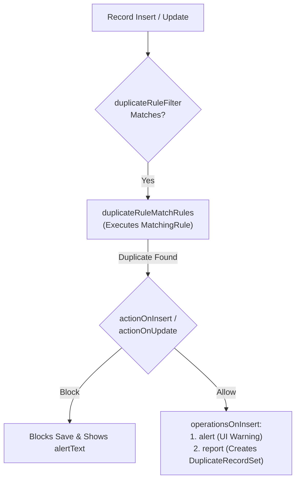

The `DuplicateRule` metadata type controls what happens when a user or API integration attempts to create or update a record that matches an existing record identified by a [MatchingRule](/docs/metadata/matching-rule-metadata-type/). Introduced in API version 38.0, `DuplicateRule` lets architects either **Block** duplicate saves outright or **Allow** saves while presenting an inline warning (`alertText`) and logging `DuplicateRecordSet` / `DuplicateRecordItem` records for steward review.

In Salesforce DX projects, duplicate rules are stored in `force-app/main/default/duplicateRules/` using the naming convention `<ObjectName>.<RuleDeveloperName>.duplicateRule-meta.xml`.



## Key Metadata Fields

| Field | Type | Required | Description |
|---|---|---|---|
| `masterLabel` | `string` | Yes | UI display name of the duplicate rule |
| `isActive` | `boolean` | Yes | Activates (`true`) or deactivates (`false`) the duplicate rule |
| `securityOption` | `DuplicateRuleSecurityOption` | Yes | `EnforceSharingRules` (checks only visible records) or `BypassSharingRules` (checks all org records) |
| `actionOnInsert` | `DupeActionType` | Yes | `Allow` or `Block` on record creation |
| `actionOnUpdate` | `DupeActionType` | Yes | `Allow` or `Block` on record edit |
| `alertText` | `string` | Yes | Warning/error message displayed to the user (set `xsi:nil="true"` only if alerts are disabled) |
| `operationsOnInsert` | `string[]` | No | `alert` and/or `report` (logs `DuplicateRecordSet` when `actionOnInsert` is `Allow`) |
| `operationsOnUpdate` | `string[]` | No | `alert` and/or `report` when `actionOnUpdate` is `Allow` |
| `sortOrder` | `int` | Yes | Execution priority (`1`-based) among duplicate rules on the same object |
| `duplicateRuleMatchRules` | `DuplicateRuleMatchRule[]` | Yes | Links to one or more `MatchingRule` definitions and cross-object `objectMapping` |
| `duplicateRuleFilter` | `DuplicateRuleFilter` | Yes | Entry criteria (`duplicateRuleFilterItems` + `booleanFilter`) determining when the rule runs |

## Production-Grade XML Example (Cross-Object Lead-to-Contact Duplicate Rule)

Below is a `DuplicateRule` on `Lead` (`force-app/main/default/duplicateRules/Lead.Prevent_Lead_Matching_Existing_Contact.duplicateRule-meta.xml`) that checks incoming Leads against existing `Contact` records and maps Contact fields into the Lead fields:

```xml
<?xml version="1.0" encoding="UTF-8"?>
<DuplicateRule xmlns="http://soap.sforce.com/2006/04/metadata" xmlns:xsi="http://www.w3.org/2001/XMLSchema-instance">
    <actionOnInsert>Allow</actionOnInsert>
    <actionOnUpdate>Allow</actionOnUpdate>
    <alertText>This Lead matches an existing Contact in Salesforce. Please convert into the existing Contact rather than creating a duplicate.</alertText>
    <description>Detects Leads that match existing Contacts using fuzzy name and exact email matching.</description>
    <duplicateRuleFilter>
        <booleanFilter xsi:nil="true"/>
        <duplicateRuleFilterItems>
            <field>Username</field>
            <operation>notContain</operation>
            <value>integration@</value>
            <sortOrder>1</sortOrder>
            <table>User</table>
        </duplicateRuleFilterItems>
    </duplicateRuleFilter>
    <duplicateRuleMatchRules>
        <matchRuleSObjectType>Contact</matchRuleSObjectType>
        <matchingRule>Standard_Contact_Match_Rule_v1_1</matchingRule>
        <objectMapping>
            <inputObject>Lead</inputObject>
            <mappingFields>
                <inputField>FirstName</inputField>
                <outputField>FirstName</outputField>
            </mappingFields>
            <mappingFields>
                <inputField>LastName</inputField>
                <outputField>LastName</outputField>
            </mappingFields>
            <mappingFields>
                <inputField>Email</inputField>
                <outputField>Email</outputField>
            </mappingFields>
            <outputObject>Contact</outputObject>
        </objectMapping>
    </duplicateRuleMatchRules>
    <isActive>true</isActive>
    <masterLabel>Prevent Lead Matching Existing Contact</masterLabel>
    <operationsOnInsert>alert</operationsOnInsert>
    <operationsOnInsert>report</operationsOnInsert>
    <operationsOnUpdate>report</operationsOnUpdate>
    <securityOption>BypassSharingRules</securityOption>
    <sortOrder>1</sortOrder>
</DuplicateRule>
```

## Querying Duplicate Rules and Logged Duplicates with SOQL

```sql
-- 1. List all DuplicateRules and their active status
SELECT Id, DeveloperName, MasterLabel, SobjectType, IsActive
FROM DuplicateRule
ORDER BY SobjectType, MasterLabel

-- 2. Inspect logged duplicate sets generated by 'report' operations
SELECT Id, Name, DuplicateRule.MasterLabel, RecordCount, CreatedDate,
       (SELECT Id, RecordId FROM DuplicateRecordItems)
FROM DuplicateRecordSet
WHERE RecordCount > 1
ORDER BY CreatedDate DESC
LIMIT 25
```

