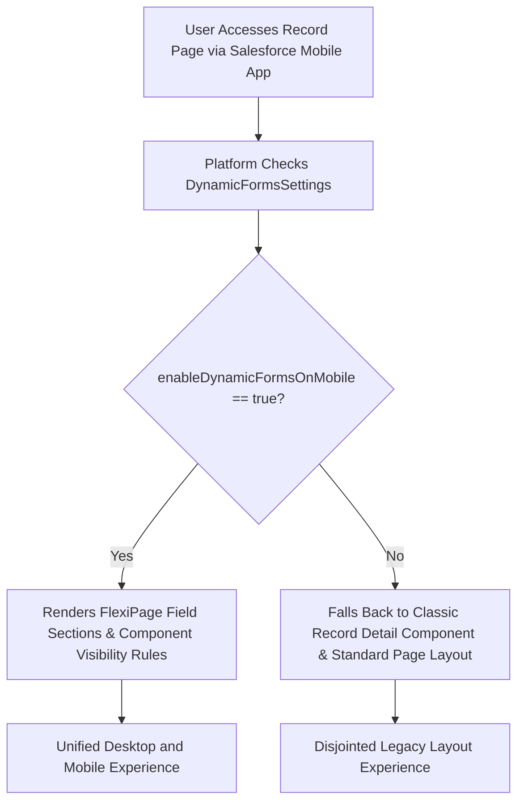

## Architectural Overview

The `DynamicFormsSettings` metadata type manages org-level preferences for **Salesforce Dynamic Forms** (`Setup > Feature Settings > Salesforce Mobile App > Dynamic Forms on Mobile`).

Dynamic Forms modernizes user interface architecture by decomposing monolithic page layouts (`Layout` metadata) into individual field and section components directly inside Lightning App Builder (`FlexiPage` metadata). Instead of relying on rigid page layout XML files with multi-column tables, architects use Dynamic Forms to place fields, configure granular component visibility rules, and enforce field-level requiredness conditionally.

`DynamicFormsSettings` controls the cross-device behavior of these modern flexipages. Specifically, the setting toggles whether mobile users accessing the Salesforce mobile application on smartphones and tablets render the modernized Dynamic Forms layout or fall back to classic page layouts.



## Directory and File Suffix Reference

In Salesforce DX source format, `DynamicFormsSettings` is stored as a singleton file in the `settings` directory.

| Property | Value |
| :--- | :--- |
| **Metadata Type Name** | `DynamicFormsSettings` (deployed via `Settings`) |
| **SFDX Source Directory** | `force-app/main/default/settings/` |
| **Source File Name** | `DynamicForms.settings-meta.xml` |
| **Package Manifest Type** | `Settings` |
| **Package Manifest Member** | `DynamicForms` |
| **API Version Introduced** | v59.0 (Verified through `68.0` in Winter '27) |

## Key Metadata Fields

The `DynamicFormsSettings` metadata type extends `Metadata` and provides the following org-level preference:

| Field Name | Field Type | Required | Architectural Description |
| :--- | :--- | :--- | :--- |
| `enableDynamicFormsOnMobile` | `boolean` | No | When `true`, enables Dynamic Forms on Mobile devices, allowing Lightning pages configured with Field Section components to render natively on the Salesforce mobile app. Defaults to `false`. |

> [!TIP]
> Enabling `enableDynamicFormsOnMobile` ensures that field-level conditional visibility rules defined in `FlexiPage` metadata apply consistently across desktop, tablet, and mobile phone viewports.

## Declarative XML, Scratch Org, and Package.xml Examples

### 1. Settings Metadata File (`DynamicForms.settings-meta.xml`)

```xml title="force-app/main/default/settings/DynamicForms.settings-meta.xml"
<?xml version="1.0" encoding="UTF-8"?>
<DynamicFormsSettings xmlns="http://soap.sforce.com/2006/04/metadata">
    <enableDynamicFormsOnMobile>true</enableDynamicFormsOnMobile>
</DynamicFormsSettings>
```

### 2. Scratch Org Definition (`config/project-scratch-def.json`)

To configure scratch orgs for mobile testing and end-to-end Playwright or Cypress validation, declare `dynamicFormsSettings` in your scratch org configuration:

```json title="config/project-scratch-def.json"
{
  "orgName": "Dynamic Forms Mobile Testing Scratch Org",
  "edition": "Enterprise",
  "settings": {
    "dynamicFormsSettings": {
      "enableDynamicFormsOnMobile": true
    }
  }
}
```

### 3. Package Manifest (`manifest/package.xml`)

In manifest-based deployments, reference `DynamicForms` under the `Settings` metadata type:

```xml title="manifest/package.xml"
<?xml version="1.0" encoding="UTF-8"?>
<Package xmlns="http://soap.sforce.com/2006/04/metadata">
    <types>
        <members>DynamicForms</members>
        <name>Settings</name>
    </types>
    <version>68.0</version>
</Package>
```

## Retrieval and Deployment Commands

Manage `DynamicFormsSettings` using the modern Salesforce CLI (`sf`):

```bash
# Retrieve DynamicForms settings from target org
sf project retrieve start --metadata Settings:DynamicForms

# Deploy DynamicForms settings to target environment
sf project deploy start --metadata Settings:DynamicForms --target-org staging-sandbox

# Check deployment status
sf project deploy report
```

## Senior Architect Deployment Best Practices and Gotchas

- **Dual-Maintenance Elimination:** Before Dynamic Forms on Mobile, architects often had to maintain two sets of page definitions: a complex desktop `FlexiPage` using Dynamic Forms and an equivalent classic `Layout` for mobile field service reps. Deploying `enableDynamicFormsOnMobile: true` allows teams to retire legacy `Layout` modifications and unify UI logic under source-tracked `FlexiPage` metadata.
- **Mobile Performance Considerations:** Dynamic Forms allows page designers to add dozens of individual fields and complex visibility filters. On lower-end mobile devices with slow cellular connections, rendering a flexipage with excessive visibility expressions can increase Total Blocking Time (TBT). Architects should group fields into collapsed Accordion or Tab sections to defer off-screen field rendering.
- **Interaction with Standard Object Migration:** When converting standard objects (such as `Account`, `Contact`, `Opportunity`, or `Case`) to Dynamic Forms, verify that standard action buttons and required fields are properly represented in the `FlexiPage` metadata. If a required field is omitted from a Dynamic Forms section, mobile record saves can fail with validation errors that do not highlight a visible input field.
- **Release Gating in CI/CD:** If your deployment includes `FlexiPage` components that rely on mobile Dynamic Forms rendering, deploy `DynamicForms.settings-meta.xml` before or alongside the `FlexiPage` metadata to prevent mobile users from experiencing layout discrepancies.
