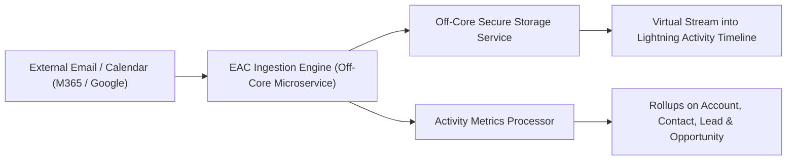

## Architectural Overview

The `EACSettings` metadata type represents the org-wide configuration for **Einstein Activity Capture (EAC)** (`Setup > Einstein > Einstein Activity Capture > Settings`).

Einstein Activity Capture automatically synchronizes emails, calendar events, and contacts between external productivity suites (Microsoft Exchange, Microsoft 365, Google Workspace) and Salesforce CRM records. Unlike legacy email logging systems that create physical `Task` and `EmailMessage` records in the relational transactional database, EAC captures and stores communication streams in high-scale, off-core AWS/Hyperforce microservices. Captured events and emails are dynamically streamed and virtualized directly into the Lightning Activity Timeline.

Architecturally, `EACSettings` acts as the gatekeeper for:
- Org-wide activation of Einstein Activity Capture synchronization engines.
- Enabling **Activity Metrics**, which computes real-time aggregation fields (such as `LastActivityDate`, `LastEmailDate`, and `InactiveDays`) on `Account`, `Contact`, `Lead`, and `Opportunity` records.
- Enforcing org-level email and event sharing guardrails to ensure compliance with enterprise privacy and data loss prevention (DLP) standards.



## Directory and File Suffix Reference

In Salesforce DX source format, `EACSettings` is deployed as a singleton setting file.

| Property | Value |
| :--- | :--- |
| **Metadata Type Name** | `EACSettings` (deployed via `Settings`) |
| **SFDX Source Directory** | `force-app/main/default/settings/` |
| **Source File Name** | `EAC.settings-meta.xml` |
| **Package Manifest Type** | `Settings` |
| **Package Manifest Member** | `EAC` |
| **API Version Introduced** | v48.0 (Verified through `68.0` in Winter '27) |

## Key Metadata Fields

The `EACSettings` metadata type extends `Metadata` and exposes the following org-level properties:

| Field Name | Field Type | Required | Architectural Description |
| :--- | :--- | :--- | :--- |
| `enableEAC` | `boolean` | No | Master feature toggle that activates or deactivates Einstein Activity Capture org-wide. Defaults to `false`. |
| `enableActivityMetrics` | `boolean` | No | Enables Activity Metrics calculation. When `true`, Salesforce calculates automated rollup fields (e.g., `LastActivityDate`, `NextActivityDate`) across standard CRM objects based on EAC-captured data. |
| `enableInsightsInTimeline` | `boolean` | No | Displays natural language processing (NLP) email insights (such as commitment tracking, executive involvement, and pricing queries) inside the activity timeline. |
| `enableDefaultEmailSharing` | `boolean` | No | Governs org-wide baseline sharing preferences for captured communications (e.g., sharing with everyone, sharing with specific manager groups, or keeping emails private). |

> [!NOTE]
> Setting `enableEAC` to `true` requires standard EAC or Sales Cloud Einstein user licenses in the target org.

## Declarative XML, Scratch Org, and Package.xml Examples

### 1. Settings Metadata File (`EAC.settings-meta.xml`)

```xml title="force-app/main/default/settings/EAC.settings-meta.xml"
<?xml version="1.0" encoding="UTF-8"?>
<EACSettings xmlns="http://soap.sforce.com/2006/04/metadata">
    <enableActivityMetrics>true</enableActivityMetrics>
    <enableDefaultEmailSharing>false</enableDefaultEmailSharing>
    <enableEAC>true</enableEAC>
    <enableInsightsInTimeline>true</enableInsightsInTimeline>
</EACSettings>
```

### 2. Scratch Org Definition (`config/project-scratch-def.json`)

To enable Einstein Activity Capture and Activity Metrics in CI/CD scratch orgs, configure the `eacSettings` block:

```json title="config/project-scratch-def.json"
{
  "orgName": "Sales Cloud EAC Validation Scratch Org",
  "edition": "Enterprise",
  "features": ["SalesUser"],
  "settings": {
    "eacSettings": {
      "enableEAC": true,
      "enableActivityMetrics": true,
      "enableInsightsInTimeline": true
    }
  }
}
```

### 3. Package Manifest (`manifest/package.xml`)

To retrieve or deploy EAC settings using manifest-driven pipelines:

```xml title="manifest/package.xml"
<?xml version="1.0" encoding="UTF-8"?>
<Package xmlns="http://soap.sforce.com/2006/04/metadata">
    <types>
        <members>EAC</members>
        <name>Settings</name>
    </types>
    <version>68.0</version>
</Package>
```

## Retrieval and Deployment Commands

Manage `EACSettings` via modern Salesforce CLI commands:

```bash
# Retrieve EAC settings from the target org
sf project retrieve start --metadata Settings:EAC

# Deploy EAC settings to the target org
sf project deploy start --metadata Settings:EAC --target-org staging-sandbox

# Preview deployment changes with dry run
sf project deploy validate --metadata Settings:EAC --target-org prod-ci
```

## Senior Architect Deployment Best Practices and Gotchas

- **SOQL Reporting and Data Residency:** Because EAC emails and calendar events are stored in off-core data stores, standard SOQL queries on `Task` or `EmailMessage` objects will **not** return activities captured solely by EAC. Enterprise reporting on sales interactions requires configuring Activity Metrics or using CRM Analytics EAC reporting templates rather than standard relational SOQL joins.
- **Activity Metrics Field Triggers:** Activity Metrics fields (such as `LastActivityDateTime`) are updated asynchronously by EAC backend workers. Do not design real-time Apex triggers or synchronous record-triggered Flows expecting instantaneous updates immediately upon an external email send.
- **Privacy and Sensitive Email Exclusions:** Architects working in healthcare, banking, or legal domains must configure org-wide sensitive domain exclusions (such as internal HR, legal counsel, or payroll domains) to prevent confidential email threads from being unintentionally captured into CRM timelines.
- **Connected App and OAuth Prerequisites:** Deploying `EACSettings` activates the platform framework, but full calendar and inbox synchronization requires authorizing the Microsoft 365 or Google Workspace connected service via OAuth 2.0 or service-account certificate credentials before end-user data flows.
