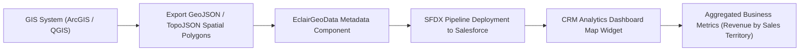

## Architectural Overview

The `EclairGeoData` metadata type represents custom geographic map boundaries and spatial definitions used by the Salesforce **Eclair** visualization engine within **CRM Analytics (formerly Tableau CRM / Einstein Analytics)** and Lightning dashboard charting components.

Standard analytics map charts provide out-of-the-box geographic shapes for standard political boundaries (countries, US states, Canadian provinces, European regions). However, enterprise commercial organizations frequently execute go-to-market strategies based on proprietary territorial structures, such as:
- Multi-state sales districts or customized franchise operating areas.
- Healthcare provider coverage clusters and medical service territories.
- Public utility distribution grids and municipal service precincts.

`EclairGeoData` packages and deploys custom GeoJSON or TopoJSON spatial boundary definitions as first-class Salesforce metadata. Once deployed into an org, analytics dashboard designers can select the custom map directly within chart widget properties to render custom choropleth maps, polygon overlays, and territory heatmaps.



## Directory and File Suffix Reference

In Salesforce DX project structures, `EclairGeoData` components reside in the `eclairGeoData` directory.

| Property | Value |
| :--- | :--- |
| **Metadata Type Name** | `EclairGeoData` |
| **SFDX Source Directory** | `force-app/main/default/eclairGeoData/` |
| **Metadata File Suffix** | `.eclairGeoData-meta.xml` |
| **Package Manifest Type** | `EclairGeoData` |
| **Supports Wildcard (`*`)** | Yes |
| **API Version Introduced** | v47.0 (Verified through `68.0` in Winter '27) |

## Key Metadata Fields

The `EclairGeoData` metadata type extends `Metadata` and encapsulates custom map attributes and spatial vector definitions:

| Field Name | Field Type | Required | Architectural Description |
| :--- | :--- | :--- | :--- |
| `masterLabel` | `string` | Yes | The user-facing label of the custom map displayed in CRM Analytics chart configuration picklists. |
| `description` | `string` | No | Architectural description of the territory model, coordinate reference system (CRS), or revision year. |
| `mapType` | `string` | No | The geometric format used for boundary parsing, typically `GeoJson` or `TopoJson`. |
| `content` | `string` (Base64) | Yes | Base64-encoded UTF-8 string containing the GeoJSON feature collection or TopoJSON topology defining the polygon coordinates. |

> [!TIP]
> Minify and simplify your GeoJSON polygon geometry using tools like `mapshaper` before encoding into `content`. Reducing unnecessary coordinate precision significantly improves browser rendering performance on high-density analytics dashboards.

## Declarative XML and Package.xml Examples

### 1. Custom Territory Map Definition (`NorthEast_Sales_Territories.eclairGeoData-meta.xml`)

```xml title="force-app/main/default/eclairGeoData/NorthEast_Sales_Territories.eclairGeoData-meta.xml"
<?xml version="1.0" encoding="UTF-8"?>
<EclairGeoData xmlns="http://soap.sforce.com/2006/04/metadata">
    <description>Custom regional sales boundary map covering New England, Metro New York, and Mid-Atlantic sales clusters.</description>
    <mapType>GeoJson</mapType>
    <masterLabel>NorthEast Sales Territories</masterLabel>
    <content>eyJ0eXBlIjoiRmVhdHVyZUNvbGxlY3Rpb24iLCJmZWF0dXJlcyI6W3sidHlwZSI6IkZlYXR1cmUiLCJwcm9wZXJ0aWVzIjp7ImlkIjoiTkUxIiwibmFtZSI6Ik5ldyBFbmdsYW5kIE5vcnRoIn0sImdlb21ldHJ5Ijp7InR5cGUiOiJQb2x5Z29uIiwiY29vcmRpbmF0ZXMiOltbWy03MS4wNSw0Mi4zNl1dXX1dfQ==</content>
</EclairGeoData>
```

### 2. Package Manifest (`manifest/package.xml`)

Include `EclairGeoData` in your deployment manifest alongside dependent analytics dashboards and lenses:

```xml title="manifest/package.xml"
<?xml version="1.0" encoding="UTF-8"?>
<Package xmlns="http://soap.sforce.com/2006/04/metadata">
    <types>
        <members>*</members>
        <name>EclairGeoData</name>
    </types>
    <types>
        <members>*</members>
        <name>WaveDashboard</name>
    </types>
    <types>
        <members>*</members>
        <name>WaveLens</name>
    </types>
    <version>68.0</version>
</Package>
```

## Retrieval and Deployment Commands

Manage `EclairGeoData` using standard Salesforce CLI commands:

```bash
# Retrieve all custom geo maps from target org
sf project retrieve start --metadata EclairGeoData

# Deploy a specific custom map definition
sf project deploy start --metadata EclairGeoData:NorthEast_Sales_Territories --target-org staging-sandbox

# Query existing EclairGeoData records via Tooling API
sf data query --query "SELECT Id, DeveloperName, MasterLabel, Description FROM EclairGeoData" --use-tooling-api --target-org prod-ci
```

## Senior Architect Deployment Best Practices and Gotchas

- **Feature ID Key Alignment:** In CRM Analytics datasets, SAQL queries match dimension values to map polygons using the GeoJSON feature `id` property or designated property key (e.g., `"properties": { "id": "TERR_01" }`). Ensure your data recipes and recipes output dimension values matching these exact keys, or the dashboard map will render blank polygons.
- **Coordinate Reference System (CRS) Standards:** Salesforce Eclair engine expects geographic coordinates using the standard WGS 84 (`EPSG:4326`) geographic reference system (longitude/latitude in decimal degrees). Attempting to deploy geometry projected in UTM or state plane coordinates will result in invalid map bounds and rendering failures.
- **Payload Size and Deployment Limits:** While Metadata API allows substantial payloads, excessive GeoJSON detail (such as ultra-high-resolution coastline vectors) can inflate metadata file sizes and cause browser memory exhaustion during dashboard loading. Architects should enforce a maximum file size of 2 MB per map component after polygon simplification.
- **Dependency Sequencing in Release Pipelines:** When introducing a new custom map widget to a CRM Analytics dashboard (`WaveDashboard`), deploy `EclairGeoData` prior to or in the same manifest transaction as the dashboard JSON. If the dashboard is deployed into an environment lacking the referenced `EclairGeoData`, the dashboard parser throws a missing chart asset compilation error.
