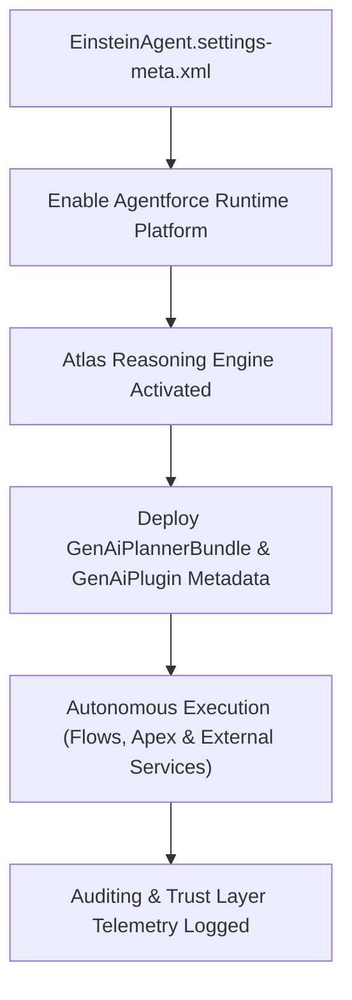

## Architectural Overview

The `EinsteinAgentSettings` metadata type represents the org-level configuration for **Agentforce (formerly Einstein Copilot and Einstein Agents)** (`Setup > Einstein > Einstein Agents / Agentforce Studio`).

Agentforce represents the evolution of conversational AI from deterministic rule-based dialogue trees into autonomous, goal-driven agents powered by Large Language Models (LLMs) and the Einstein 1 Platform. Operating on top of the Atlas Reasoning Engine, Agentforce autonomously reasons over user queries, retrieves relevant business context via Data Cloud and semantic search, plans execution paths, and dispatches platform actions (Flows, Apex invocations, External Services, and Prompt Templates).

`EinsteinAgentSettings` is the foundational metadata prerequisite for an agentic architecture. If `enableEinsteinAgent` is not enabled in a target environment, deployments of downstream agent metadata—such as `GenAiPlannerBundle`, `GenAiPlugin`, and `Bot` (Agent version)—fail with unresolvable feature dependency errors.



## Directory and File Suffix Reference

In modern SFDX project structures, `EinsteinAgentSettings` is stored as a singleton file in the `settings` directory.

| Property | Value |
| :--- | :--- |
| **Metadata Type Name** | `EinsteinAgentSettings` (deployed via `Settings`) |
| **SFDX Source Directory** | `force-app/main/default/settings/` |
| **Source File Name** | `EinsteinAgent.settings-meta.xml` |
| **Package Manifest Type** | `Settings` |
| **Package Manifest Member** | `EinsteinAgent` |
| **API Version Introduced** | v60.0 (Verified through `68.0` in Winter '27) |

## Key Metadata Fields

The `EinsteinAgentSettings` metadata type extends `Metadata` and exposes the following settings:

| Field Name | Field Type | Required | Architectural Description |
| :--- | :--- | :--- | :--- |
| `enableEinsteinAgent` | `boolean` | No | Master org-level toggle that activates Agentforce and the Atlas Reasoning Engine runtime. Defaults to `false`. |
| `enableAutonomousAgent` | `boolean` | No | Enables autonomous decision-making and multi-action chain orchestration for configured agents without requiring manual prompt confirmations. |
| `enableAgentAuditing` | `boolean` | No | Activates detailed audit logging, session trace capture, and compliance metrics for all agent interactions across messaging channels. |

> [!RELEASE] Winter '27
> In Winter '27, `EinsteinAgentSettings` enforces strict verification of trust policies, integrating natively with Einstein Trust Layer guardrails to prevent ungrounded hallucinations during autonomous execution.

## Declarative XML, Scratch Org, and Package.xml Examples

### 1. Settings Metadata File (`EinsteinAgent.settings-meta.xml`)

```xml title="force-app/main/default/settings/EinsteinAgent.settings-meta.xml"
<?xml version="1.0" encoding="UTF-8"?>
<EinsteinAgentSettings xmlns="http://soap.sforce.com/2006/04/metadata">
    <enableAgentAuditing>true</enableAgentAuditing>
    <enableAutonomousAgent>true</enableAutonomousAgent>
    <enableEinsteinAgent>true</enableEinsteinAgent>
</EinsteinAgentSettings>
```

### 2. Scratch Org Definition (`config/project-scratch-def.json`)

To enable Agentforce development in scratch orgs, declare `einsteinAgentSettings` alongside required platform features:

```json title="config/project-scratch-def.json"
{
  "orgName": "Agentforce Autonomous Development Scratch Org",
  "edition": "Enterprise",
  "features": ["EinsteinCopilotUser", "Chatbot"],
  "settings": {
    "einsteinAgentSettings": {
      "enableEinsteinAgent": true,
      "enableAutonomousAgent": true,
      "enableAgentAuditing": true
    }
  }
}
```

### 3. Package Manifest (`manifest/package.xml`)

```xml title="manifest/package.xml"
<?xml version="1.0" encoding="UTF-8"?>
<Package xmlns="http://soap.sforce.com/2006/04/metadata">
    <types>
        <members>EinsteinAgent</members>
        <name>Settings</name>
    </types>
    <version>68.0</version>
</Package>
```

## Retrieval and Deployment Commands

Manage `EinsteinAgentSettings` using the Salesforce CLI:

```bash
# Retrieve EinsteinAgent settings from target org
sf project retrieve start --metadata Settings:EinsteinAgent

# Deploy settings to staging environment
sf project deploy start --metadata Settings:EinsteinAgent --target-org staging-sandbox

# Validate settings deployment in production CI/CD pipeline
sf project deploy validate --metadata Settings:EinsteinAgent --target-org prod-ci
```

## Senior Architect Deployment Best Practices and Gotchas

- **Pipeline Prerequisites for Agent Metadata:** Agentforce architectures comprise interdependent layers: `EinsteinAgentSettings` (runtime engine) -> `GenAiPlannerBundle` (reasoning model) -> `GenAiPlugin` (action library). Never bundle planner and plugin changes in a deployment without verifying that `EinsteinAgentSettings` is either already active or deployed in the initial manifest transaction.
- **Enterprise Guardrails and Permissions:** Enabling `enableAutonomousAgent` permits agents to execute committed transactional actions. Enterprise architects should mandate that any custom Apex `@InvocableMethod` or autolaunched Flow exposed to an agent is protected by strict permission set gating and idempotency validation to prevent duplicate operations during agent retries.
- **Audit Logging and Telemetry Storage:** Turning on `enableAgentAuditing: true` records prompt tokens, retrieved groundings, and generated response traces. In high-volume omni-channel customer service environments, ensure retention policies align with GDPR/CCPA data privacy compliance mandates.
- **Sandbox Refresh Strategy:** After refreshing full or partial sandboxes, verify that Agentforce features are re-enabled. In some sandbox environments, generative AI features are disabled by default to protect production API quotas; committing `EinsteinAgent.settings-meta.xml` automates re-activation post-refresh.
