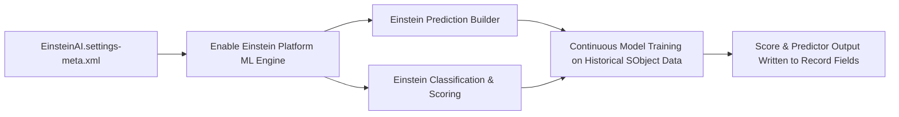

## Architectural Overview

The `EinsteinAISettings` metadata type controls foundational org-level preferences for **Salesforce Einstein AI and Machine Learning services** (`Setup > Einstein > Einstein AI / Einstein Prediction Builder`).

Before the advent of generative Large Language Models, Salesforce pioneered predictive machine learning through native algorithms for classification, regression, propensity scoring, and automated insight discovery. Predictive AI features—including **Einstein Prediction Builder**, **Einstein Opportunity Scoring**, **Einstein Lead Scoring**, and **Case Classification**—rely on platform-level infrastructure to ingest historical CRM data, train machine learning models, and write predictive scores directly onto standard and custom records.

`EinsteinAISettings` serves as the global switch that turns on this machine learning framework. Without activating `EinsteinAISettings`, attempts to deploy custom prediction configurations, AI-driven field definitions, or scoring automations fail during metadata validation.



## Directory and File Suffix Reference

In SFDX source format, `EinsteinAISettings` is stored as a singleton XML file under the `settings` directory.

| Property | Value |
| :--- | :--- |
| **Metadata Type Name** | `EinsteinAISettings` (deployed via `Settings`) |
| **SFDX Source Directory** | `force-app/main/default/settings/` |
| **Source File Name** | `EinsteinAI.settings-meta.xml` |
| **Package Manifest Type** | `Settings` |
| **Package Manifest Member** | `EinsteinAI` |
| **API Version Introduced** | v46.0 (Verified through `68.0` in Winter '27) |

## Key Metadata Fields

The `EinsteinAISettings` metadata type extends `Metadata` and exposes the following platform switches:

| Field Name | Field Type | Required | Architectural Description |
| :--- | :--- | :--- | :--- |
| `enableEinsteinAI` | `boolean` | No | Master feature toggle that activates the core Einstein AI infrastructure across the organization. Defaults to `false`. |
| `enablePredictionBuilder` | `boolean` | No | Activates Einstein Prediction Builder, allowing declarative creation of custom AI predictions on standard and custom objects. |
| `enableDataCollection` | `boolean` | No | Opts the organization into data collection and usage protocols required for training global and localized AI models. |

> [!NOTE]
> Enabling `enablePredictionBuilder` requires corresponding CRM Analytics Plus or Einstein Predictions licenses in the target Salesforce environment.

## Declarative XML, Scratch Org, and Package.xml Examples

### 1. Settings Metadata File (`EinsteinAI.settings-meta.xml`)

```xml title="force-app/main/default/settings/EinsteinAI.settings-meta.xml"
<?xml version="1.0" encoding="UTF-8"?>
<EinsteinAISettings xmlns="http://soap.sforce.com/2006/04/metadata">
    <enableDataCollection>true</enableDataCollection>
    <enableEinsteinAI>true</enableEinsteinAI>
    <enablePredictionBuilder>true</enablePredictionBuilder>
</EinsteinAISettings>
```

### 2. Scratch Org Definition (`config/project-scratch-def.json`)

To configure automated scratch orgs with Einstein AI capabilities for CI/CD test runs:

```json title="config/project-scratch-def.json"
{
  "orgName": "Einstein Predictive AI Test Org",
  "edition": "Enterprise",
  "features": ["SalesUser", "ServiceUser"],
  "settings": {
    "einsteinAISettings": {
      "enableEinsteinAI": true,
      "enablePredictionBuilder": true,
      "enableDataCollection": true
    }
  }
}
```

### 3. Package Manifest (`manifest/package.xml`)

```xml title="manifest/package.xml"
<?xml version="1.0" encoding="UTF-8"?>
<Package xmlns="http://soap.sforce.com/2006/04/metadata">
    <types>
        <members>EinsteinAI</members>
        <name>Settings</name>
    </types>
    <version>68.0</version>
</Package>
```

## Retrieval and Deployment Commands

Manage `EinsteinAISettings` using the modern Salesforce CLI (`sf`):

```bash
# Retrieve EinsteinAI settings from the target org
sf project retrieve start --metadata Settings:EinsteinAI

# Deploy settings to staging sandbox
sf project deploy start --metadata Settings:EinsteinAI --target-org staging-sandbox

# Check deployment result
sf project deploy report
```

## Senior Architect Deployment Best Practices and Gotchas

- **Separation from Generative AI:** Architects must distinguish between predictive AI (`EinsteinAISettings`) and generative AI (`EinsteinGptSettings`). Predictive AI models operate on structured tabular data to calculate probabilities, while Generative AI models operate on unstructured prompts to generate natural language. Both settings are often required in comprehensive AI implementations.
- **Model Training and Minimum Data Thresholds:** Deploying `EinsteinAISettings` enables the platform feature, but individual prediction models will not begin training until target objects satisfy minimum record thresholds (typically 400 historical records with both positive and negative outcomes). Automated data seeding scripts should be run in scratch orgs to support model validation.
- **Data Governance and Global Model Training:** Setting `enableDataCollection: true` allows Salesforce to process de-identified data for platform model enhancements. Regulated clients in defense, finance, or public healthcare may require this flag to remain `false` to comply with strict jurisdictional data sovereignty mandates.
- **Post-Deployment Verification:** When deploying `EinsteinAI.settings-meta.xml` across sandboxes, verify in Setup that Einstein status changes to Active before executing automated smoke tests that depend on prediction field values.
