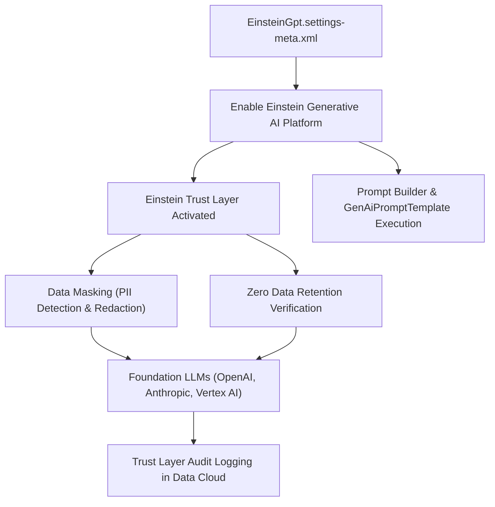

## Architectural Overview

The `EinsteinGptSettings` metadata type represents the org-level configuration for **Salesforce Generative AI (Einstein 1 Studio)** (`Setup > Einstein > Einstein Generative AI > Setup`).

Generative AI in Salesforce empowers users with automated email drafting, case summarization, dynamic record insights, and conversational intelligence. Crucially, enterprise adoption of Large Language Models (LLMs) demands strict data privacy, enterprise trust, and regulatory compliance. Salesforce addresses these requirements through the **Einstein Trust Layer**, which provides dynamic data masking for Personally Identifiable Information (PII), strict zero-data-retention agreements with third-party foundation model providers (such as OpenAI, Anthropic, and Google Cloud), toxicity scoring, and audit trail logging.

`EinsteinGptSettings` serves as the global feature switch governing:
- Org-wide enablement of generative AI prompt execution and **Prompt Builder** templates (`GenAiPromptTemplate` metadata).
- Activation of **Model Builder** integrations connecting to custom foundation models via AWS Bedrock or Google Cloud Vertex AI.
- Audit trail logging and security telemetry across all generative LLM requests.



## Directory and File Suffix Reference

In Salesforce DX projects, `EinsteinGptSettings` is stored as a singleton file in the `settings` directory.

| Property | Value |
| :--- | :--- |
| **Metadata Type Name** | `EinsteinGptSettings` (deployed via `Settings`) |
| **SFDX Source Directory** | `force-app/main/default/settings/` |
| **Source File Name** | `EinsteinGpt.settings-meta.xml` |
| **Package Manifest Type** | `Settings` |
| **Package Manifest Member** | `EinsteinGpt` |
| **API Version Introduced** | v58.0 (Verified through `68.0` in Winter '27) |

## Key Metadata Fields

The `EinsteinGptSettings` metadata type extends `Metadata` and exposes the following org-level properties:

| Field Name | Field Type | Required | Architectural Description |
| :--- | :--- | :--- | :--- |
| `enableEinsteinGpt` | `boolean` | No | Master org-level toggle that activates Einstein Generative AI capabilities. Defaults to `false`. |
| `enableGenerativeAi` | `boolean` | No | Enables generative AI features across Sales Cloud, Service Cloud, and platform UI extensions. |
| `enableTrustLayerAudit` | `boolean` | No | Enables continuous audit trail logging into Data Cloud, capturing prompt tokens, masked fields, and toxicity scores for compliance audits. |

> [!RELEASE] Winter '27
> In Winter '27, `EinsteinGptSettings` enforces enhanced grounding verification protocols, ensuring that custom prompt templates deployed via CI/CD pipelines adhere to zero-retention data boundaries.

## Declarative XML, Scratch Org, and Package.xml Examples

### 1. Settings Metadata File (`EinsteinGpt.settings-meta.xml`)

```xml title="force-app/main/default/settings/EinsteinGpt.settings-meta.xml"
<?xml version="1.0" encoding="UTF-8"?>
<EinsteinGptSettings xmlns="http://soap.sforce.com/2006/04/metadata">
    <enableEinsteinGpt>true</enableEinsteinGpt>
    <enableGenerativeAi>true</enableGenerativeAi>
    <enableTrustLayerAudit>true</enableTrustLayerAudit>
</EinsteinGptSettings>
```

### 2. Scratch Org Definition (`config/project-scratch-def.json`)

To enable Generative AI in scratch org environments for automated testing of prompt templates and Apex `ConnectApi` calls:

```json title="config/project-scratch-def.json"
{
  "orgName": "Generative AI CI/CD Testing Scratch Org",
  "edition": "Enterprise",
  "features": ["Einstein1PlatformUser", "SalesUser"],
  "settings": {
    "einsteinGptSettings": {
      "enableEinsteinGpt": true,
      "enableGenerativeAi": true,
      "enableTrustLayerAudit": true
    }
  }
}
```

### 3. Package Manifest (`manifest/package.xml`)

```xml title="manifest/package.xml"
<?xml version="1.0" encoding="UTF-8"?>
<Package xmlns="http://soap.sforce.com/2006/04/metadata">
    <types>
        <members>EinsteinGpt</members>
        <name>Settings</name>
    </types>
    <version>68.0</version>
</Package>
```

## Retrieval and Deployment Commands

Manage `EinsteinGptSettings` via modern Salesforce CLI commands:

```bash
# Retrieve EinsteinGpt settings from target org
sf project retrieve start --metadata Settings:EinsteinGpt

# Deploy settings to staging environment
sf project deploy start --metadata Settings:EinsteinGpt --target-org staging-sandbox

# Validate settings deployment in production pipeline
sf project deploy validate --metadata Settings:EinsteinGpt --target-org prod-ci
```

## Senior Architect Deployment Best Practices and Gotchas

- **Prerequisite for Prompt Template Deployment:** Deploying `GenAiPromptTemplate` components (Prompt Builder templates) will fail with missing feature errors if `enableEinsteinGpt` is `false` in the target org. In release pipelines, sequence `EinsteinGpt.settings-meta.xml` before prompt template metadata.
- **Data Cloud Infrastructure Dependency:** When `enableTrustLayerAudit` is `true`, generation audit logs are stored in standard Data Cloud data lake objects. Ensure the target org has active Data Cloud provisioning, or audit logs will be buffered temporarily in platform queues.
- **Token Consumption Monitoring:** Generative AI features consume Einstein 1 Platform generative credit allowances. Enterprise architects must monitor consumption via the Digital Wallet in Salesforce Setup to prevent prompt generation failures when quotas are exhausted.
- **Sandbox Refresh Strategy:** Like other AI features, generative AI toggles may revert to disabled status upon sandbox refresh. Automate the re-enablement of generative AI by deploying `EinsteinGpt.settings-meta.xml` as part of your post-refresh automated configuration jobs.
