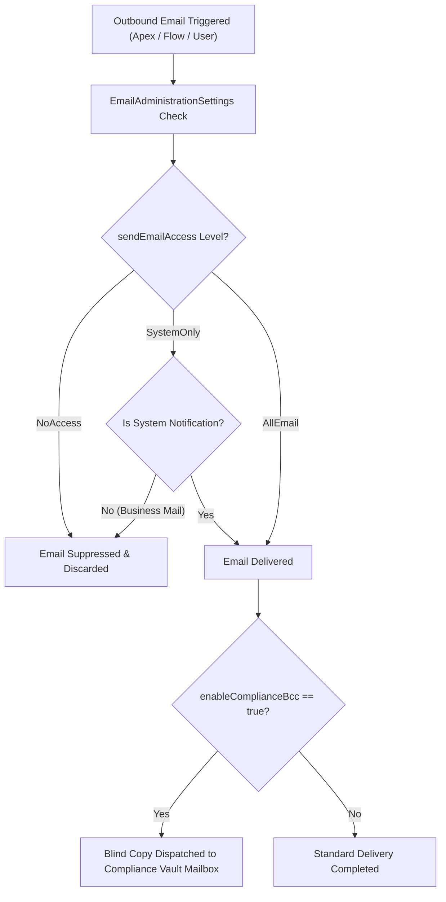

## Architectural Overview

The `EmailAdministrationSettings` metadata type represents the org-level configuration for **Salesforce Outbound Email Deliverability, Compliance, and Bounce Management** (`Setup > Administration > Email > Deliverability`).

In enterprise architectures, outbound email touches mission-critical communication workflows: automated order receipts, password resets, approval requests, marketing cadences, and service notifications. Managing outbound deliverability at scale requires strict governance across deliverability tiers, sender authenticity, anti-spoofing protocols, and regulatory record-keeping (such as FINRA and SEC compliance archiving).

`EmailAdministrationSettings` controls:
1. **Deliverability Access Level:** Controls whether the org can send all outbound emails (`AllEmail`), restrict sending to system-generated notifications like password resets (`SystemOnly`), or shut off outbound mail delivery entirely (`NoAccess`).
2. **Bounce Management:** Tracks delivery failures and flags bad email addresses on `Contact` and `Lead` records.
3. **Compliance BCC Archiving:** Automatically routes unalterable blind carbon copies of every outbound email sent by any user or automated Flow to a central enterprise vault.



## Directory and File Suffix Reference

In modern Salesforce DX source format, `EmailAdministrationSettings` is stored as a singleton file in the `settings` directory.

| Property | Value |
| :--- | :--- |
| **Metadata Type Name** | `EmailAdministrationSettings` (deployed via `Settings`) |
| **SFDX Source Directory** | `force-app/main/default/settings/` |
| **Source File Name** | `EmailAdministration.settings-meta.xml` |
| **Package Manifest Type** | `Settings` |
| **Package Manifest Member** | `EmailAdministration` |
| **API Version Introduced** | v45.0 (Verified through `68.0` in Winter '27) |

## Key Metadata Fields

The `EmailAdministrationSettings` metadata type extends `Metadata` and provides the following org-wide fields:

| Field Name | Field Type | Required | Architectural Description |
| :--- | :--- | :--- | :--- |
| `sendEmailAccess` | `string` | No | Deliverability access tier for outbound email. Valid values: `NoAccess`, `SystemOnly`, or `AllEmail`. |
| `enableBounceManagement` | `boolean` | No | Activates automated bounce tracking. When a mail bounces, the destination email address on the corresponding record is marked as invalid. |
| `enableEmailSenderId` | `boolean` | No | Embeds Sender ID and SPF authentication headers in outbound email envelopes to minimize spam classification. |
| `enableComplianceBcc` | `boolean` | No | Enables compliance archiving by automatically adding an unalterable BCC recipient to all outbound emails. |
| `complianceBccEmail` | `string` | No | The target email address receiving compliance BCC copies when `enableComplianceBcc` is active. |

> [!WARNING]
> In freshly created or refreshed sandboxes, Salesforce automatically sets `sendEmailAccess` to `SystemOnly` to prevent test automations from emailing production customers. In automated CI/CD environments where integration tests verify email dispatch, deploy `sendEmailAccess: AllEmail` explicitly.

## Declarative XML, Scratch Org, and Package.xml Examples

### 1. Settings Metadata File (`EmailAdministration.settings-meta.xml`)

```xml title="force-app/main/default/settings/EmailAdministration.settings-meta.xml"
<?xml version="1.0" encoding="UTF-8"?>
<EmailAdministrationSettings xmlns="http://soap.sforce.com/2006/04/metadata">
    <enableBounceManagement>true</enableBounceManagement>
    <enableComplianceBcc>true</enableComplianceBcc>
    <complianceBccEmail>compliance-vault@enterprise-archive.internal</complianceBccEmail>
    <enableEmailSenderId>true</enableEmailSenderId>
    <sendEmailAccess>AllEmail</sendEmailAccess>
</EmailAdministrationSettings>
```

### 2. Scratch Org Definition (`config/project-scratch-def.json`)

To enable full email deliverability in ephemeral scratch orgs during automated test execution:

```json title="config/project-scratch-def.json"
{
  "orgName": "Email Automation Validation Scratch Org",
  "edition": "Enterprise",
  "settings": {
    "emailAdministrationSettings": {
      "sendEmailAccess": "AllEmail",
      "enableBounceManagement": true,
      "enableEmailSenderId": true
    }
  }
}
```

### 3. Package Manifest (`manifest/package.xml`)

```xml title="manifest/package.xml"
<?xml version="1.0" encoding="UTF-8"?>
<Package xmlns="http://soap.sforce.com/2006/04/metadata">
    <types>
        <members>EmailAdministration</members>
        <name>Settings</name>
    </types>
    <version>68.0</version>
</Package>
```

## Retrieval and Deployment Commands

Manage `EmailAdministrationSettings` using the Salesforce CLI:

```bash
# Retrieve EmailAdministration settings from target org
sf project retrieve start --metadata Settings:EmailAdministration

# Deploy settings to staging environment
sf project deploy start --metadata Settings:EmailAdministration --target-org staging-sandbox

# Check deployment validation
sf project deploy validate --metadata Settings:EmailAdministration --target-org prod-ci
```

## Senior Architect Deployment Best Practices and Gotchas

- **Sandbox Data Safety and Outbound Blast Risk:** Deploying `sendEmailAccess: AllEmail` to an environment containing masked or unmasked customer email addresses creates serious risk of unintended customer communications. Always combine sandbox email enablement with automated data masking or Apex post-refresh scripts that append `.invalid` to all test contact email addresses.
- **Apex Unit Tests and Email Deliverability:** Apex test methods invoking `Messaging.sendEmail()` execute regardless of the `sendEmailAccess` level, but physical delivery is suppressed. However, asserting `Limits.getEmailInvocations()` or testing asynchronous inbound email services requires careful isolation.
- **Compliance BCC Impact on Storage:** Enabling `enableComplianceBcc: true` generates a duplicate outbound message dispatched externally. The external archiving service must be sized to handle high-volume transactional spikes (such as monthly billing statements or mass status notifications).
- **Transport Layer Security (TLS) Alignment:** Modern email security requires enforcing opportunistic or verified TLS. In conjunction with `EmailAdministrationSettings`, configure outbound email relay settings to enforce encrypted transport to avoid message rejection by strict enterprise mail gateways.
