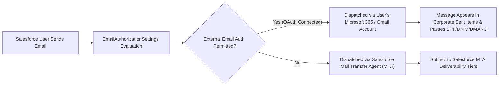

## Architectural Overview

The `EmailAuthorizationSettings` metadata type represents the org-level configuration for **External Email Account Authorization and Sender Authentication** (`Setup > Email > Send through External Email Services`).

In modern enterprise architectures, sending customer communications directly through shared Salesforce Mail Transfer Agent (MTA) IP pools can introduce deliverability and anti-spoofing challenges. If a recipient email server inspects SPF, DKIM, and DMARC alignments, emails sent from a corporate domain (`@enterprise.com`) via Salesforce servers without proper cryptographic signatures may be marked as spam or rejected.

Salesforce solves this challenge through **Send through External Email Services (Send through Gmail / Microsoft 365)**. Instead of dispatching messages via Salesforce MTAs, Salesforce connects to the user's corporate email account using OAuth 2.0 and transmits the message via the customer's own authenticated Microsoft 365 or Google Workspace mail infrastructure.

`EmailAuthorizationSettings` governs whether users are permitted to authenticate and send email through these external OAuth email services, enforcing enterprise compliance and sender verification org-wide.



## Directory and File Suffix Reference

In SFDX source format, `EmailAuthorizationSettings` is stored as a singleton XML file under the `settings` directory.

| Property | Value |
| :--- | :--- |
| **Metadata Type Name** | `EmailAuthorizationSettings` (deployed via `Settings`) |
| **SFDX Source Directory** | `force-app/main/default/settings/` |
| **Source File Name** | `EmailAuthorization.settings-meta.xml` |
| **Package Manifest Type** | `Settings` |
| **Package Manifest Member** | `EmailAuthorization` |
| **API Version Introduced** | v50.0 (Verified through `68.0` in Winter '27) |

## Key Metadata Fields

The `EmailAuthorizationSettings` metadata type extends `Metadata` and exposes the following fields:

| Field Name | Field Type | Required | Architectural Description |
| :--- | :--- | :--- | :--- |
| `enableEmailAuthorization` | `boolean` | No | Enables org-wide external email service authorization, allowing end users to link Microsoft 365 or Gmail accounts. Defaults to `false`. |
| `enableSenderAuthentication` | `boolean` | No | Enforces verified sender identity verification and domain alignment before an external email can be transmitted. |
| `enforceStrictDkim` | `boolean` | No | Enforces strict DKIM key verification for outbound relays to prevent unauthorized domain impersonation. |

> [!NOTE]
> When external email sending is enabled, outbound messages appear in the user's corporate email client "Sent Items" folder, ensuring complete visibility across CRM and personal desktop email applications.

## Declarative XML, Scratch Org, and Package.xml Examples

### 1. Settings Metadata File (`EmailAuthorization.settings-meta.xml`)

```xml title="force-app/main/default/settings/EmailAuthorization.settings-meta.xml"
<?xml version="1.0" encoding="UTF-8"?>
<EmailAuthorizationSettings xmlns="http://soap.sforce.com/2006/04/metadata">
    <enableEmailAuthorization>true</enableEmailAuthorization>
    <enableSenderAuthentication>true</enableSenderAuthentication>
    <enforceStrictDkim>true</enforceStrictDkim>
</EmailAuthorizationSettings>
```

### 2. Scratch Org Definition (`config/project-scratch-def.json`)

To enable external email authorization settings in automated scratch org pipelines:

```json title="config/project-scratch-def.json"
{
  "orgName": "Email Authentication Validation Scratch Org",
  "edition": "Enterprise",
  "settings": {
    "emailAuthorizationSettings": {
      "enableEmailAuthorization": true,
      "enableSenderAuthentication": true
    }
  }
}
```

### 3. Package Manifest (`manifest/package.xml`)

```xml title="manifest/package.xml"
<?xml version="1.0" encoding="UTF-8"?>
<Package xmlns="http://soap.sforce.com/2006/04/metadata">
    <types>
        <members>EmailAuthorization</members>
        <name>Settings</name>
    </types>
    <version>68.0</version>
</Package>
```

## Retrieval and Deployment Commands

Manage `EmailAuthorizationSettings` via modern Salesforce CLI commands:

```bash
# Retrieve EmailAuthorization settings from target org
sf project retrieve start --metadata Settings:EmailAuthorization

# Deploy settings to staging sandbox
sf project deploy start --metadata Settings:EmailAuthorization --target-org staging-sandbox

# Check deployment status
sf project deploy report
```

## Senior Architect Deployment Best Practices and Gotchas

- **User-Level OAuth vs. Service Accounts:** Enabling `enableEmailAuthorization: true` turns on the capability org-wide, but each individual user must still perform an initial OAuth handshake with Microsoft or Google from their personal user settings unless an org-wide email relay or Connected App service account is configured.
- **Apex and Mass Email Exceptions:** Outbound emails triggered by Apex `Messaging.SingleEmailMessage` or mass marketing email campaigns do **not** route through the individual user's OAuth external email connection; they continue to dispatch through Salesforce MTAs or configured org-wide Email Relays. Ensure your DNS records include Salesforce SPF includes (`include:_spf.salesforce.com`) even when external email authorization is enabled.
- **Compliance BCC Interaction:** When messages are sent through external email services, compliance BCC rules defined in `EmailAdministrationSettings` still apply, dispatching a duplicate copy to your corporate compliance archive.
- **Multi-Factor Authentication (MFA) & Conditional Access:** When users authenticate with Microsoft 365 or Google Workspace, Azure AD / Entra ID conditional access policies may block the Salesforce OAuth client unless the Salesforce OAuth Connected App is explicitly approved in your corporate identity provider.
