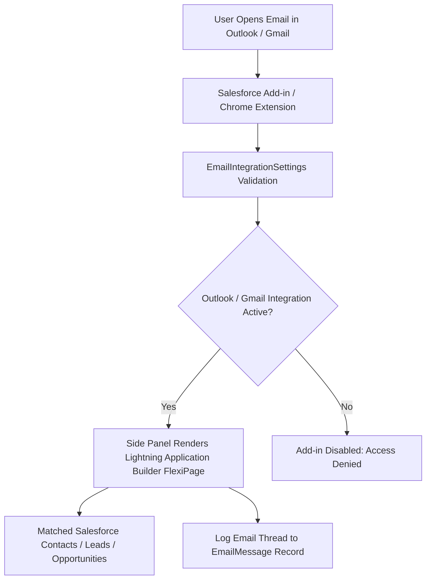

## Architectural Overview

The `EmailIntegrationSettings` metadata type represents the org-level configuration for **Salesforce for Outlook and Gmail Integrations** (`Setup > Feature Settings > Outlook Integration and Sync` and `Setup > Feature Settings > Gmail Integration and Sync`).

Enterprise sales and customer support professionals spend a substantial portion of their working day inside email clients (Microsoft Outlook on desktop and web, or Google Workspace Gmail in Chrome). The Salesforce email integration add-ins bridge desktop productivity clients with Salesforce CRM by embedding an interactive Lightning Experience side panel directly into the email client interface.

From this side panel, users can:
- View CRM record details (Contacts, Leads, Accounts, Opportunities, Cases) matched by recipient email addresses.
- Manually log email threads and attachments as `EmailMessage` records linked to specific CRM records.
- Create new Salesforce records directly from email headers without switching application windows.
- Monitor email engagement metrics, such as real-time open notifications and link click tracking.

`EmailIntegrationSettings` is the metadata switchboard controlling org-wide availability of these side panel integrations, email tracking capabilities, and Lightning application builder layouts for Outlook and Gmail.



## Directory and File Suffix Reference

In SFDX source format, `EmailIntegrationSettings` is stored as a singleton file in the `settings` directory.

| Property | Value |
| :--- | :--- |
| **Metadata Type Name** | `EmailIntegrationSettings` (deployed via `Settings`) |
| **SFDX Source Directory** | `force-app/main/default/settings/` |
| **Source File Name** | `EmailIntegration.settings-meta.xml` |
| **Package Manifest Type** | `Settings` |
| **Package Manifest Member** | `EmailIntegration` |
| **API Version Introduced** | v47.0 (Verified through `68.0` in Winter '27) |

## Key Metadata Fields

The `EmailIntegrationSettings` metadata type extends `Metadata` and exposes the following settings:

| Field Name | Field Type | Required | Architectural Description |
| :--- | :--- | :--- | :--- |
| `enableOutlookIntegration` | `boolean` | No | Master switch that activates the Salesforce add-in for Microsoft Outlook desktop, web, and Mac. |
| `enableGmailIntegration` | `boolean` | No | Master switch that activates the Salesforce integration extension for Google Chrome and Gmail. |
| `isOutlookSidePanelEnabled` | `boolean` | No | Enables the interactive Lightning side panel within Outlook, allowing users to view and edit matched CRM records. |
| `enableEmailTrackingInOutlook` | `boolean` | No | Allows sales reps to insert tracking pixels and link wrappers into outgoing emails to monitor recipient opens and clicks. |
| `enableEngageForEmail` | `boolean` | No | Enables Marketing Cloud Account Engagement (Pardot) email tracking and template selection within the integration side panel. |

> [!TIP]
> Customize the Outlook side panel UI by creating a dedicated `FlexiPage` of type `EmailApplicationPane` in Lightning App Builder and assigning it to specific user profiles.

## Declarative XML, Scratch Org, and Package.xml Examples

### 1. Settings Metadata File (`EmailIntegration.settings-meta.xml`)

```xml title="force-app/main/default/settings/EmailIntegration.settings-meta.xml"
<?xml version="1.0" encoding="UTF-8"?>
<EmailIntegrationSettings xmlns="http://soap.sforce.com/2006/04/metadata">
    <enableEmailTrackingInOutlook>true</enableEmailTrackingInOutlook>
    <enableEngageForEmail>false</enableEngageForEmail>
    <enableGmailIntegration>true</enableGmailIntegration>
    <enableOutlookIntegration>true</enableOutlookIntegration>
    <isOutlookSidePanelEnabled>true</isOutlookSidePanelEnabled>
</EmailIntegrationSettings>
```

### 2. Scratch Org Definition (`config/project-scratch-def.json`)

To enable email integration add-ins in scratch orgs during automated testing:

```json title="config/project-scratch-def.json"
{
  "orgName": "Email Integration Validation Scratch Org",
  "edition": "Enterprise",
  "settings": {
    "emailIntegrationSettings": {
      "enableOutlookIntegration": true,
      "enableGmailIntegration": true,
      "isOutlookSidePanelEnabled": true,
      "enableEmailTrackingInOutlook": true
    }
  }
}
```

### 3. Package Manifest (`manifest/package.xml`)

```xml title="manifest/package.xml"
<?xml version="1.0" encoding="UTF-8"?>
<Package xmlns="http://soap.sforce.com/2006/04/metadata">
    <types>
        <members>EmailIntegration</members>
        <name>Settings</name>
    </types>
    <version>68.0</version>
</Package>
```

## Retrieval and Deployment Commands

Manage `EmailIntegrationSettings` using the modern Salesforce CLI (`sf`):

```bash
# Retrieve EmailIntegration settings from target org
sf project retrieve start --metadata Settings:EmailIntegration

# Deploy settings to staging environment
sf project deploy start --metadata Settings:EmailIntegration --target-org staging-sandbox

# Check deployment result
sf project deploy report
```

## Senior Architect Deployment Best Practices and Gotchas

- **Side Panel Customization Deployment Sequencing:** If your release includes custom `FlexiPage` components with `type="EmailApplicationPane"`, ensure `EmailIntegrationSettings` is deployed simultaneously or beforehand. Attempting to assign an `EmailApplicationPane` flexipage to an org where `enableOutlookIntegration` is false causes metadata deployment validation errors.
- **Coexistence with Einstein Activity Capture (EAC):** Enterprise architects frequently combine Outlook/Gmail Integration with EAC. The Outlook integration provides the human-driven, on-demand side panel interface (creating Contacts, choosing specific Opportunity targets), while EAC handles automated background email and calendar sync. Both can be active simultaneously without conflict.
- **Microsoft 365 Exchange Manifest Deployment:** Enabling `enableOutlookIntegration` in Salesforce metadata activates the backend API endpoints. Corporate IT administrators must also deploy the Salesforce Outlook Add-in XML manifest or AppSource package across enterprise Microsoft 365 user accounts via the Microsoft 365 Admin Center.
- **Enhanced Email Prerequisite:** Ensure Enhanced Email (`EnhancedEmailSettings`) is enabled in your environment before deploying `EmailIntegrationSettings`. Without Enhanced Email, logged emails are stored as legacy `Task` records rather than relational `EmailMessage` records, restricting attachment handling and rich text rendering.
