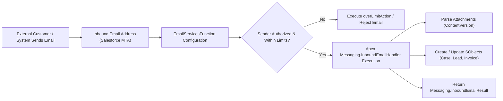

## Architectural Overview

The `EmailServicesFunction` metadata type represents an **Inbound Email Service** in Salesforce (`Setup > Email > Email Services`).

Inbound email services provide a robust, programmatic ingress architecture for receiving external emails directly into Salesforce. Rather than polling external mailboxes via IMAP/POP3, Salesforce generates unique, platform-hosted inbound email routing addresses (e.g., `support@x-1234.salesforce.com`). When external messages arrive at these addresses, the platform parses the MIME envelope, headers, plaintext body, HTML body, and binary attachments, and invokes an Apex class implementing the `Messaging.InboundEmailHandler` interface.

Common enterprise architectural use cases include:
- Automated ticket creation and routing for IT helpdesks and customer support.
- Ingestion of automated supplier invoices and parsing CSV/XML invoice attachments into ERP billing records.
- Processing unsubscribe webhooks and external delivery status reports (DSR).
- Automated approval and rejection handling via inbound reply commands.

`EmailServicesFunction` defines the metadata container for the email service: its target Apex class, attachment ingestion policies, security domains, and error handling behaviors.



## Directory and File Suffix Reference

In Salesforce DX source format, `EmailServicesFunction` components are stored in the `emailservices` directory.

| Property | Value |
| :--- | :--- |
| **Metadata Type Name** | `EmailServicesFunction` |
| **SFDX Source Directory** | `force-app/main/default/emailservices/` |
| **Metadata File Suffix** | `.xml` (e.g., `SupportTicketService.xml`) |
| **Package Manifest Type** | `EmailServicesFunction` |
| **Supports Wildcard (`*`)** | Yes |
| **API Version Introduced** | v28.0 (Verified through `68.0` in Winter '27) |

## Key Metadata Fields

The `EmailServicesFunction` metadata type extends `Metadata` and exposes the following fields:

| Field Name | Field Type | Required | Architectural Description |
| :--- | :--- | :--- | :--- |
| `functionName` | `string` | Yes | Unique developer identifier for the email service. |
| `apexClass` | `string` | Yes | The name of the Apex class implementing `Messaging.InboundEmailHandler` that executes upon message receipt. |
| `isActive` | `boolean` | No | Specifies whether the email service is currently operational. Defaults to `true`. |
| `attachmentOption` | `string` | No | Governs attachment processing. Values: `None`, `TextOnly`, `BinaryOnly`, or `All`. |
| `authorizedSenders` | `string` | No | Comma-separated list of authorized email addresses or domain patterns (e.g., `@partner.com`). If blank, messages from all senders are processed. |
| `isErrorEmailNotification` | `boolean` | No | Sends an automated notification email to the sender when an unhandled Apex exception occurs during processing. |
| `overLimitAction` | `string` | No | Platform action when daily inbound email limits are exceeded. Values: `Bounce`, `Discard`, or `Requeue`. |
| `authenticationFailureAction` | `string` | No | Action taken when sender verification or SPF/DKIM authentication fails. Values: `Bounce` or `Discard`. |

> [!NOTE]
> Deploying `EmailServicesFunction` creates the service definition, but the individual inbound email routing addresses (`EmailServicesAddress` records) are data records that must be created post-deployment via Data CLI or Apex scripts.

## Declarative XML and Package.xml Examples

### 1. Inbound Email Service Definition (`SupportTicketService.xml`)

```xml title="force-app/main/default/emailservices/SupportTicketService.xml"
<?xml version="1.0" encoding="UTF-8"?>
<EmailServicesFunction xmlns="http://soap.sforce.com/2006/04/metadata">
    <apexClass>InboundSupportTicketHandler</apexClass>
    <attachmentOption>All</attachmentOption>
    <authenticationFailureAction>Discard</authenticationFailureAction>
    <functionName>SupportTicketService</functionName>
    <isActive>true</isActive>
    <isErrorEmailNotification>true</isErrorEmailNotification>
    <overLimitAction>Bounce</overLimitAction>
</EmailServicesFunction>
```

### 2. Corresponding Inbound Handler Apex Class

```apex title="force-app/main/default/classes/InboundSupportTicketHandler.cls"
public with sharing class InboundSupportTicketHandler implements Messaging.InboundEmailHandler {
    public Messaging.InboundEmailResult handleInboundEmail(
        Messaging.InboundEmail email,
        Messaging.InboundEnvelope envelope
    ) {
        Messaging.InboundEmailResult result = new Messaging.InboundEmailResult();
        try {
            Case newCase = new Case(
                Subject = email.subject,
                Description = email.plainTextBody,
                Origin = 'Email',
                SuppliedEmail = email.fromAddress
            );
            insert newCase;

            // Process binary attachments into ContentVersion
            if (email.binaryAttachments != null) {
                List<ContentVersion> files = new List<ContentVersion>();
                for (Messaging.InboundEmail.BinaryAttachment file : email.binaryAttachments) {
                    files.add(new ContentVersion(
                        Title = file.fileName,
                        PathOnClient = file.fileName,
                        VersionData = file.body,
                        FirstPublishLocationId = newCase.Id
                    ));
                }
                insert files;
            }
            result.success = true;
        } catch (Exception ex) {
            result.success = false;
            result.message = 'Error processing incoming email: ' + ex.getMessage();
        }
        return result;
    }
}
```

### 3. Package Manifest (`manifest/package.xml`)

```xml title="manifest/package.xml"
<?xml version="1.0" encoding="UTF-8"?>
<Package xmlns="http://soap.sforce.com/2006/04/metadata">
    <types>
        <members>SupportTicketService</members>
        <name>EmailServicesFunction</name>
    </types>
    <types>
        <members>InboundSupportTicketHandler</members>
        <name>ApexClass</name>
    </types>
    <version>68.0</version>
</Package>
```

## Retrieval and Deployment Commands

Manage `EmailServicesFunction` metadata via standard Salesforce CLI commands:

```bash
# Retrieve all inbound email service functions
sf project retrieve start --metadata EmailServicesFunction

# Deploy email service function along with its handler class
sf project deploy start --metadata EmailServicesFunction:SupportTicketService ApexClass:InboundSupportTicketHandler --target-org staging-sandbox

# Query active email services via SOQL
sf data query --query "SELECT Id, FunctionName, ApexClassId, IsActive, AttachmentOption FROM EmailServicesFunction" --target-org prod-ci
```

## Senior Architect Deployment Best Practices and Gotchas

- **Deploy Handler Class in Same Transaction:** The `apexClass` field creates a hard compilation dependency on the referenced Apex class. Always bundle the handler `ApexClass` and the `EmailServicesFunction` within the same deployment manifest to avoid `Dependent class does not exist` compilation failures.
- **Governor Limits on Inbound Email:** Inbound email processing runs synchronously in the execution context of the context user assigned to the email routing address. Keep processing lightweight: if the incoming message contains multiple megabytes of attachments or requires heavy external callouts, parse basic record headers and enqueue an asynchronous `Queueable` job to perform the remaining work.
- **Daily Processing Limits:** Salesforce enforces daily inbound email limits (number of user licenses multiplied by 1,000, up to platform caps). Configure `overLimitAction` to `Bounce` or `Requeue` rather than `Discard` for mission-critical systems so senders or mail relays can retry during transient volume surges.
- **Post-Deployment Address Provisioning:** In scratch org and sandbox provisioning scripts, automate the generation of `EmailServicesAddress` records using Apex scripts or CLI data commands, as the routing email address itself is generated dynamically per environment.
