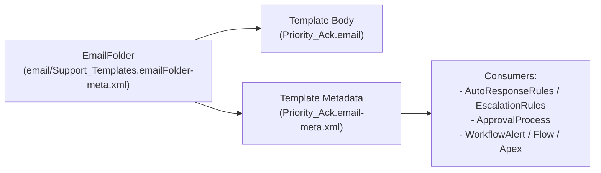

The `EmailTemplate` metadata type represents a Classic (`Aloha`) or Lightning Experience (`SFX`) email template used across [AutoResponseRules](/docs/metadata/auto-response-rules-metadata-type/), [EscalationRules](/docs/metadata/escalation-rules-metadata-type/), [ApprovalProcess](/docs/metadata/approval-process-metadata-type/), Flow `emailSimple` / Email Alerts, and Apex `Messaging.SingleEmailMessage`.

In Salesforce DX projects, email templates are stored inside folder subdirectories under `force-app/main/default/email/<FolderName>/` as a pair of files:
1. `<TemplateName>.email` — the raw text, HTML, or Visualforce markup body.
2. `<TemplateName>.email-meta.xml` — the metadata XML file defining `name`, `subject`, `type`, `uiType`, and `encodingKey`.



## Supported Template Types (`type` and `uiType`)

| `type` | `uiType` | Merge Syntax | Supported By |
|---|---|---|---|
| `text` | `Aloha` | `{!Case.CaseNumber}` | All declarative rules, Email Alerts, and Apex |
| `html` | `Aloha` | `{!Case.CaseNumber}` | Classic Letterhead HTML templates |
| `custom` | `Aloha` | `{!Case.CaseNumber}` | Custom HTML without a Letterhead |
| `visualforce` | `Aloha` | `<messaging:emailTemplate>` + Apex component | Complex child-record tables (`relatedToType`, `recipientType`) |
| `custom` | `SFX` | `{{{Case.CaseNumber}}}` | Lightning Experience Email Composer & Flow Email Alerts (`relatedEntityType`) |

## Key Metadata Fields

| Field | Type | Required | Description |
|---|---|---|---|
| `name` | `string` | Yes | Display title of the email template |
| `available` | `boolean` | Yes | Makes the template available for use (`true`) |
| `type` | `EmailTemplateType` | Yes | `text`, `html`, `custom`, or `visualforce` |
| `style` | `EmailTemplateStyle` | Yes | `none` (for `text`, `custom`, `visualforce` and `SFX`), `freeForm`, `formalLetter`, etc. |
| `encodingKey` | `Encoding` | Yes | Character encoding (always use `UTF-8` for international support) |
| `subject` | `string` | No | Email subject line (up to 230 chars for Classic, 1,000 chars for Lightning `SFX`) |
| `uiType` | `EmailTemplateUiType` | No | `Aloha` (Classic) or `SFX` (Lightning Email Template) |
| `relatedEntityType` | `string` | No | Target SObject API name for Lightning (`SFX`) templates (for example, `Case`) |
| `textOnly` | `string` | No | Plain-text fallback body for `html` and `custom` templates |

## Production-Grade Example (`Support_Templates/Priority_Case_Acknowledgment`)

### 1. Metadata File (`Priority_Case_Acknowledgment.email-meta.xml`)

```xml
<?xml version="1.0" encoding="UTF-8"?>
<EmailTemplate xmlns="http://soap.sforce.com/2006/04/metadata">
    <available>true</available>
    <description>Sent automatically when a High or Critical Case is logged.</description>
    <encodingKey>UTF-8</encodingKey>
    <name>Priority Case Acknowledgment</name>
    <style>none</style>
    <subject>[Case #{!Case.CaseNumber}] Priority Support Acknowledgment: {!Case.Subject}</subject>
    <textOnly>Hello {!Contact.FirstName}, We have received your priority support case #{!Case.CaseNumber} ({!Case.Subject}). A Tier 3 engineer is reviewing your request.</textOnly>
    <type>custom</type>
    <uiType>Aloha</uiType>
</EmailTemplate>
```

### 2. HTML Content File (`Priority_Case_Acknowledgment.email`)

```html
<!DOCTYPE html>
<html>
<body style="font-family: Arial, sans-serif; color: #181818;">
    <p>Hello {!Contact.FirstName},</p>
    <p>We have received your priority support request <strong>#{!Case.CaseNumber}</strong> regarding <em>{!Case.Subject}</em>.</p>
    <p>A Tier 3 Support Engineer has been paged and will respond within your SLA window.</p>
</body>
</html>
```

## Querying `EmailTemplate` with SOQL

```sql
-- 1. Find EmailTemplates in a specific folder by DeveloperName
SELECT Id, Name, DeveloperName, FolderName, Folder.DeveloperName,
       TemplateType, UiType, Subject, IsActive
FROM EmailTemplate
WHERE Folder.DeveloperName = 'Support_Templates'
  AND IsActive = true
ORDER BY Name ASC
```

## Retrieving Foldered Email Templates (`package.xml`)

Note that templates in the **Unfiled Public Classic Email Templates** folder use the special folder name `unfiled$public`:

```xml
<?xml version="1.0" encoding="UTF-8"?>
<Package xmlns="http://soap.sforce.com/2006/04/metadata">
    <types>
        <members>unfiled$public/SalesNewCustomerEmail</members>
        <members>Support_Templates</members>
        <members>Support_Templates/Priority_Case_Acknowledgment</members>
        <name>EmailTemplate</name>
    </types>
    <version>68.0</version>
</Package>
```
