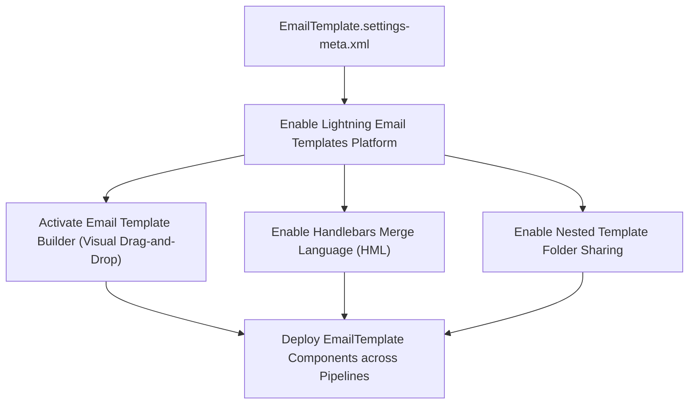

## Architectural Overview

The `EmailTemplateSettings` metadata type represents the org-level configuration for **Lightning Email Templates, Folders, and the Email Template Builder** (`Setup > Feature Settings > Email > Lightning Email Templates`).

Historically, Salesforce email templates were managed through classic text, HTML, and Visualforce templates stored in classic folders. While functional, classic templates lacked modern responsive layout components, WYSIWYG builders, and flexible sharing models.

Salesforce introduced **Enhanced Lightning Email Templates** and the **Email Template Builder** to bring modern web standards to email authoring. Enhanced templates are built using responsive Lightning components (rows, columns, images, buttons, and rich text) and leverage **Handlebars Merge Language (HML)** for cross-object merge fields.

`EmailTemplateSettings` serves as the foundational metadata switch controlling:
- Activation of Enhanced Lightning Email Templates and the visual Email Template Builder.
- Organization of templates into nested, granularly shared public and private folders.
- Org-wide adoption of Handlebars Merge Language (HML).



## Directory and File Suffix Reference

In Salesforce DX source format, `EmailTemplateSettings` is deployed as a singleton file in the `settings` directory.

| Property | Value |
| :--- | :--- |
| **Metadata Type Name** | `EmailTemplateSettings` (deployed via `Settings`) |
| **SFDX Source Directory** | `force-app/main/default/settings/` |
| **Source File Name** | `EmailTemplate.settings-meta.xml` |
| **Package Manifest Type** | `Settings` |
| **Package Manifest Member** | `EmailTemplate` |
| **API Version Introduced** | v49.0 (Verified through `68.0` in Winter '27) |

## Key Metadata Fields

The `EmailTemplateSettings` metadata type extends `Metadata` and exposes the following org-level settings:

| Field Name | Field Type | Required | Architectural Description |
| :--- | :--- | :--- | :--- |
| `enableEnhancedEmailTemplates` | `boolean` | No | Enables Enhanced Lightning Email Templates and the drag-and-drop Email Template Builder org-wide. |
| `enableEmailTemplateFolders` | `boolean` | No | Enables folder-based sharing and permission management for Lightning email templates, allowing granular user/role/group access. |
| `enableHmlMergeLanguage` | `boolean` | No | Activates Handlebars Merge Language (`{{{Recipient.FirstName}}}`) for both classic and Lightning templates, enabling cross-object field traversal. |

> [!TIP]
> Always enable `enableEmailTemplateFolders: true` when deploying Lightning email templates. Without folder sharing, all Lightning templates are saved to a flat public library, preventing role-based template governance.

## Declarative XML, Scratch Org, and Package.xml Examples

### 1. Settings Metadata File (`EmailTemplate.settings-meta.xml`)

```xml title="force-app/main/default/settings/EmailTemplate.settings-meta.xml"
<?xml version="1.0" encoding="UTF-8"?>
<EmailTemplateSettings xmlns="http://soap.sforce.com/2006/04/metadata">
    <enableEmailTemplateFolders>true</enableEmailTemplateFolders>
    <enableEnhancedEmailTemplates>true</enableEnhancedEmailTemplates>
    <enableHmlMergeLanguage>true</enableHmlMergeLanguage>
</EmailTemplateSettings>
```

### 2. Scratch Org Definition (`config/project-scratch-def.json`)

To configure scratch orgs for testing Lightning Email Templates and automated Flow email alerts:

```json title="config/project-scratch-def.json"
{
  "orgName": "Email Template Architecture Scratch Org",
  "edition": "Enterprise",
  "settings": {
    "emailTemplateSettings": {
      "enableEnhancedEmailTemplates": true,
      "enableEmailTemplateFolders": true,
      "enableHmlMergeLanguage": true
    }
  }
}
```

### 3. Package Manifest (`manifest/package.xml`)

```xml title="manifest/package.xml"
<?xml version="1.0" encoding="UTF-8"?>
<Package xmlns="http://soap.sforce.com/2006/04/metadata">
    <types>
        <members>EmailTemplate</members>
        <name>Settings</name>
    </types>
    <version>68.0</version>
</Package>
```

## Retrieval and Deployment Commands

Manage `EmailTemplateSettings` via modern Salesforce CLI commands:

```bash
# Retrieve EmailTemplate settings from target org
sf project retrieve start --metadata Settings:EmailTemplate

# Deploy settings to staging sandbox
sf project deploy start --metadata Settings:EmailTemplate --target-org staging-sandbox

# Check deployment result
sf project deploy report
```

## Senior Architect Deployment Best Practices and Gotchas

- **Prerequisite for Lightning `EmailTemplate` Deployments:** If your deployment package contains Lightning `EmailTemplate` components (`relatedEntityType` specified, `uiType="Aloha"` absent), deploying into an org where `enableEnhancedEmailTemplates` is false will fail with `Invalid template type` errors. Always sequence `EmailTemplate.settings-meta.xml` before or alongside template metadata.
- **Merge Syntax Differences (SML vs. HML):** Classic Salesforce Merge Language (SML) uses `{!Contact.FirstName}`, whereas Handlebars Merge Language (HML) uses triple curly brackets `{{{Recipient.FirstName}}}`. When migrating legacy templates, ensure merge tags are updated to HML syntax to avoid runtime rendering errors.
- **Folder Metadata Deployment Dependencies:** When `enableEmailTemplateFolders` is enabled, Lightning templates must be placed inside valid `EmailFolder` metadata directories (e.g., `email/Marketing_Templates/Welcome_Email.email-meta.xml`). Deploying a template into a folder that has not been deployed will cause `Cannot find folder` deployment failures.
- **User Permission Alignment:** Enabling Enhanced Email Templates in metadata activates the platform capability, but users who author templates also require the `Access Email Template Builder` or `Create and Edit Lightning Email Templates` system permissions via [PermissionSet](/docs/metadata/permission-set-metadata-type/).
