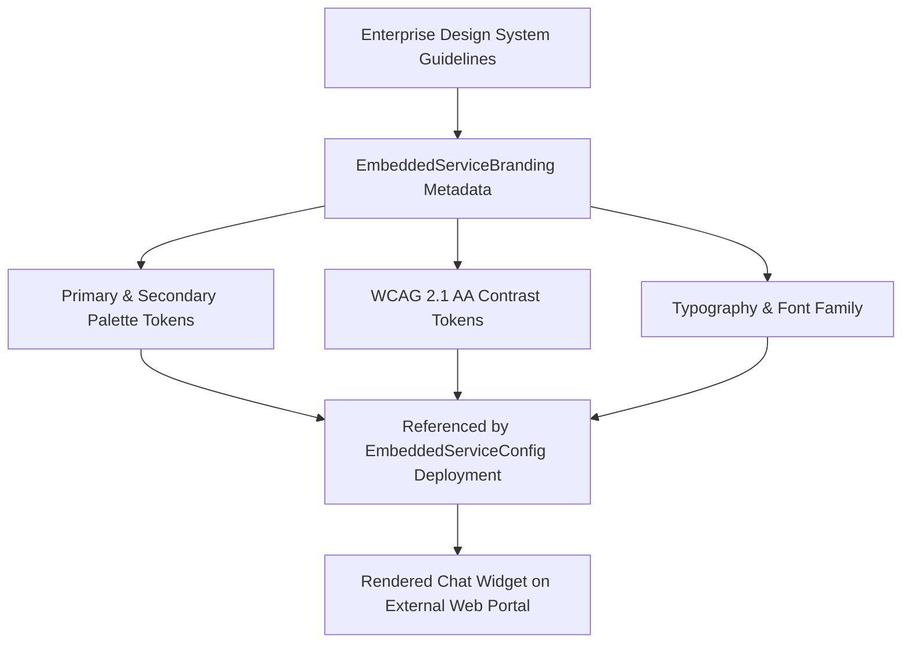

## Architectural Overview

The `EmbeddedServiceBranding` metadata type represents the visual styling and brand presentation configuration for **Salesforce Embedded Service Chat** and **Messaging for In-App and Web (MIAW)** (`Setup > Service > Embedded Service Deployments > Branding`).

When embedding real-time customer support into customer-facing digital properties (e-commerce storefronts, public portals, or native mobile applications), enterprise design systems mandate strict adherence to brand guidelines. An unbranded or visually discordant chat widget damages customer trust and degrades user experience.

`EmbeddedServiceBranding` abstracts the visual design layer from chat routing logic. It defines:
- **Palette Tokens:** Hexadecimal color codes for primary brand accents, secondary highlights, background panels, and navigation headers.
- **Contrast Accessibility:** Explicit high-contrast text and icon colors ensuring compliance with WCAG 2.1 AA accessibility standards.
- **Typography:** Brand font family definitions applied uniformly across widget headers, chat dialogue bubbles, and action buttons.

In deployment architectures, `EmbeddedServiceBranding` is linked to parent `EmbeddedServiceConfig` deployments, enabling teams to maintain distinct branding themes across different brand properties or international locales.



## Directory and File Suffix Reference

In Salesforce DX project structures, `EmbeddedServiceBranding` components reside in the `embeddedServiceBrandings` directory.

| Property | Value |
| :--- | :--- |
| **Metadata Type Name** | `EmbeddedServiceBranding` |
| **SFDX Source Directory** | `force-app/main/default/embeddedServiceBrandings/` |
| **Metadata File Suffix** | `.embeddedServiceBranding-meta.xml` |
| **Package Manifest Type** | `EmbeddedServiceBranding` |
| **Supports Wildcard (`*`)** | Yes |
| **API Version Introduced** | v43.0 (Verified through `68.0` in Winter '27) |

## Key Metadata Fields

The `EmbeddedServiceBranding` metadata type extends `Metadata` and provides the following visual style fields:

| Field Name | Field Type | Required | Architectural Description |
| :--- | :--- | :--- | :--- |
| `masterLabel` | `string` | Yes | The user-facing identifier for the branding profile. |
| `primaryColor` | `string` (Hex) | No | Primary brand color applied to widget header bar, action buttons, and active chat states (e.g., `#005FB2`). |
| `secondaryColor` | `string` (Hex) | No | Secondary accent color used for agent message bubbles and selection highlights. |
| `contrastPrimaryColor` | `string` (Hex) | No | High-contrast foreground color for text and icons displayed over the primary color background. |
| `contrastInvertedColor` | `string` (Hex) | No | Inverted contrast color applied to alternative background sections. |
| `fontFamily` | `string` | No | Font family name (e.g., `Salesforce Sans`, `Helvetica Neue`, `Arial`, or a custom web font). |
| `navBarColor` | `string` (Hex) | No | Background color for the chat window navigation header bar. |

> [!TIP]
> Ensure the contrast ratio between `primaryColor` and `contrastPrimaryColor` satisfies a minimum of 4.5:1 to maintain compliance with international accessibility standards (WCAG 2.1).

## Declarative XML and Package.xml Examples

### 1. Branding Definition Component (`Corporate_Portal_Branding.embeddedServiceBranding-meta.xml`)

```xml title="force-app/main/default/embeddedServiceBrandings/Corporate_Portal_Branding.embeddedServiceBranding-meta.xml"
<?xml version="1.0" encoding="UTF-8"?>
<EmbeddedServiceBranding xmlns="http://soap.sforce.com/2006/04/metadata">
    <contrastInvertedColor>#181818</contrastInvertedColor>
    <contrastPrimaryColor>#FFFFFF</contrastPrimaryColor>
    <fontFamily>Salesforce Sans, Arial, sans-serif</fontFamily>
    <masterLabel>Corporate Portal Branding</masterLabel>
    <navBarColor>#0B5CAB</navBarColor>
    <primaryColor>#0B5CAB</primaryColor>
    <secondaryColor>#E5E5E5</secondaryColor>
</EmbeddedServiceBranding>
```

### 2. Package Manifest (`manifest/package.xml`)

Deploy `EmbeddedServiceBranding` alongside its parent `EmbeddedServiceConfig` deployment:

```xml title="manifest/package.xml"
<?xml version="1.0" encoding="UTF-8"?>
<Package xmlns="http://soap.sforce.com/2006/04/metadata">
    <types>
        <members>*</members>
        <name>EmbeddedServiceBranding</name>
    </types>
    <types>
        <members>*</members>
        <name>EmbeddedServiceConfig</name>
    </types>
    <version>68.0</version>
</Package>
```

## Retrieval and Deployment Commands

Manage `EmbeddedServiceBranding` using standard Salesforce CLI commands:

```bash
# Retrieve all EmbeddedServiceBranding definitions
sf project retrieve start --metadata EmbeddedServiceBranding

# Deploy a specific branding configuration to staging
sf project deploy start --metadata EmbeddedServiceBranding:Corporate_Portal_Branding --target-org staging-sandbox

# Query branding records via Tooling API
sf data query --query "SELECT Id, DeveloperName, MasterLabel, PrimaryColor, NavBarColor FROM EmbeddedServiceBranding" --use-tooling-api --target-org prod-ci
```

## Senior Architect Deployment Best Practices and Gotchas

- **Deployment Dependency Order:** When deploying an `EmbeddedServiceConfig` that references an `EmbeddedServiceBranding` component, both files must be included in the same deployment transaction or the branding component must be deployed first. A missing branding dependency will cause deployment failure on the parent config.
- **Custom Font Loading in Host Web Pages:** Setting `fontFamily` in `EmbeddedServiceBranding` applies the CSS rule to the chat widget container. However, if using a proprietary corporate web font (such as Google Fonts or Adobe Typekit), the host website embedding the chat snippet must also import the font stylesheet in its HTML `<head>` tag.
- **Mobile Responsive Viewports:** When the chat widget opens on mobile devices, Embedded Service expands to full screen. Verify that `navBarColor` and `contrastPrimaryColor` provide adequate visibility on mobile displays under varying brightness conditions.
- **Coexistence with Custom Lightning Web Components:** If your team implements custom Lightning Web Components (LWCs) to replace the default chat header or minimized state, your LWC styles can inherit theme colors by consuming standard CSS design tokens rather than hardcoding hex values.
