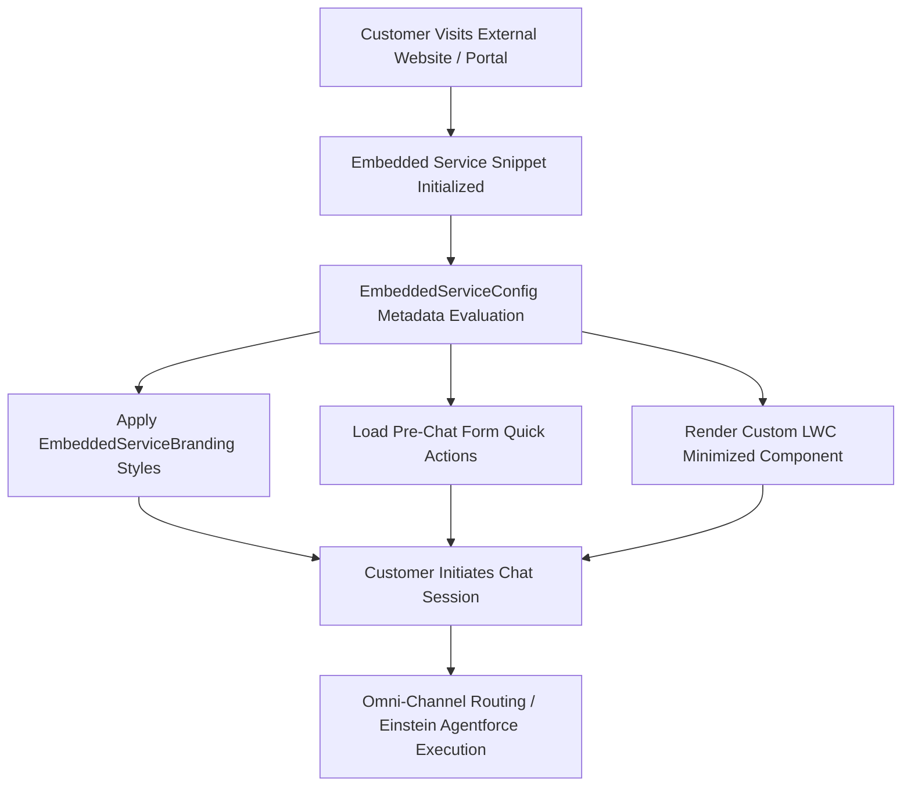

## Architectural Overview

The `EmbeddedServiceConfig` metadata type represents the master configuration container for **Salesforce Embedded Service Deployments (formerly Snap-ins, Embedded Chat, and Messaging for In-App and Web)** (`Setup > Service > Embedded Service Deployments`).

Embedded Service is the primary conversational runtime through which enterprises deploy omnichannel customer service to external websites, customer portals, and mobile apps. Rather than requiring developers to build custom chat websockets and UI scaffolding from scratch, Salesforce provides an embeddable, customizable JavaScript snippet that surfaces real-time chat, AI bot handoffs, pre-chat intake forms, and offline case logging.

Architecturally, `EmbeddedServiceConfig` serves as the central orchestration hub that links together:
- **Branding and Presentation:** References an `EmbeddedServiceBranding` component for visual styling and color themes.
- **Site and Domain Security:** Associates the deployment with a Salesforce Site (`CustomSite`) or external CORS-approved domains.
- **Form Orchestration:** Configures pre-chat Quick Actions for capturing customer information and creating `Contact` or `Case` records prior to routing.
- **Component Overrides:** Links custom Lightning Web Components (LWCs) that override default chat headers, minimized pills, or chat message bubbles.
- **Routing Engine Integration:** Dispatches chat sessions to Omni-Channel queues, skill-based routing rules, or Einstein Bots.



## Directory and File Suffix Reference

In Salesforce DX project source format, `EmbeddedServiceConfig` definitions are stored in the `embeddedServiceConfigs` directory.

| Property | Value |
| :--- | :--- |
| **Metadata Type Name** | `EmbeddedServiceConfig` |
| **SFDX Source Directory** | `force-app/main/default/embeddedServiceConfigs/` |
| **Metadata File Suffix** | `.embeddedServiceConfig-meta.xml` |
| **Package Manifest Type** | `EmbeddedServiceConfig` |
| **Supports Wildcard (`*`)** | Yes |
| **API Version Introduced** | v43.0 (Verified through `68.0` in Winter '27) |

## Key Metadata Fields

The `EmbeddedServiceConfig` metadata type extends `Metadata` and exposes the following core properties:

| Field Name | Field Type | Required | Architectural Description |
| :--- | :--- | :--- | :--- |
| `masterLabel` | `string` | Yes | The user-facing name of the Embedded Service deployment. |
| `site` | `string` | No | The developer name of the Experience Cloud Site (`CustomSite`) hosting the deployment endpoint and guest user context. |
| `areGuestUsersAllowed` | `boolean` | No | Allows unauthenticated guest visitors on public websites to initiate chat or messaging sessions. |
| `authType` | `string` | No | Specifies the authentication model for messaging sessions (`Unauthenticated` or `Authenticated`). |
| `customMinimizedComponent` | `string` | No | The developer name of a custom Aura or Lightning Web Component overriding the minimized chat bar. |
| `deploymentType` | `string` | No | Indicates whether this deployment utilizes legacy Service Cloud Chat or modern Messaging for In-App and Web (MIAW). |

> [!NOTE]
> For new implementations, architects should configure Messaging for In-App and Web (MIAW) deployments rather than legacy Live Agent Chat to take advantage of asynchronous messaging, cross-device persistence, and native Agentforce integration.

## Declarative XML and Package.xml Examples

### 1. Embedded Service Deployment Configuration (`Customer_Support_Web.embeddedServiceConfig-meta.xml`)

```xml title="force-app/main/default/embeddedServiceConfigs/Customer_Support_Web.embeddedServiceConfig-meta.xml"
<?xml version="1.0" encoding="UTF-8"?>
<EmbeddedServiceConfig xmlns="http://soap.sforce.com/2006/04/metadata">
    <areGuestUsersAllowed>true</areGuestUsersAllowed>
    <authType>Unauthenticated</authType>
    <deploymentType>InAppMessaging</deploymentType>
    <masterLabel>Customer Support Web</masterLabel>
    <site>Customer_Self_Service_Portal</site>
</EmbeddedServiceConfig>
```

### 2. Package Manifest (`manifest/package.xml`)

When releasing Embedded Service deployments across environments, include all dependent metadata layers in the manifest:

```xml title="manifest/package.xml"
<?xml version="1.0" encoding="UTF-8"?>
<Package xmlns="http://soap.sforce.com/2006/04/metadata">
    <types>
        <members>*</members>
        <name>EmbeddedServiceConfig</name>
    </types>
    <types>
        <members>*</members>
        <name>EmbeddedServiceBranding</name>
    </types>
    <types>
        <members>Customer_Self_Service_Portal</members>
        <name>CustomSite</name>
    </types>
    <types>
        <members>*</members>
        <name>ServiceChannel</name>
    </types>
    <version>68.0</version>
</Package>
```

## Retrieval and Deployment Commands

Manage `EmbeddedServiceConfig` components via the Salesforce CLI:

```bash
# Retrieve all EmbeddedServiceConfig definitions from target org
sf project retrieve start --metadata EmbeddedServiceConfig

# Deploy a specific deployment configuration
sf project deploy start --metadata EmbeddedServiceConfig:Customer_Support_Web --target-org staging-sandbox

# Query deployment configurations via Tooling API
sf data query --query "SELECT Id, DeveloperName, MasterLabel, SiteId, AreGuestUsersAllowed FROM EmbeddedServiceConfig" --use-tooling-api --target-org prod-ci
```

## Senior Architect Deployment Best Practices and Gotchas

- **Cross-Origin Resource Sharing (CORS) Configuration:** Deploying `EmbeddedServiceConfig` configures the backend metadata, but external websites hosting the embedded code snippet cannot communicate with Salesforce APIs unless their domain origins (e.g., `https://www.company.com`) are explicitly whitelisted under **CORS** (`CorsWhitelist` metadata) in Salesforce Setup.
- **Experience Cloud Site Dependency:** The `site` field establishes a hard dependency on an existing `CustomSite` component. If the specified site has not been deployed or exists in an inactive state, deploying `EmbeddedServiceConfig` will fail with missing site references.
- **Guest User Profile Security Hardening:** When `areGuestUsersAllowed` is `true`, pre-chat forms create records under the context of the Site's Guest User Profile. Enterprise architects must audit the guest user profile's object and field permissions, ensuring that guest users possess only `Create` permissions on `Case` and `Lead`, and have no read or query access to sensitive CRM records.
- **Snippet Code Synchronization:** Whenever changes are made to the deployment configuration (such as changing the deployment URL or authentication type), review whether the generated static JavaScript code snippet embedded on external web servers requires updating.
