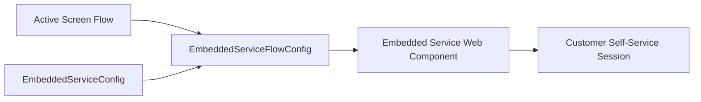

## Architectural Overview

`EmbeddedServiceFlowConfig` is a specialized metadata component within Service Cloud that couples active Salesforce Screen Flows directly to an Embedded Service deployment (formerly Snap-ins). It enables organizations to embed guided self-service experiences—such as appointment scheduling, incident triage, identity verification, and case creation—directly into external websites and Experience Cloud portals.

From an enterprise architecture perspective, decoupling the conversational flow definition from the widget deployment allows contact center administrators to iterate on business logic inside Flow Builder without reconfiguring web endpoints or snippet code.



## Directory and File Conventions

`EmbeddedServiceFlowConfig` metadata files reside within the `embeddedServiceFlowConfigs` directory when retrieved as standalone definitions, or are managed as nested configurations alongside `EmbeddedServiceConfig`.

| Property | Value |
| :--- | :--- |
| **Metadata Type Name** | `EmbeddedServiceFlowConfig` |
| **SFDX Folder** | `force-app/main/default/embeddedServiceFlowConfigs/` |
| **File Suffix** | `.embeddedServiceFlowConfig-meta.xml` |
| **API Support** | Tooling API, Metadata API |

## Key Metadata Fields

The `EmbeddedServiceFlowConfig` metadata structure includes the following core fields:

| Field Name | Field Type | Required | Architectural Description |
| :--- | :--- | :--- | :--- |
| `embeddedServiceConfig` | `string` | Yes | DeveloperName of the parent `EmbeddedServiceConfig` deployment. |
| `flow` | `string` | Yes | API name of the target active Flow definition. |
| `flowType` | `string` (Picklist) | Yes | Specifies flow behavior: `FL_Flow`, `FS_Appointment_Booking`, `FS_Cancel_Appointment`, `FS_Modify_Appointment`, or `FS_New_Appointment`. |
| `isAuthenticationRequired` | `boolean` | No | Indicates whether guest users must authenticate before executing the flow. |

> [!NOTE]
> The target Flow must be active and configured with Screen elements compatible with the Embedded Service runtime container.

## Declarative XML and Package Manifest Examples

Below is a declarative XML definition linking a customer intake flow to an Embedded Service deployment:

```xml title="force-app/main/default/embeddedServiceFlowConfigs/Case_Intake_Flow.embeddedServiceFlowConfig-meta.xml"
<?xml version="1.0" encoding="UTF-8"?>
<EmbeddedServiceFlowConfig xmlns="http://soap.sforce.com/2006/04/metadata">
    <embeddedServiceConfig>Customer_Support_Channel</embeddedServiceConfig>
    <flow>Customer_Intake_Screen_Flow</flow>
    <flowType>FL_Flow</flowType>
    <isAuthenticationRequired>false</isAuthenticationRequired>
</EmbeddedServiceFlowConfig>
```

### Manifest Definition (`package.xml`)

```xml title="manifest/package.xml"
<?xml version="1.0" encoding="UTF-8"?>
<Package xmlns="http://soap.sforce.com/2006/04/metadata">
    <types>
        <members>Case_Intake_Flow</members>
        <name>EmbeddedServiceFlowConfig</name>
    </types>
    <types>
        <members>Customer_Intake_Screen_Flow</members>
        <name>Flow</name>
    </types>
    <version>68.0</version>
</Package>
```

## CLI Retrieval and Deployment Commands

Retrieve and deploy the metadata using the Salesforce CLI:

```bash
# Retrieve EmbeddedServiceFlowConfig
sf project retrieve start --metadata EmbeddedServiceFlowConfig:Case_Intake_Flow

# Deploy flow and configuration together
sf project deploy start --metadata EmbeddedServiceFlowConfig:Case_Intake_Flow Flow:Customer_Intake_Screen_Flow
```

## Architect Best Practices and Gotchas

- **Dependency Sequencing:** The referenced `Flow` must exist and be activated in the target org before or during deployment. If deploying in a single transaction, include both `Flow` and `EmbeddedServiceFlowConfig` in the same package manifest.
- **Guest User Permissions:** If `isAuthenticationRequired` is `false`, verify that the Experience Cloud Guest User Profile or Guest User Permission Set has read access to all objects, fields, and Apex controllers invoked within the Screen Flow.
- **Field Service Appointment Flows:** When using `FS_Appointment_Booking` or related Field Service flow types, ensure Salesforce Field Service (FFS) licenses and operating hours are properly configured in target sandboxes.

> [!TIP]
> Use [Flow](/docs/metadata/flow-metadata-type/) versioning discipline to test flow logic in sandbox sandboxes without disrupting the live Embedded Service snippet on public websites.
