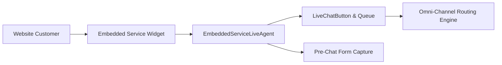

## Architectural Overview

`EmbeddedServiceLiveAgent` represents the integration layer between legacy Live Agent (Chat) routing infrastructure and modern Embedded Service web widgets. It establishes the bridge connecting live customer inquiries from digital touchpoints to omnichannel agent queues, skill groups, and pre-chat data gathering components.

When designing omni-channel customer service architectures, architects use `EmbeddedServiceLiveAgent` to define how chat sessions initiate, what customer context is captured before agent handoff, and how offline support inquiries are channeled into Case records when no agents are available.



## Directory and File Conventions

`EmbeddedServiceLiveAgent` metadata items are saved in the `embeddedServiceLiveAgents` folder within standard SFDX projects.

| Property | Value |
| :--- | :--- |
| **Metadata Type Name** | `EmbeddedServiceLiveAgent` |
| **SFDX Folder** | `force-app/main/default/embeddedServiceLiveAgents/` |
| **File Suffix** | `.embeddedServiceLiveAgent-meta.xml` |
| **API Support** | Metadata API, Tooling API |

## Key Metadata Fields

The `EmbeddedServiceLiveAgent` type encompasses configuration parameters controlling chat routing and visual assets:

| Field Name | Field Type | Required | Architectural Description |
| :--- | :--- | :--- | :--- |
| `embeddedServiceConfig` | `string` | Yes | Name of the associated parent `EmbeddedServiceConfig`. |
| `liveChatButton` | `string` | Yes | DeveloperName of the `LiveChatButton` routing rule. |
| `liveChatDeployment` | `string` | Yes | DeveloperName of the parent `LiveChatDeployment` container. |
| `prechatEnabled` | `boolean` | No | Enables pre-chat form input collection prior to agent routing. |
| `offlineEnabled` | `boolean` | No | Enables offline support Case creation when agents are unavailable. |
| `fontSize` | `string` (Picklist) | No | Font sizing configuration for the client widget interface. |

> [!NOTE]
> Salesforce has transitioned modern conversational experiences to Messaging for Web and In-App. However, `EmbeddedServiceLiveAgent` remains critical for maintaining enterprise legacy chat infrastructure.

## Declarative XML and Package Manifest Examples

Below is a declarative XML definition representing an Embedded Service Live Agent configuration:

```xml title="force-app/main/default/embeddedServiceLiveAgents/Support_Chat_Agent.embeddedServiceLiveAgent-meta.xml"
<?xml version="1.0" encoding="UTF-8"?>
<EmbeddedServiceLiveAgent xmlns="http://soap.sforce.com/2006/04/metadata">
    <embeddedServiceConfig>Support_Chat_Widget</embeddedServiceConfig>
    <fontSize>Medium</fontSize>
    <liveChatButton>Support_Tier_1_Button</liveChatButton>
    <liveChatDeployment>Enterprise_Live_Deployment</liveChatDeployment>
    <offlineEnabled>true</offlineEnabled>
    <prechatEnabled>true</prechatEnabled>
</EmbeddedServiceLiveAgent>
```

### Manifest Definition (`package.xml`)

```xml title="manifest/package.xml"
<?xml version="1.0" encoding="UTF-8"?>
<Package xmlns="http://soap.sforce.com/2006/04/metadata">
    <types>
        <members>Support_Chat_Agent</members>
        <name>EmbeddedServiceLiveAgent</name>
    </types>
    <types>
        <members>Support_Chat_Widget</members>
        <name>EmbeddedServiceConfig</name>
    </types>
    <types>
        <members>Support_Tier_1_Button</members>
        <name>LiveChatButton</name>
    </types>
    <version>68.0</version>
</Package>
```

## CLI Retrieval and Deployment Commands

Retrieve and deploy with `sf` CLI commands:

```bash
# Retrieve EmbeddedServiceLiveAgent configuration
sf project retrieve start --metadata EmbeddedServiceLiveAgent:Support_Chat_Agent

# Deploy Embedded Service alongside Live Agent buttons
sf project deploy start --metadata EmbeddedServiceLiveAgent:Support_Chat_Agent LiveChatButton:Support_Tier_1_Button
```

## Architect Best Practices and Gotchas

- **Strict Dependency Tree:** `EmbeddedServiceLiveAgent` references `LiveChatButton`, `LiveChatDeployment`, and `EmbeddedServiceConfig`. Deploying an `EmbeddedServiceLiveAgent` without these pre-requisites will fail with a metadata dependency resolution error.
- **Pre-Chat Custom Components:** If custom Lightning Web Components (LWCs) are used for pre-chat instead of standard forms, ensure the LWC is deployed and assigned to the parent `EmbeddedServiceConfig` custom component layout.
- **Environment URLs:** Live Agent server endpoints (`liveAgentChatUrl` and `liveAgentContentUrl`) can shift between production and sandboxes. Validate endpoint stability during sandbox refreshes.

> [!TIP]
> Group `LiveChatDeployment`, `LiveChatButton`, and `EmbeddedServiceLiveAgent` in a single modular package to avoid deployment errors across scratch orgs and staging environments.
