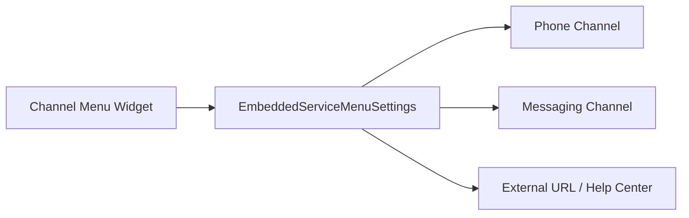

## Architectural Overview

`EmbeddedServiceMenuSettings` represents the metadata configuration for Salesforce Channel Menu (formerly part of Snap-ins Channel Menu). Rather than forcing users into a single communication channel, the Channel Menu surfaces a unified, floating action widget on external web properties or Experience Cloud sites, presenting visitors with multiple support options such as Phone, Messaging for Web, WhatsApp, and Knowledge Base URLs.

Architecturally, the Channel Menu aggregates various underlying service channels into an ordered, brand-consistent launcher. This reduces digital channel friction and allows architects to centrally manage channel visibility and availability schedules across web properties.



## Directory and File Conventions

`EmbeddedServiceMenuSettings` components are stored under the `embeddedServiceMenuSettings` folder in an SFDX source structure.

| Property | Value |
| :--- | :--- |
| **Metadata Type Name** | `EmbeddedServiceMenuSettings` |
| **SFDX Folder** | `force-app/main/default/embeddedServiceMenuSettings/` |
| **File Suffix** | `.embeddedServiceMenuSettings-meta.xml` |
| **API Support** | Metadata API, Tooling API |

## Key Metadata Fields

The `EmbeddedServiceMenuSettings` metadata schema exposes the menu container and child channel items:

| Field Name | Field Type | Required | Architectural Description |
| :--- | :--- | :--- | :--- |
| `masterLabel` | `string` | Yes | Human-readable title displayed in administration and accessibility tags. |
| `shouldShowOnLoad` | `boolean` | No | Dictates whether the menu expands automatically upon page load. |
| `embeddedServiceMenuItems` | `EmbeddedServiceMenuItem[]` | No | Collection of configured channel entries displayed within the menu. |
| `embeddedServiceMenuItems.channel` | `string` | No | API name of the target service channel deployment. |
| `embeddedServiceMenuItems.channelType` | `string` (Picklist) | Yes | Channel classification: `Phone`, `URL`, `Messaging`, or `Chat`. |
| `embeddedServiceMenuItems.phoneNumber` | `string` | No | Direct dial telephone number for click-to-call functionality. |
| `embeddedServiceMenuItems.url` | `string` | No | External URL link when configured for navigational channels. |

> [!NOTE]
> Channel menu items referencing messaging deployments or embedded chat services must point to active, valid channel configurations in the target organization.

## Declarative XML and Package Manifest Examples

Below is a declarative XML definition of an omnichannel support menu:

```xml title="force-app/main/default/embeddedServiceMenuSettings/Global_Support_Menu.embeddedServiceMenuSettings-meta.xml"
<?xml version="1.0" encoding="UTF-8"?>
<EmbeddedServiceMenuSettings xmlns="http://soap.sforce.com/2006/04/metadata">
    <masterLabel>Global Support Menu</masterLabel>
    <shouldShowOnLoad>false</shouldShowOnLoad>
    <embeddedServiceMenuItems>
        <channelType>Phone</channelType>
        <displaySequence>1</displaySequence>
        <isPublic>true</isPublic>
        <label>Call Customer Support</label>
        <phoneNumber>+1-800-555-0199</phoneNumber>
    </embeddedServiceMenuItems>
    <embeddedServiceMenuItems>
        <channelType>URL</channelType>
        <displaySequence>2</displaySequence>
        <isPublic>true</isPublic>
        <label>Help &amp; Documentation</label>
        <url>https://help.example.com</url>
    </embeddedServiceMenuItems>
</EmbeddedServiceMenuSettings>
```

### Manifest Definition (`package.xml`)

```xml title="manifest/package.xml"
<?xml version="1.0" encoding="UTF-8"?>
<Package xmlns="http://soap.sforce.com/2006/04/metadata">
    <types>
        <members>Global_Support_Menu</members>
        <name>EmbeddedServiceMenuSettings</name>
    </types>
    <version>68.0</version>
</Package>
```

## CLI Retrieval and Deployment Commands

Retrieve and deploy with `sf` CLI commands:

```bash
# Retrieve Channel Menu settings
sf project retrieve start --metadata EmbeddedServiceMenuSettings:Global_Support_Menu

# Deploy Channel Menu settings
sf project deploy start --metadata EmbeddedServiceMenuSettings:Global_Support_Menu
```

## Architect Best Practices and Gotchas

- **Channel Linkage Dependencies:** If a channel item references an `EmbeddedServiceConfig` or `LiveChatDeployment`, ensure those components are included in your deployment payload or already exist in the target org.
- **Content Security Policy (CSP):** When including external URLs or custom icons in `embeddedServiceMenuItems`, configure appropriate CSP Trusted Sites in Salesforce Setup to allow outbound navigation and icon asset fetching.
- **Mobile Experience Optimization:** Keep `shouldShowOnLoad` set to `false` on public mobile-responsive sites to avoid obstructing the primary user viewport on mobile devices.

> [!TIP]
> Use Channel Menu metadata in version control to automate staging-to-production promotion of seasonal support routing updates without manual setup clicks.
