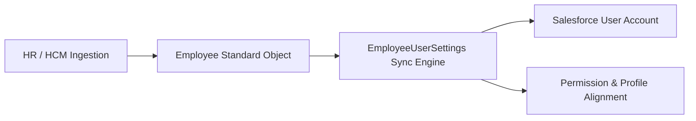

## Architectural Overview

`EmployeeUserSettings` is an enterprise settings metadata type that bridges human resources data management with Salesforce identity and access management (IAM). It governs how standard `Employee` object records synchronize changes and automatically provision or update standard `User` accounts across the platform.

In modern enterprise architectures, human capital management (HCM) systems like Workday or SAP SuccessFactors replicate worker records into the Salesforce `Employee` standard object. `EmployeeUserSettings` provides declarative controls ensuring that worker onboarding, role changes, contact updates, and terminations cascade cleanly into Salesforce user accounts without bespoke batch Apex triggers.



## Directory and File Conventions

`EmployeeUserSettings` follows standard Salesforce settings conventions. It is saved in the `settings` directory using the `EmployeeUser` name prefix.

| Property | Value |
| :--- | :--- |
| **Metadata Type Name** | `Settings` (member: `EmployeeUser`) / `EmployeeUserSettings` |
| **SFDX Folder** | `force-app/main/default/settings/` |
| **File Name** | `EmployeeUser.settings-meta.xml` |
| **Scratch Org Key** | `employeeUserSettings` |

## Key Metadata Fields

The `EmployeeUserSettings` XML structure contains settings that regulate provisioning rules and automatic synchronization:

| Field Name | Field Type | Required | Architectural Description |
| :--- | :--- | :--- | :--- |
| `enableEmployeeUserSync` | `boolean` | Yes | Controls bi-directional synchronization between Employee records and Users. |
| `enableAutoUserProvisioning` | `boolean` | No | Automatically provisions a corresponding User record when an Employee is created. |
| `profileName` | `string` | No | Default Profile assigned to newly auto-provisioned users. |

> [!NOTE]
> Auto-provisioning consumes available Salesforce user licenses. Ensure your scratch org definitions or target environments have sufficient active user licenses before enabling automatic provisioning.

## Declarative XML and Package Manifest Examples

Below is an example declarative settings XML configuration:

```xml title="force-app/main/default/settings/EmployeeUser.settings-meta.xml"
<?xml version="1.0" encoding="UTF-8"?>
<EmployeeUserSettings xmlns="http://soap.sforce.com/2006/04/metadata">
    <enableAutoUserProvisioning>false</enableAutoUserProvisioning>
    <enableEmployeeUserSync>true</enableEmployeeUserSync>
</EmployeeUserSettings>
```

### Manifest Definition (`package.xml`)

```xml title="manifest/package.xml"
<?xml version="1.0" encoding="UTF-8"?>
<Package xmlns="http://soap.sforce.com/2006/04/metadata">
    <types>
        <members>EmployeeUser</members>
        <name>Settings</name>
    </types>
    <version>68.0</version>
</Package>
```

## CLI Retrieval and Deployment Commands

Retrieve and deploy `EmployeeUserSettings` using the `sf` CLI:

```bash
# Retrieve EmployeeUser settings
sf project retrieve start --metadata Settings:EmployeeUser

# Deploy EmployeeUser settings
sf project deploy start --metadata Settings:EmployeeUser
```

## Architect Best Practices and Gotchas

- **Identity Lifecycle Integrity:** Avoid enabling `enableAutoUserProvisioning` without strict email address validation on the inbound HCM data feed to prevent duplicate user account generation.
- **Deactivation Handling:** When an employee record is marked inactive or terminated, verify that your synchronization settings downgrade user access or deactivate the corresponding User record in compliance with SOC2 access governance.
- **Profile Dependencies:** If `profileName` is specified in the settings metadata, the referenced Profile must exist in the target org prior to deployment.

> [!TIP]
> Pair `EmployeeUserSettings` with [PermissionSet](/docs/metadata/permission-set-metadata-type/) group assignments driven by automation to manage fine-grained functional rights rather than monolithic Profiles.
