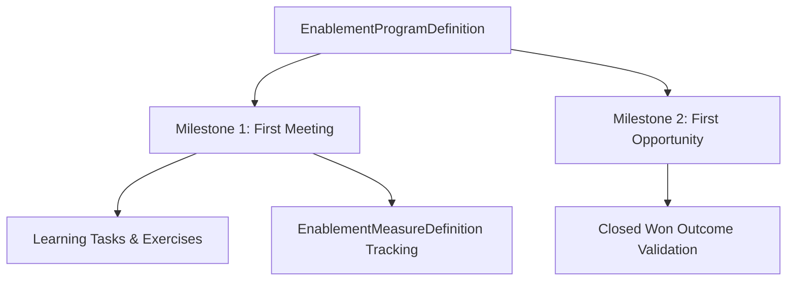

## Architectural Overview

`EnablementProgramDefinition` defines the end-to-end curriculum, milestone sequences, and learning tasks for Salesforce Sales Enablement. Designed to ramp revenue teams faster, enablement programs combine content consumption (Trailhead, external videos) with experiential milestone activities that verify actual in-app execution.

From an application lifecycle management (ALM) perspective, storing enablement programs as metadata allows revenue operations teams to develop, test, and validate learning paths in sandbox environments before packaging and promoting them into production.



## Directory and File Conventions

`EnablementProgramDefinition` components are organized inside the `enablementProgramDefinitions` directory.

| Property | Value |
| :--- | :--- |
| **Metadata Type Name** | `EnablementProgramDefinition` |
| **SFDX Folder** | `force-app/main/default/enablementProgramDefinitions/` |
| **File Suffix** | `.enablementProgramDefinition-meta.xml` |
| **API Support** | Metadata API, Tooling API |

## Key Metadata Fields

The `EnablementProgramDefinition` XML contains container attributes and child milestone elements:

| Field Name | Field Type | Required | Architectural Description |
| :--- | :--- | :--- | :--- |
| `masterLabel` | `string` | Yes | Display title shown to reps in the Enablement guidance center. |
| `description` | `string` | No | Contextual overview outlining program objectives. |
| `status` | `string` (Picklist) | Yes | Deployment lifecycle state: `Draft`, `Active`, or `Archived`. |
| `programCategory` | `string` (Picklist) | No | Classification tag, such as `Onboarding` or `SkillBuilding`. |

> [!NOTE]
> Programs in `Active` status cannot be deleted or restructured if active participants are currently assigned to the program.

## Declarative XML and Package Manifest Examples

Below is a declarative XML definition of a sales onboarding program:

```xml title="force-app/main/default/enablementProgramDefinitions/SDR_Onboarding_Program.enablementProgramDefinition-meta.xml"
<?xml version="1.0" encoding="UTF-8"?>
<EnablementProgramDefinition xmlns="http://soap.sforce.com/2006/04/metadata">
    <description>Ramp new Sales Development Reps within 30 days.</description>
    <masterLabel>SDR 30-Day Onboarding</masterLabel>
    <programCategory>Onboarding</programCategory>
    <status>Draft</status>
</EnablementProgramDefinition>
```

### Manifest Definition (`package.xml`)

```xml title="manifest/package.xml"
<?xml version="1.0" encoding="UTF-8"?>
<Package xmlns="http://soap.sforce.com/2006/04/metadata">
    <types>
        <members>SDR_Onboarding_Program</members>
        <name>EnablementProgramDefinition</name>
    </types>
    <types>
        <members>Deals_Closed_Measure</members>
        <name>EnablementMeasureDefinition</name>
    </types>
    <version>68.0</version>
</Package>
```

## CLI Retrieval and Deployment Commands

Retrieve and deploy with `sf` CLI commands:

```bash
# Retrieve program definition
sf project retrieve start --metadata EnablementProgramDefinition:SDR_Onboarding_Program

# Deploy program alongside related measures
sf project deploy start --metadata EnablementProgramDefinition:SDR_Onboarding_Program EnablementMeasureDefinition:*
```

## Architect Best Practices and Gotchas

- **Deploy as Draft First:** Deploy new or modified program definitions in `Draft` status first. Once validated in the target environment, activate the program either manually or via a separate release script.
- **Dependency Staging:** Ensure all underlying `EnablementMeasureDefinition` and task category components are included in the same deployment bundle to avoid metadata resolution failures.
- **Sandbox Testing:** Populate mock Opportunities and Tasks in sandbox environments to verify that milestones register completion automatically before assigning users in production.

> [!TIP]
> Combine enablement programs with [PermissionSet](/docs/metadata/permission-set-metadata-type/) automation to assign enablement licenses and programs simultaneously upon user creation.
