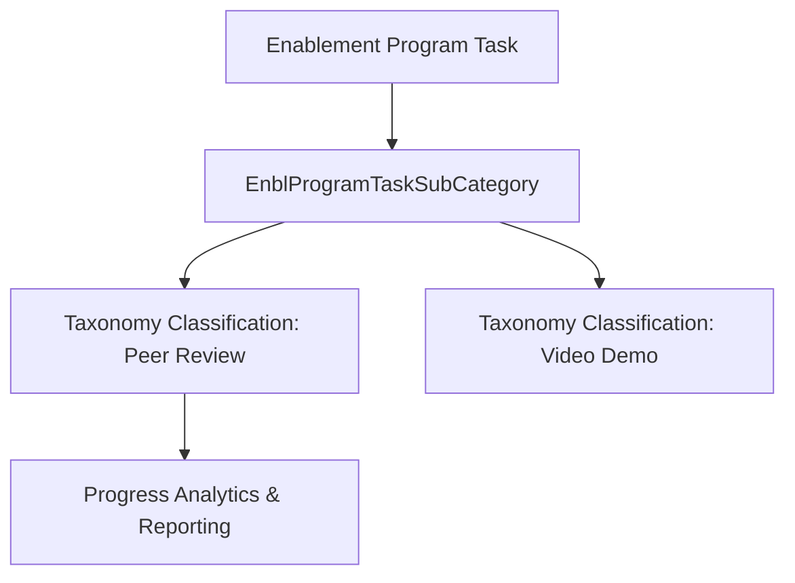

## Architectural Overview

`EnblProgramTaskSubCategory` manages the classification taxonomy for enablement exercises and curriculum items within Salesforce Sales Enablement. When enablement architects structure learning programs, tasks are categorized into clear activity buckets—such as external videos, documentation reviews, pitch recordings, or peer assessments.

Structuring these categories as version-controlled metadata enables multi-org enterprise deployments to enforce consistent reporting taxonomies across disparate sales teams and subsidiaries without relying on manual setup in production.



## Directory and File Conventions

`EnblProgramTaskSubCategory` metadata components are located within the `enblProgramTaskSubCategories` folder in standard SFDX source layouts.

| Property | Value |
| :--- | :--- |
| **Metadata Type Name** | `EnblProgramTaskSubCategory` |
| **SFDX Folder** | `force-app/main/default/enblProgramTaskSubCategories/` |
| **File Suffix** | `.enblProgramTaskSubCategory-meta.xml` |
| **API Support** | Metadata API, Tooling API |

## Key Metadata Fields

The `EnblProgramTaskSubCategory` metadata schema contains the following primary fields:

| Field Name | Field Type | Required | Architectural Description |
| :--- | :--- | :--- | :--- |
| `masterLabel` | `string` | Yes | Human-readable label displayed across the enablement builder and reporting. |
| `description` | `string` | No | Description outlining the intended task types covered by this subcategory. |

> [!NOTE]
> Enablement task subcategories provide filtering facets in Sales Enablement analytics dashboards and learner progress cards.

## Declarative XML and Package Manifest Examples

Below is a declarative XML definition of a custom enablement task subcategory:

```xml title="force-app/main/default/enblProgramTaskSubCategories/Peer_Pitch_Review.enblProgramTaskSubCategory-meta.xml"
<?xml version="1.0" encoding="UTF-8"?>
<EnblProgramTaskSubCategory xmlns="http://soap.sforce.com/2006/04/metadata">
    <description>Peer review and pitch certification exercises for sales reps.</description>
    <masterLabel>Peer Pitch Review</masterLabel>
</EnblProgramTaskSubCategory>
```

### Manifest Definition (`package.xml`)

```xml title="manifest/package.xml"
<?xml version="1.0" encoding="UTF-8"?>
<Package xmlns="http://soap.sforce.com/2006/04/metadata">
    <types>
        <members>Peer_Pitch_Review</members>
        <name>EnblProgramTaskSubCategory</name>
    </types>
    <version>68.0</version>
</Package>
```

## CLI Retrieval and Deployment Commands

Retrieve and deploy with `sf` CLI commands:

```bash
# Retrieve all task subcategories
sf project retrieve start --metadata EnblProgramTaskSubCategory:*

# Deploy a specific task subcategory
sf project deploy start --metadata EnblProgramTaskSubCategory:Peer_Pitch_Review
```

## Architect Best Practices and Gotchas

- **Deploy Upstream of Programs:** Because program tasks reference subcategories, deploy all `EnblProgramTaskSubCategory` components before deploying `EnablementProgramDefinition` records.
- **Taxonomy Governance:** Limit creation of duplicate subcategories across development teams by centralizing enablement taxonomy definitions in a shared core repository.
- **Reporting Alignment:** Ensure that reporting teams reference the standardized API names of subcategories when creating custom report types on Enablement Task completion.

> [!TIP]
> Group related enablement categories into a single package directory within your `sfdx-project.json` for streamlined continuous delivery.
