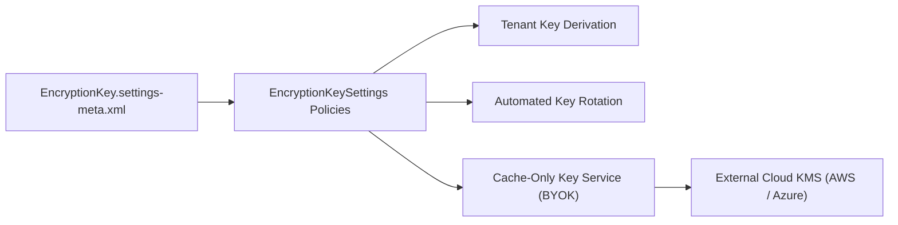

## Architectural Overview

`EncryptionKeySettings` manages organization-wide policies for Salesforce Shield Platform Encryption key management services (KMS). In high-compliance enterprise architectures across banking, healthcare, and federal sectors, cryptographic key lifecycles must be strictly audited and automated.

This metadata type controls whether Salesforce automatically rotates tenant secrets, enforces Cache-Only Keys (where cryptographic keys are fetched on-demand from an external KMS like AWS KMS or HashiCorp Vault without ever persisting to Salesforce disks), and configures key derivation protocols.



## Directory and File Conventions

`EncryptionKeySettings` is deployed as part of the `Settings` metadata family and resides in the `settings` directory.

| Property | Value |
| :--- | :--- |
| **Metadata Type Name** | `Settings` (member: `EncryptionKey`) / `EncryptionKeySettings` |
| **SFDX Folder** | `force-app/main/default/settings/` |
| **File Name** | `EncryptionKey.settings-meta.xml` |
| **Scratch Org Setting** | `encryptionKeySettings` |

## Key Metadata Fields

The `EncryptionKeySettings` XML exposes key governance toggles:

| Field Name | Field Type | Required | Architectural Description |
| :--- | :--- | :--- | :--- |
| `enableAutoKeyRotation` | `boolean` | No | When enabled, automatically generates and rotates active tenant secrets periodically. |
| `enableCacheOnlyKeys` | `boolean` | No | Enables the Cache-Only Key service for external Bring Your Own Key (BYOK) integrations. |
| `tenantKeyType` | `string` (Picklist) | No | Specifies the target tenant secret domain: `Data`, `SearchIndex`, `EventBus`, or `Analytics`. |

> [!NOTE]
> Enabling Shield Platform Encryption features requires active Salesforce Shield or Platform Encryption add-on licenses in the target organization.

## Declarative XML and Package Manifest Examples

Below is a declarative XML file configuring encryption key policies:

```xml title="force-app/main/default/settings/EncryptionKey.settings-meta.xml"
<?xml version="1.0" encoding="UTF-8"?>
<EncryptionKeySettings xmlns="http://soap.sforce.com/2006/04/metadata">
    <enableAutoKeyRotation>true</enableAutoKeyRotation>
    <enableCacheOnlyKeys>false</enableCacheOnlyKeys>
</EncryptionKeySettings>
```

### Manifest Definition (`package.xml`)

```xml title="manifest/package.xml"
<?xml version="1.0" encoding="UTF-8"?>
<Package xmlns="http://soap.sforce.com/2006/04/metadata">
    <types>
        <members>EncryptionKey</members>
        <name>Settings</name>
    </types>
    <version>68.0</version>
</Package>
```

## CLI Retrieval and Deployment Commands

Retrieve and deploy using `sf` CLI commands:

```bash
# Retrieve EncryptionKeySettings
sf project retrieve start --metadata Settings:EncryptionKey

# Deploy EncryptionKeySettings
sf project deploy start --metadata Settings:EncryptionKey
```

## Architect Best Practices and Gotchas

- **Sandbox Licensing:** Scratch org definitions must enable the `PlatformEncryption` feature in `project-scratch-def.json` before deploying `EncryptionKeySettings`.
- **Cache-Only Key High Availability:** If `enableCacheOnlyKeys` is toggled on, ensure external KMS callout endpoints have strict SLAs and callout credentials configured; an unreachable external KMS blocks data access.
- **Data Filtering Impacts:** When enabling encryption on standard and [CustomField](/docs/metadata/custom-field-metadata-type/) metadata, deterministic encryption must be selected if fields participate in SOQL `WHERE` filters or report groupings.

> [!TIP]
> Restrict key management privileges by assigning the `Manage Encryption Keys` administrative permission solely via tightly audited [PermissionSet](/docs/metadata/permission-set-metadata-type/) artifacts.
