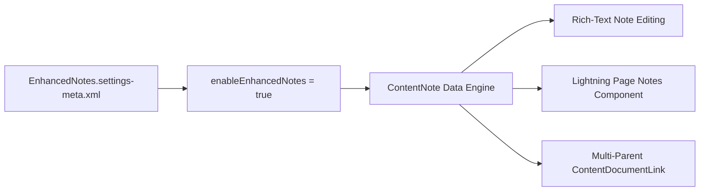

## Architectural Overview

`EnhancedNotesSettings` controls org-wide activation of Enhanced Notes across Salesforce. Enhanced Notes replaces the legacy `Note` attachment object with the Salesforce Files infrastructure backed by `ContentNote` and `ContentDocumentLink`.

Enabling this setting activates modern rich-text capabilities, embedded image support, multi-record association, document version history, and granular sharing controls for notes. In enterprise CI/CD workflows, failing to enable `EnhancedNotesSettings` before deploying Lightning Record Pages (`FlexiPage`) or Page Layouts (`Layout`) that contain the Notes component will cause deployment validation failures.



## Directory and File Conventions

`EnhancedNotesSettings` is part of the `Settings` metadata family and is stored within the `settings` directory using the member name `EnhancedNotes`.

| Property | Value |
| :--- | :--- |
| **Metadata Type Name** | `Settings` (member: `EnhancedNotes`) / `EnhancedNotesSettings` |
| **SFDX Folder** | `force-app/main/default/settings/` |
| **File Name** | `EnhancedNotes.settings-meta.xml` |
| **Scratch Org Setting** | `enhancedNotesSettings` |

## Key Metadata Fields

The XML schema for `EnhancedNotesSettings` defines the following primary configuration options:

| Field Name | Field Type | Required | Architectural Description |
| :--- | :--- | :--- | :--- |
| `enableEnhancedNotes` | `boolean` | Yes | Enables Enhanced Notes globally across the Salesforce organization. |
| `enableTasksOnNotes` | `boolean` | No | Allows users to create follow-up Task records directly from within Notes. |

> [!NOTE]
> When `enableEnhancedNotes` is set to `true`, the `Note` related list on standard and custom objects transitions to leverage `ContentDocumentLink` behind the scenes.

## Declarative XML and Package Manifest Examples

Below is the standard `EnhancedNotes.settings-meta.xml` file:

```xml title="force-app/main/default/settings/EnhancedNotes.settings-meta.xml"
<?xml version="1.0" encoding="UTF-8"?>
<EnhancedNotesSettings xmlns="http://soap.sforce.com/2006/04/metadata">
    <enableEnhancedNotes>true</enableEnhancedNotes>
    <enableTasksOnNotes>true</enableTasksOnNotes>
</EnhancedNotesSettings>
```

### Manifest Definition (`package.xml`)

```xml title="manifest/package.xml"
<?xml version="1.0" encoding="UTF-8"?>
<Package xmlns="http://soap.sforce.com/2006/04/metadata">
    <types>
        <members>EnhancedNotes</members>
        <name>Settings</name>
    </types>
    <version>68.0</version>
</Package>
```

## CLI Retrieval and Deployment Commands

Retrieve and deploy with `sf` CLI commands:

```bash
# Retrieve EnhancedNotes settings
sf project retrieve start --metadata Settings:EnhancedNotes

# Deploy EnhancedNotes settings to target org
sf project deploy start --metadata Settings:EnhancedNotes
```

## Architect Best Practices and Gotchas

- **FlexiPage Dependency Sequencing:** Always deploy `Settings:EnhancedNotes` prior to or simultaneously with [FlexiPage](/docs/metadata/flexipage-metadata-type/) components referencing the `runtime_sales_notes` Lightning component.
- **Legacy Note Migration:** Enabling Enhanced Notes does not automatically convert legacy `Note` records to `ContentNote`. Plan an ETL migration using tools that insert records into `ContentVersion` with `FileType = 'SNOTE'` and create associated `ContentDocumentLink` entries.
- **File Storage Impact:** Because Enhanced Notes are stored as Content records, note bodies and embedded screenshots consume File Storage rather than Data Storage allocations.

> [!TIP]
> Include `enhancedNotesSettings: { "enableEnhancedNotes": true }` in your default `project-scratch-def.json` template to ensure reproducible developer scratch environments.
