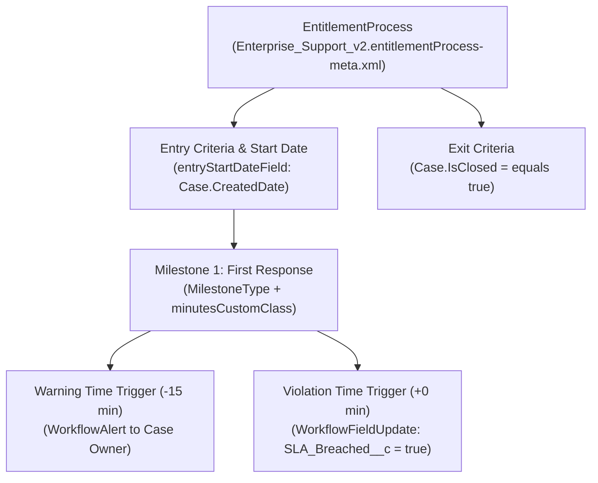

## Why the `EntitlementProcess` Metadata Type Is Core to Service Cloud SLAs

While [EscalationRules](/docs/metadata/escalation-rules-metadata-type/) handle simple Case age escalations, **`EntitlementProcess`** (`entitlementProcesses/<Name>.entitlementProcess-meta.xml`) powers contractual **Service Level Agreements (SLAs)** on **Cases** and **Work Orders**. An `EntitlementProcess` orchestrates:

- **Entry & Exit Criteria:** When the SLA clock starts (e.g., `Case CreatedDate`) and stops (`IsClosed = true`).
- **Ordered Milestones (`EntitlementProcessMilestoneItem`):** First Response, Technical Workaround, and Final Resolution targets referencing [MilestoneType](/docs/metadata/milestone-type-metadata-type/) definitions.
- **Dynamic SLA Duration via Apex (`minutesCustomClass`):** Calculating SLA minutes dynamically based on severity, entitlement tier, or customer contract via `Support.MilestoneTriggerTimeCalculator`.
- **Success, Warning, and Violation Time Triggers:** Executing [WorkflowFieldUpdate](/docs/metadata/workflow-metadata-type/) and `WorkflowAlert` actions before or after an SLA breach.



---

## Key Metadata Fields on `EntitlementProcess`

| Field | Type | Description |
|---|---|---|
| `SObjectType` | `string` | Target object for the SLA timeline: `Case` or `WorkOrder`. |
| `active` | `boolean` | Activates the Entitlement Process so it can be linked to Customer Entitlements. |
| `entryStartDateField` | `string` | Date/Time field that starts the entitlement clock (e.g., `Case.CreatedDate`). |
| `exitCriteriaBooleanFilter` | `string` | Filter logic (`1 AND 2`) for `exitCriteriaFilterItems` or `exitCriteriaFormula`. |
| `businessHours` | `string` | Name of the org Business Hours applied to the overall entitlement process. |
| `versionMaster` | `string` | Base identifier of the Entitlement Process when Entitlement Versioning is enabled. |
| `versionNumber` | `int` | Version number (`1`, `2`, `3`) when Entitlement Versioning is enabled. |
| ` isVersionDefault` | `boolean` | Marks this version as the default version for new Entitlement records. |
| `milestones` | `EntitlementProcessMilestoneItem[]` | Ordered list of SLA milestones, criteria, business hours, and time triggers. |
| `milestones.minutesCustomClass` | `string` | Apex class implementing `Support.MilestoneTriggerTimeCalculator` to compute SLA minutes dynamically. |

---

## Real-World XML Example (`entitlementProcesses/enterprise gold support_v1.entitlementProcess-meta.xml`)

```xml
<?xml version="1.0" encoding="UTF-8"?>
<EntitlementProcess xmlns="http://soap.sforce.com/2006/04/metadata">
    <SObjectType>Case</SObjectType>
    <active>true</active>
    <businessHours>Default</businessHours>
    <description>24x7 Enterprise Gold Support SLA with dynamic First Response and Resolution milestones.</description>
    <entryStartDateField>Case.CreatedDate</entryStartDateField>
    <exitCriteriaFilterItems>
        <field>Case.IsClosed</field>
        <operation>equals</operation>
        <value>true</value>
    </exitCriteriaFilterItems>
    <isVersionDefault>true</isVersionDefault>
    <milestones>
        <businessHours>Default</businessHours>
        <milestoneCriteriaFilterItems>
            <field>Case.Priority</field>
            <operation>equals</operation>
            <value>High,Critical</value>
        </milestoneCriteriaFilterItems>
        <milestoneName>First Response</milestoneName>
        <minutesCustomClass>DynamicSlaTriggerTimeCalculator</minutesCustomClass>
        <timeTriggers>
            <actions>
                <name>Case.SLA_Warning_Notification</name>
                <type>Alert</type>
            </actions>
            <timeLength>-15</timeLength>
            <workflowTimeTriggerUnit>Minutes</workflowTimeTriggerUnit>
        </timeTriggers>
        <useCriteriaStartTime>false</useCriteriaStartTime>
    </milestones>
    <name>Enterprise Gold Support</name>
    <versionMaster>552000000000abc</versionMaster>
    <versionNumber>1</versionNumber>
</EntitlementProcess>
```

---

## Querying `EntitlementProcess` (`SlaProcess`) via SOQL

In the Salesforce database schema, an `EntitlementProcess` is represented by the **`SlaProcess`** object.

### 1. Query Active Entitlement Processes and Versions

```sql
SELECT Id, Name, NameNorm, SobjectType, IsActive, IsVersionDefault,
       VersionNumber, StartDateField, BusinessHours.Name, LastModifiedDate
FROM SlaProcess
WHERE IsActive = true
ORDER BY Name, VersionNumber DESC
```

### 2. Find Entitlements Currently Using a Specific `SlaProcess` Version

```sql
SELECT Id, Name, Account.Name, Status, SlaProcess.Name, SlaProcess.VersionNumber
FROM Entitlement
WHERE SlaProcess.IsActive = true
  AND Status = 'Active'
```

---

## Senior Architect Best Practices & Gotchas

> [!WARNING]
> **File Naming Is Lowercase in SFDX Retrieve:** Notice that Salesforce CLI often retrieves `EntitlementProcess` files with lowercase names and a version suffix (such as `enterprise gold support_v1.entitlementProcess-meta.xml`). Always verify the exact member name via `sf org list metadata --metadata-type EntitlementProcess` before building a manual `package.xml`.

- **Always Enable Entitlement Versioning Early:** Without Entitlement Versioning enabled in **Setup → Entitlement Settings**, you cannot modify milestones on an `EntitlementProcess` that is already in use by any active Entitlement or open Case in Production.
- **Deploy Prerequisite `MilestoneType` and `Workflow` Actions First:** Every `<milestoneName>` must match an existing [MilestoneType](/docs/metadata/milestone-type-metadata-type/), and every `<actions>` reference must match a deployed [WorkflowAlert or WorkflowFieldUpdate](/docs/metadata/workflow-metadata-type/).
