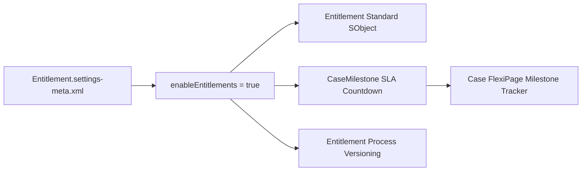

## Architectural Overview

`EntitlementSettings` activates and governs Entitlement Management in Service Cloud. In enterprise customer support centers with strict service-level agreements (SLAs), entitlement features ensure that support tiers, contract terms, response times, and resolution milestones are systematically measured and enforced on Case records.

Deploying `EntitlementSettings` enables the `Entitlement`, `Milestone`, and `CaseMilestone` standard objects, allowing administrators to attach countdown timers, SLA breach alerts, and milestone automation to customer cases. Without this setting enabled, attempting to deploy page layouts, Lightning record pages, or Apex classes that reference Entitlement objects will result in deployment failures.



## Directory and File Conventions

`EntitlementSettings` follows standard Salesforce settings naming and directory conventions.

| Property | Value |
| :--- | :--- |
| **Metadata Type Name** | `Settings` (member: `Entitlement`) / `EntitlementSettings` |
| **SFDX Folder** | `force-app/main/default/settings/` |
| **File Name** | `Entitlement.settings-meta.xml` |
| **Scratch Org Key** | `entitlementSettings` |

## Key Metadata Fields

The `EntitlementSettings` XML exposes key configuration options for SLA governance:

| Field Name | Field Type | Required | Architectural Description |
| :--- | :--- | :--- | :--- |
| `enableEntitlements` | `boolean` | Yes | Globally turns on Entitlement Management in the org. |
| `enableEntitlementVersioning` | `boolean` | No | Enables multi-version entitlement processes for gradual SLA updates. |
| `enableMilestoneStoppedTime` | `boolean` | No | Pauses milestone clocks when cases enter on-hold or customer-waiting status. |
| `enableMilestoneFeed` | `boolean` | No | Posts milestone updates and breach notifications to the Case Chatter feed. |

> [!NOTE]
> Setting `enableMilestoneStoppedTime` to `true` requires configuring Case statuses that represent stopped-time states (e.g., "Pending Customer Action").

## Declarative XML and Package Manifest Examples

Below is a declarative XML definition enabling Entitlement Management with milestone paused-time tracking:

```xml title="force-app/main/default/settings/Entitlement.settings-meta.xml"
<?xml version="1.0" encoding="UTF-8"?>
<EntitlementSettings xmlns="http://soap.sforce.com/2006/04/metadata">
    <enableEntitlementVersioning>true</enableEntitlementVersioning>
    <enableEntitlements>true</enableEntitlements>
    <enableMilestoneFeed>true</enableMilestoneFeed>
    <enableMilestoneStoppedTime>true</enableMilestoneStoppedTime>
</EntitlementSettings>
```

### Manifest Definition (`package.xml`)

```xml title="manifest/package.xml"
<?xml version="1.0" encoding="UTF-8"?>
<Package xmlns="http://soap.sforce.com/2006/04/metadata">
    <types>
        <members>Entitlement</members>
        <name>Settings</name>
    </types>
    <version>68.0</version>
</Package>
```

## CLI Retrieval and Deployment Commands

Retrieve and deploy with `sf` CLI commands:

```bash
# Retrieve Entitlement settings
sf project retrieve start --metadata Settings:Entitlement

# Deploy Entitlement settings to destination org
sf project deploy start --metadata Settings:Entitlement
```

## Architect Best Practices and Gotchas

- **Deployment Prerequisites:** Always deploy `Settings:Entitlement` in the initial deployment wave before deploying Entitlement Processes (`EntitlementProcess`), Case Milestones, or Case [Layout](/docs/metadata/layout-metadata-type/) components.
- **Milestone Clock Accuracies:** Pair `enableMilestoneStoppedTime` with well-defined Case Status picklist values in Business Hours configurations to prevent false SLA breaches across global timezones.
- **Entitlement Process Versioning:** Always turn on `enableEntitlementVersioning` to allow releasing new SLA definitions without forcibly migrating in-flight customer cases.

> [!TIP]
> Include `entitlementSettings: { "enableEntitlements": true }` in your scratch org definitions to support automated continuous integration testing for Service Cloud repositories.
