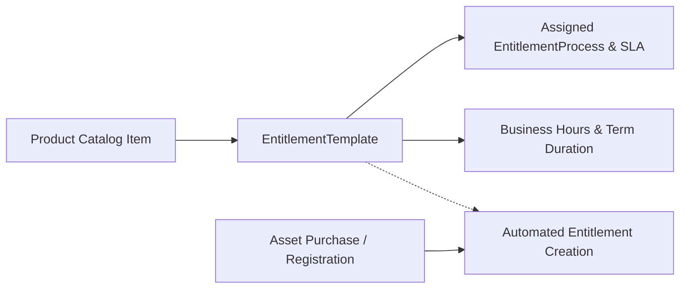

## Architectural Overview

`EntitlementTemplate` allows Service Cloud architects to predefine terms of support—such as warranty duration, allowable case volume, service hours, and milestone escalation processes—and associate them with Product catalog items. When a sales order completes and an `Asset` is created or registered, Salesforce can automatically instantiate an active `Entitlement` for the account based on the assigned template.

Automating entitlement provisioning via metadata eliminates error-prone manual data entry by customer service representatives. It ensures that customer support entitlements accurately reflect contractual warranties and premium SLA tiers across enterprise deployments.



## Directory and File Conventions

`EntitlementTemplate` components are stored within the `entitlementTemplates` directory in standard SFDX project repositories.

| Property | Value |
| :--- | :--- |
| **Metadata Type Name** | `EntitlementTemplate` |
| **SFDX Folder** | `force-app/main/default/entitlementTemplates/` |
| **File Suffix** | `.entitlementTemplate-meta.xml` |
| **API Support** | Metadata API, Tooling API |

## Key Metadata Fields

The `EntitlementTemplate` metadata XML schema includes the following primary parameters:

| Field Name | Field Type | Required | Architectural Description |
| :--- | :--- | :--- | :--- |
| `name` | `string` | Yes | DeveloperName and unique identifier of the entitlement template. |
| `businessHours` | `string` | No | Name of the `BusinessHours` record governing calendar calculations. |
| `casesPerEntitlement` | `int` | No | Maximum number of support cases permitted under this entitlement. |
| `entitlementProcess` | `string` | No | DeveloperName of the associated `EntitlementProcess` milestone sequence. |
| `term` | `int` | Yes | Duration of the entitlement coverage period in days. |
| `type` | `string` (Picklist) | No | Support tier classification: `Web Support`, `Phone Support`, or `Standard`. |

> [!NOTE]
> The target organization must have Entitlement Management activated via `EntitlementSettings` before deploying `EntitlementTemplate` metadata.

## Declarative XML and Package Manifest Examples

Below is a declarative XML definition of a standard 1-year product warranty template:

```xml title="force-app/main/default/entitlementTemplates/Standard_1_Year_Warranty.entitlementTemplate-meta.xml"
<?xml version="1.0" encoding="UTF-8"?>
<EntitlementTemplate xmlns="http://soap.sforce.com/2006/04/metadata">
    <businessHours>Default</businessHours>
    <casesPerEntitlement>25</casesPerEntitlement>
    <entitlementProcess>Standard_Case_SLA_v1</entitlementProcess>
    <name>Standard 1-Year Warranty</name>
    <term>365</term>
    <type>Web Support</type>
</EntitlementTemplate>
```

### Manifest Definition (`package.xml`)

```xml title="manifest/package.xml"
<?xml version="1.0" encoding="UTF-8"?>
<Package xmlns="http://soap.sforce.com/2006/04/metadata">
    <types>
        <members>Standard_1_Year_Warranty</members>
        <name>EntitlementTemplate</name>
    </types>
    <types>
        <members>Standard_Case_SLA_v1</members>
        <name>EntitlementProcess</name>
    </types>
    <version>68.0</version>
</Package>
```

## CLI Retrieval and Deployment Commands

Retrieve and deploy with `sf` CLI commands:

```bash
# Retrieve EntitlementTemplate metadata
sf project retrieve start --metadata EntitlementTemplate:Standard_1_Year_Warranty

# Deploy EntitlementTemplate alongside EntitlementProcess
sf project deploy start --metadata EntitlementTemplate:Standard_1_Year_Warranty EntitlementProcess:Standard_Case_SLA_v1
```

## Architect Best Practices and Gotchas

- **Upstream Dependencies:** Always deploy `Settings:Entitlement`, `BusinessHours`, and the target `EntitlementProcess` before or alongside `EntitlementTemplate`.
- **Business Hours Naming:** The `businessHours` tag references the name of an existing Business Hours record in the target org. Ensure default business hours exist across all sandbox tiers.
- **Product Association:** In SFDX source format, the association between `Product2` records and `EntitlementTemplate` is established via data links (`ProductEntitlementTemplate`), which must be seeded using data import tools or post-deployment scripts.

> [!TIP]
> Use versioned naming conventions for entitlement processes referenced inside templates (e.g., `Hardware_SLA_v2`) to enable seamless contract policy updates over time.
