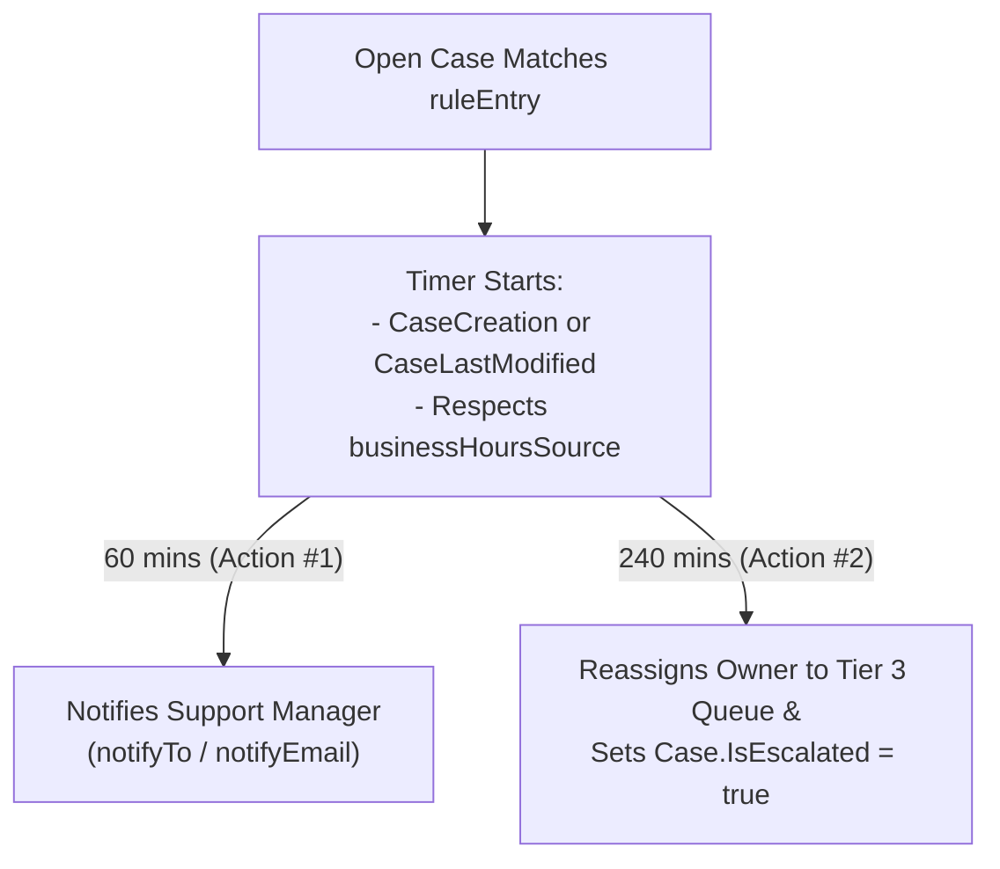

The `EscalationRules` metadata type automates time-based escalation for unresolved **Case** records. Introduced in API version 27.0, `EscalationRules` evaluates `<ruleEntry>` blocks in top-to-bottom order and schedules one or more time-delayed `<escalationAction>` timers (`minutesToEscalation`) measured against either a 24/7 clock or your organization's `BusinessHours` calendar.

In Salesforce DX projects, case escalation rules are stored in `force-app/main/default/escalationRules/Case.escalationRules-meta.xml`.



## Key Fields on `RuleEntry` and `EscalationAction`

| Field | Location | Required | Description |
|---|---|---|---|
| `fullName` | `escalationRule` | Yes | Name of the escalation rule |
| `active` | `escalationRule` | No | Whether this escalation rule is active (only 1 active rule on `Case` at a time) |
| `businessHoursSource` | `ruleEntry` | No | `None` (24/7), `Case` (uses `Case.BusinessHoursId`), or `Static` (uses `businessHours` field) |
| `businessHours` | `ruleEntry` | Conditional | Name of the `BusinessHours` record when `businessHoursSource` is `Static` |
| `escalationStartTime` | `ruleEntry` | No | `CaseCreation` or `CaseLastModified` |
| `disableEscalationWhenModified` | `ruleEntry` | No | Stops the escalation timer after the first modification |
| `minutesToEscalation` | `escalationAction` | No | Time until escalation in 30-minute increments (`30`, `60`, `120`, `240`, etc.) |
| `assignedTo` | `escalationAction` | No | Target `Queue` developer name or `User` username |
| `assignedToType` | `escalationAction` | No | `Queue` or `User` |
| `assignedToTemplate` | `escalationAction` | No | Classic Email Template sent to the newly assigned owner |
| `notifyCaseOwner` | `escalationAction` | No | Sends an alert to the current `Case.OwnerId` when escalated |
| `notifyEmail` | `escalationAction` | No | Up to 5 external or distribution list email addresses to notify |

## Production-Grade XML Example (`Case.escalationRules-meta.xml`)

Below is an escalation rule (`force-app/main/default/escalationRules/Case.escalationRules-meta.xml`) that respects the `Case` record's Business Hours and executes a two-stage escalation at 60 minutes and 240 minutes:

```xml
<?xml version="1.0" encoding="UTF-8"?>
<EscalationRules xmlns="http://soap.sforce.com/2006/04/metadata">
    <escalationRule>
        <fullName>Enterprise_SLA_Escalation</fullName>
        <active>true</active>
        <ruleEntry>
            <businessHoursSource>Case</businessHoursSource>
            <criteriaItems>
                <field>Case.Priority</field>
                <operation>equals</operation>
                <value>Critical,High</value>
            </criteriaItems>
            <criteriaItems>
                <field>Case.IsClosed</field>
                <operation>equals</operation>
                <value>False</value>
            </criteriaItems>
            <disableEscalationWhenModified>false</disableEscalationWhenModified>
            <escalationAction>
                <minutesToEscalation>60</minutesToEscalation>
                <notifyCaseOwner>true</notifyCaseOwner>
                <notifyEmail>incident-command@example.com</notifyEmail>
                <notifyToTemplate>Support_Templates/SLA_Warning_60_Min</notifyToTemplate>
            </escalationAction>
            <escalationAction>
                <assignedTo>Tier_3_Engineering_Queue</assignedTo>
                <assignedToTemplate>Support_Templates/Case_Escalated_To_Tier_3</assignedToTemplate>
                <assignedToType>Queue</assignedToType>
                <minutesToEscalation>240</minutesToEscalation>
                <notifyCaseOwner>true</notifyCaseOwner>
            </escalationAction>
            <escalationStartTime>CaseCreation</escalationStartTime>
        </ruleEntry>
    </escalationRule>
</EscalationRules>
```

> [!TIP]
> **Escalation Rules vs. Entitlement Processes (Milestones)**: Use `EscalationRules` when you need straightforward time-based owner reassignment and email alerts based on Case fields. If you require pause/resume SLA timers, repeating violation milestones, or per-Account contract entitlements, use `EntitlementProcess` and `MilestoneType` instead.

