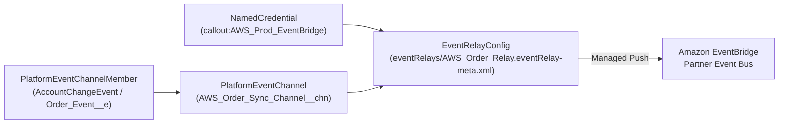

## Why the `EventRelayConfig` Metadata Type Eliminates Custom CometD/PubSub Middleware

Traditionally, streaming Salesforce **Platform Events** and **Change Data Capture (CDC)** events into AWS required building, hosting, and monitoring stateful Pub/Sub API (gRPC) or CometD subscriber workers on ECS/Lambda to track `ReplayId` checkpoints.

Introduced in API v56.0, **`EventRelayConfig`** (`eventRelays/<Name>.eventRelay-meta.xml`) provides a **100% managed, serverless event bridge** managed by Salesforce. Salesforce pushes every event on your custom [PlatformEventChannel](/docs/metadata/platform-event-channel-metadata-type/) directly into an **Amazon EventBridge Partner Event Bus**, handling replay checkpoints and error recovery automatically.



---

## Key Metadata Fields on `EventRelayConfig`

| Field | Type | Required | Description |
|---|---|---|---|
| `eventChannel` | `string` | Yes | Developer name of the custom [PlatformEventChannel](/docs/metadata/platform-event-channel-metadata-type/) (e.g., `AWS_Sync_Channel__chn`). Cannot be changed after creation! |
| `destinationResourceName` | `string` | Yes | Reference to the AWS [NamedCredential](/docs/metadata/named-credential-metadata-type/) prefixed with `callout:` (e.g., `callout:AWS_Account_US_East_1`). Cannot be changed after creation! |
| `label` | `string` | No | Meaningful UI label displayed in Setup Event Relays. |
| `state` | `EventRelayAdminState` | No | `STOP` (required on initial creation), `RUN` (actively relaying events), or `PAUSE` (paused while preserving replay state). |
| `relayOption` | `string` | No | Escaped JSON string configuring replay recovery: `{"ReplayRecovery":"LATEST"}` or `{"ReplayRecovery":"EARLIEST"}`. |

---

## Real-World XML Example (`eventRelays/AWS_ERP_Sync_Relay.eventRelay-meta.xml`)

```xml
<?xml version="1.0" encoding="UTF-8"?>
<EventRelayConfig xmlns="http://soap.sforce.com/2006/04/metadata">
    <destinationResourceName>callout:AWS_EventBridge_US_East_1</destinationResourceName>
    <eventChannel>AWS_ERP_Sync_Channel__chn</eventChannel>
    <label>AWS ERP Sync Relay</label>
    <relayOption>{&quot;ReplayRecovery&quot;:&quot;EARLIEST&quot;}</relayOption>
    <state>STOP</state>
</EventRelayConfig>
```

---

## Monitoring `EventRelayConfig` & `EventRelayFeedback` via SOQL

In Production, you can monitor the live operational state, AWS Partner Event Source name, and last relayed timestamp by querying **`EventRelayFeedback`** in standard SOQL:

```sql
SELECT Id, EventRelayConfigId, EventRelayConfig.DeveloperName,
       Status, RemoteResource, LastRelayedEventTime,
       ErrorCode, ErrorMessage, ErrorTime
FROM EventRelayFeedback
ORDER BY LastRelayedEventTime DESC
```

---

## Senior Architect Two-Step Deployment Pattern

> [!WARNING]
> **Why Deploying `<state>RUN</state>` Fails on First Deploy:** Salesforce does not allow creating a brand-new `EventRelayConfig` with `<state>RUN</state>`. Follow this two-step deployment sequence:
> 1. Deploy the `NamedCredential`, `PlatformEventChannel`, `PlatformEventChannelMember`, and `EventRelayConfig` with `<state>STOP</state>`.
> 2. Activate the Partner Event Source in your AWS EventBridge console (matching the `RemoteResource` returned in `EventRelayFeedback`), then update `<state>RUN</state>`!

