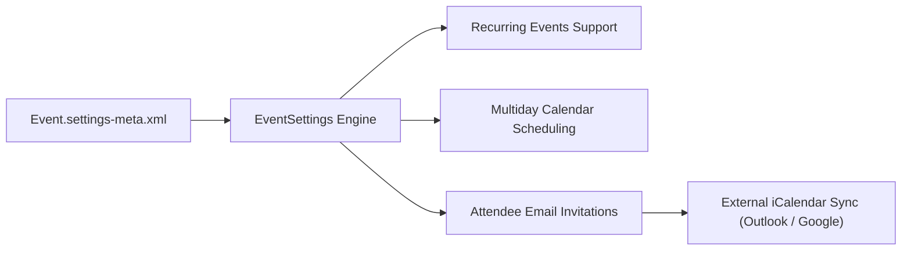

## Architectural Overview

`EventSettings` is a core settings metadata type that configures calendar management, scheduling automation, and meeting collaboration across Salesforce. In sales and service operations, events bridge CRM records with real-world customer touchpoints.

This metadata type controls global calendar behaviors—such as enabling recurring events, permitting multiday calendar entries, and determining whether Salesforce sends iCalendar meeting invites when users schedule appointments with Contacts or Leads. Managing these settings in source code ensures parity between developer environments, sandboxes, and production orgs.



## Directory and File Conventions

`EventSettings` belongs to the `Settings` metadata category and is stored within the `settings` directory using the member name `Event`.

| Property | Value |
| :--- | :--- |
| **Metadata Type Name** | `Settings` (member: `Event`) / `EventSettings` |
| **SFDX Folder** | `force-app/main/default/settings/` |
| **File Name** | `Event.settings-meta.xml` |
| **Scratch Org Key** | `eventSettings` |

## Key Metadata Fields

The `EventSettings` XML schema defines configuration toggles for calendar scheduling:

| Field Name | Field Type | Required | Architectural Description |
| :--- | :--- | :--- | :--- |
| `enableDeleteMultiDayEvents` | `boolean` | No | Allows users to delete individual or series instances of multiday events. |
| `enableEventAttendeeInvitations` | `boolean` | No | Enables sending email invitations to internal attendees and external participants. |
| `enableMultidayEvents` | `boolean` | No | Enables calendar scheduling across multiple continuous calendar days. |
| `enableRecurringEvents` | `boolean` | No | Activates recurring event series generation in Lightning and Classic views. |

> [!NOTE]
> Disabling recurring events while existing recurring series exist will prevent users from editing the recurrence rules without altering historical single occurrences.

## Declarative XML and Package Manifest Examples

Below is a declarative XML definition configuring calendar scheduling capabilities:

```xml title="force-app/main/default/settings/Event.settings-meta.xml"
<?xml version="1.0" encoding="UTF-8"?>
<EventSettings xmlns="http://soap.sforce.com/2006/04/metadata">
    <enableDeleteMultiDayEvents>true</enableDeleteMultiDayEvents>
    <enableEventAttendeeInvitations>true</enableEventAttendeeInvitations>
    <enableMultidayEvents>true</enableMultidayEvents>
    <enableRecurringEvents>true</enableRecurringEvents>
</EventSettings>
```

### Manifest Definition (`package.xml`)

```xml title="manifest/package.xml"
<?xml version="1.0" encoding="UTF-8"?>
<Package xmlns="http://soap.sforce.com/2006/04/metadata">
    <types>
        <members>Event</members>
        <name>Settings</name>
    </types>
    <version>68.0</version>
</Package>
```

## CLI Retrieval and Deployment Commands

Retrieve and deploy with `sf` CLI commands:

```bash
# Retrieve Event settings
sf project retrieve start --metadata Settings:Event

# Deploy Event settings
sf project deploy start --metadata Settings:Event
```

## Architect Best Practices and Gotchas

- **Invitation Deliverability:** When `enableEventAttendeeInvitations` is set to `true`, ensure Salesforce Email Deliverability is configured to "All Email" in sandboxes, or calendar invitations will be suppressed.
- **Integration Interactions:** If your organization uses Einstein Activity Capture or third-party sync engines (such as Riva or Groove), align `enableRecurringEvents` with your integration engine capabilities to avoid duplicate meeting artifacts.
- **Page Layout Dependencies:** When enabling recurring events, verify that the `IsRecurrence` and recurrence frequency fields are exposed on Event [Layout](/docs/metadata/layout-metadata-type/) definitions.

> [!TIP]
> Include `eventSettings: { "enableRecurringEvents": true, "enableMultidayEvents": true }` in scratch org definitions to ensure calendar test scripts pass in automated CI/CD runs.
