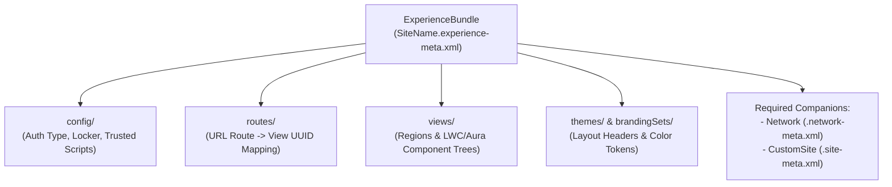

The `ExperienceBundle` metadata type represents a human-readable, text-based JSON decomposition of an **Experience Builder site** (Aura and non-enhanced LWR sites). Introduced in API version 46.0 to replace the opaque binary `SiteDotCom` blob, `ExperienceBundle` lets developers inspect, diff, code-review, and merge community pages (`views`), URL `routes`, `themes`, `brandingSets`, and `config` files directly in Git.

## SFDX Directory Structure

When retrieved into a Salesforce DX project, each site is unpacked under `force-app/main/default/experiences/<Site_Name>/`:

```text
force-app/main/default/experiences/
├── Customer_Support_Portal.experience-meta.xml
└── Customer_Support_Portal/
    ├── brandingSets/
    │   └── customerService.json
    ├── config/
    │   ├── customerSupportPortal.json
    │   ├── languages.json
    │   ├── loginAppPage.json
    │   └── mainAppPage.json
    ├── routes/
    │   ├── home.json
    │   ├── login.json
    │   └── caseDetail.json
    ├── themes/
    │   └── customerService.json
    ├── variations/
    └── views/
        ├── home.json
        ├── login.json
        └── caseDetail.json
```



## Key Subfolders and JSON Responsibilities

| Subfolder | Contents | Architectural Role |
|---|---|---|
| `config/` | `<sitename>.json`, `mainAppPage.json`, `loginAppPage.json` | Controls guest access (`isAvailableToGuests` / `authenticationType`), Locker Service, `<head>` markup, and `trustedSitesForScript` |
| `routes/` | `<route_name>.json` | Maps a relative `urlPrefix` and `routeType` to a target `activeViewId` (UUID in `views/`) and `appPageId` |
| `views/` | `<view_name>.json` | Defines the page regions (`header`, `content`, `footer`) and component instances with their attribute maps |
| `themes/` | `<theme_name>.json` | Defines theme layout structures (Login, Home, Service Not Available) and header/footer properties |
| `brandingSets/` | `<brand_name>.json` | Stores CSS color tokens (`ActionColor`, `LinkColor`, `PrimaryFont`, `HeaderBackgroundColor`) |
| `variations/` | `<variation_name>.json` | Stores audience targeting rules linking a `route` to alternate `views` |

## Production-Grade XML and JSON Examples

### 1. Bundle Metadata File (`Customer_Support_Portal.experience-meta.xml`)

```xml
<?xml version="1.0" encoding="UTF-8"?>
<ExperienceBundle xmlns="http://soap.sforce.com/2006/04/metadata">
    <label>Customer Support Portal</label>
    <type>ChatterNetworkPicasso</type>
    <urlPathPrefix>support/s</urlPathPrefix>
</ExperienceBundle>
```

### 2. Route Definition (`Customer_Support_Portal/routes/home.json`)

```json
{
  "activeViewId": "9a7d2b40-1122-4c33-8899-aabbccddeeff",
  "appPageId": "df9907cb-6e68-4ca1-8bb2-51173ca5374e",
  "configurationTags": [],
  "id": "11223344-5566-7788-99aa-bbccddeeff00",
  "label": "Home",
  "pageAccess": "UseParent",
  "routeType": "home",
  "type": "route",
  "urlPrefix": ""
}
```

> [!WARNING]
> **Always Publish the Site After Deploying `ExperienceBundle`**: Deploying an `ExperienceBundle` updates the site's draft configuration in Experience Builder, but your live external users will **not** see the changes until the site is published. Automate site publication in your CI/CD post-deploy pipeline by running `sf community publish --name "Customer Support Portal"`.
