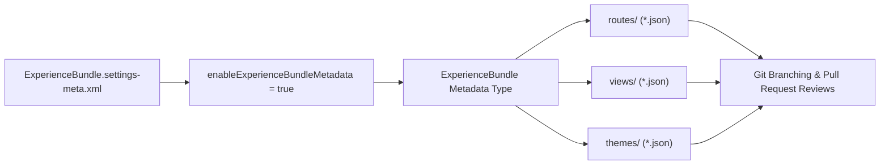

## Architectural Overview

`ExperienceBundleSettings` is a mission-critical settings metadata type for enterprise Salesforce DevOps. Historically, Experience Cloud sites (formerly Community Cloud) were packaged as opaque binary `.site` and `SiteDotCom` files that could neither be inspected nor cleanly merged in Git version control systems.

Enabling `enableExperienceBundleMetadata` instructs the Metadata API to serialize Experience Cloud sites as `ExperienceBundle` structures. This breaks down an entire digital experience into discrete, human-readable JSON artifacts representing routes, views, themes, branding sets, and component configurations—finally bringing modern CI/CD practices to digital community development.



## Directory and File Conventions

`ExperienceBundleSettings` is managed under the `Settings` metadata family in SFDX projects.

| Property | Value |
| :--- | :--- |
| **Metadata Type Name** | `Settings` (member: `ExperienceBundle`) / `ExperienceBundleSettings` |
| **SFDX Folder** | `force-app/main/default/settings/` |
| **File Name** | `ExperienceBundle.settings-meta.xml` |
| **Scratch Org Setting** | `experienceBundleSettings` |

## Key Metadata Fields

The `ExperienceBundleSettings` schema contains the primary activation switch:

| Field Name | Field Type | Required | Architectural Description |
| :--- | :--- | :--- | :--- |
| `enableExperienceBundleMetadata` | `boolean` | Yes | Enables retrieval and deployment of Experience Cloud sites in `ExperienceBundle` format. |

> [!NOTE]
> Once enabled in an org, retrieving `ExperienceBundle` returns structured directories for each digital experience rather than binary site files.

## Declarative XML and Package Manifest Examples

Below is the standard `ExperienceBundle.settings-meta.xml` configuration file:

```xml title="force-app/main/default/settings/ExperienceBundle.settings-meta.xml"
<?xml version="1.0" encoding="UTF-8"?>
<ExperienceBundleSettings xmlns="http://soap.sforce.com/2006/04/metadata">
    <enableExperienceBundleMetadata>true</enableExperienceBundleMetadata>
</ExperienceBundleSettings>
```

### Manifest Definition (`package.xml`)

```xml title="manifest/package.xml"
<?xml version="1.0" encoding="UTF-8"?>
<Package xmlns="http://soap.sforce.com/2006/04/metadata">
    <types>
        <members>ExperienceBundle</members>
        <name>Settings</name>
    </types>
    <version>68.0</version>
</Package>
```

## CLI Retrieval and Deployment Commands

Retrieve and deploy with `sf` CLI commands:

```bash
# Retrieve ExperienceBundle settings
sf project retrieve start --metadata Settings:ExperienceBundle

# Deploy ExperienceBundle settings to target org
sf project deploy start --metadata Settings:ExperienceBundle
```

## Architect Best Practices and Gotchas

- **Deploy Settings First:** In CI/CD pipelines deploying into newly spun-up scratch orgs or sandboxes, ensure `Settings:ExperienceBundle` is deployed before attempting to deploy any `ExperienceBundle` or `CustomSite` metadata.
- **Scratch Org Definitions:** Always declare `"experienceBundleSettings": { "enableExperienceBundleMetadata": true }` within your `project-scratch-def.json` files to avoid retrieval discrepancies.
- **Site Publishing Discipline:** Deploying an `ExperienceBundle` updates the draft version of the site in Experience Builder. Programmatic or manual site publishing is still required to make changes live for external guest users.

> [!TIP]
> Pair `ExperienceBundle` deployments with automated post-deploy scripts using Salesforce CLI (`sf community publish`) to ensure production changes go live immediately upon build completion.
