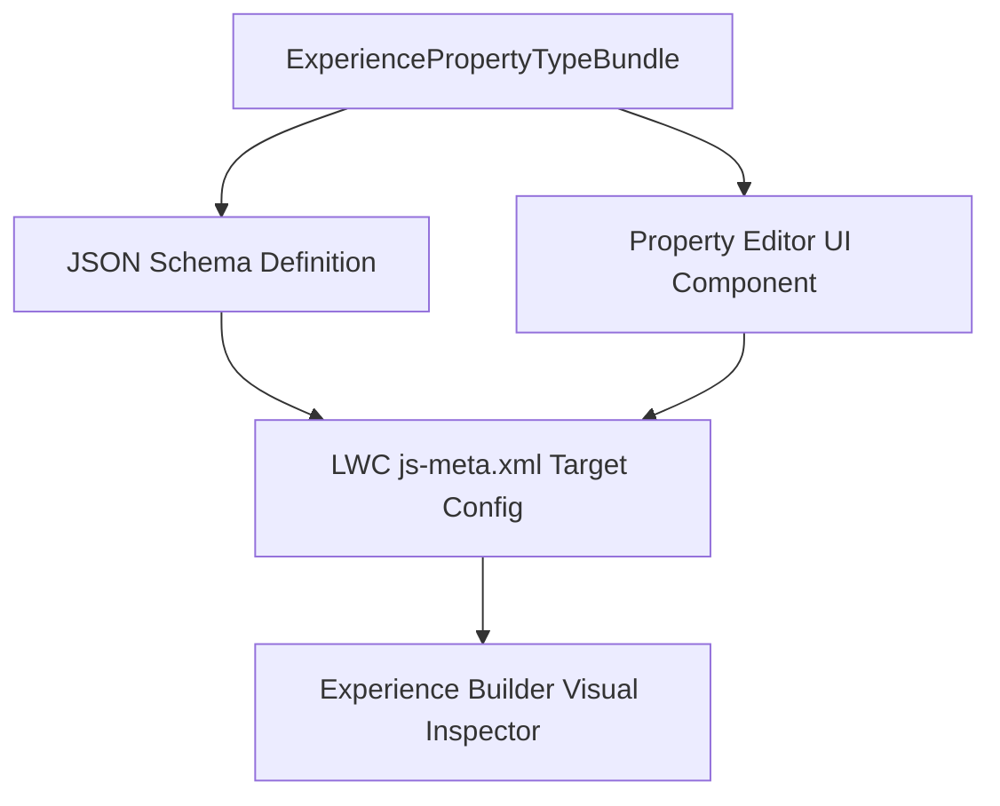

## Architectural Overview

`ExperiencePropertyTypeBundle` is an advanced metadata component introduced for Lightning Web Runtime (LWR) sites in Experience Cloud. In enterprise design systems, custom Lightning Web Components (LWCs) often require complex property inputs—such as nested JSON data, color pickers, responsive breakpoints, or dynamic query bindings—that exceed the capabilities of standard primitive property types (`String`, `Integer`, `Boolean`).

By packaging a property type declaration alongside a JSON schema, `ExperiencePropertyTypeBundle` allows architects to build standardized, strongly-typed configuration contracts. Experience Builder authors can then interact with intuitive, validated property editors without writing raw JSON or code.



## Directory and File Conventions

`ExperiencePropertyTypeBundle` items are stored inside the `experiencePropertyTypeBundles` directory within an SFDX repository.

| Property | Value |
| :--- | :--- |
| **Metadata Type Name** | `ExperiencePropertyTypeBundle` |
| **SFDX Folder** | `force-app/main/default/experiencePropertyTypeBundles/` |
| **File Suffix** | `.experiencePropertyTypeBundle-meta.xml` |
| **API Support** | Metadata API, Tooling API |

## Key Metadata Fields

The `ExperiencePropertyTypeBundle` metadata schema exposes the definition and validation schema:

| Field Name | Field Type | Required | Architectural Description |
| :--- | :--- | :--- | :--- |
| `masterLabel` | `string` | Yes | Human-readable label for the property type displayed in builder palettes. |
| `description` | `string` | No | Architectural description of the data contract and supported visual editors. |
| `declaration` | `string` | Yes | Type declaration identifier used in component metadata files. |
| `schema` | `string` | Yes | JSON Schema draft validating input properties assigned to the component. |

> [!NOTE]
> Custom property type bundles are supported primarily in enhanced LWR sites and custom component property editors.

## Declarative XML and Package Manifest Examples

Below is a declarative XML definition specifying a custom card styling property type:

```xml title="force-app/main/default/experiencePropertyTypeBundles/CardStyleBundle.experiencePropertyTypeBundle-meta.xml"
<?xml version="1.0" encoding="UTF-8"?>
<ExperiencePropertyTypeBundle xmlns="http://soap.sforce.com/2006/04/metadata">
    <declaration>c/cardStyle</declaration>
    <description>Custom styling properties for branded portal cards.</description>
    <masterLabel>Card Style Properties</masterLabel>
    <schema>{"type":"object","properties":{"borderWidth":{"type":"integer"},"accentColor":{"type":"string"}}}</schema>
</ExperiencePropertyTypeBundle>
```

### Manifest Definition (`package.xml`)

```xml title="manifest/package.xml"
<?xml version="1.0" encoding="UTF-8"?>
<Package xmlns="http://soap.sforce.com/2006/04/metadata">
    <types>
        <members>CardStyleBundle</members>
        <name>ExperiencePropertyTypeBundle</name>
    </types>
    <version>68.0</version>
</Package>
```

## CLI Retrieval and Deployment Commands

Retrieve and deploy with `sf` CLI commands:

```bash
# Retrieve ExperiencePropertyTypeBundle
sf project retrieve start --metadata ExperiencePropertyTypeBundle:CardStyleBundle

# Deploy ExperiencePropertyTypeBundle
sf project deploy start --metadata ExperiencePropertyTypeBundle:CardStyleBundle
```

## Architect Best Practices and Gotchas

- **Deployment Order:** Deploy `ExperiencePropertyTypeBundle` before deploying any custom Lightning Web Components that declare `propertyType` dependencies in their `js-meta.xml` files.
- **Strict Schema Validation:** Ensure that your JSON Schema adheres to standard JSON Schema specifications (Draft 7). Malformed schemas will reject deployment or crash the Experience Builder inspector pane.
- **Backward Compatibility:** Once an `ExperiencePropertyTypeBundle` is adopted by components deployed across multiple sites, avoid removing properties from the schema to prevent breaking existing site instances.

> [!TIP]
> Version custom property schemas alongside shared design system LWCs in a core UI package to maintain consistency across multiple Experience Cloud sites.
