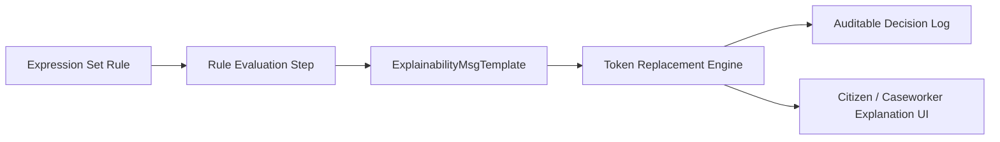

## Architectural Overview

`ExplainabilityMsgTemplate` is an essential metadata type within the Salesforce Business Rules Engine (BRE) and Explainability Service. In regulated enterprise environments—such as public sector citizen benefits, insurance underwriting, mortgage approvals, and grant disbursements—algorithms that determine eligibility or award amounts must legally provide clear, transparent rationales.

`ExplainabilityMsgTemplate` allows architects to define standardized explanation strings with dynamic tokens that explain why a specific rule fired, passed, or failed. When an Expression Set runs, the engine attaches these generated explanations to the audit log or surfaces them directly in public citizen portals and caseworker consoles.



## Directory and File Conventions

`ExplainabilityMsgTemplate` items are stored under the `explainabilityMsgTemplates` folder in standard SFDX project structures.

| Property | Value |
| :--- | :--- |
| **Metadata Type Name** | `ExplainabilityMsgTemplate` |
| **SFDX Folder** | `force-app/main/default/explainabilityMsgTemplates/` |
| **File Suffix** | `.explainabilityMsgTemplate-meta.xml` |
| **API Support** | Metadata API, Tooling API |

## Key Metadata Fields

The `ExplainabilityMsgTemplate` metadata schema outlines the message format and status:

| Field Name | Field Type | Required | Architectural Description |
| :--- | :--- | :--- | :--- |
| `name` | `string` | Yes | DeveloperName and unique identifier of the explanation template. |
| `masterLabel` | `string` | Yes | Human-readable title displayed in the Business Rules Engine designer. |
| `message` | `string` | Yes | Text string containing the explanation narrative with merge token placeholders. |
| `status` | `string` (Picklist) | Yes | Deployment status: `Draft`, `Active`, or `Archived`. |

> [!NOTE]
> The message string can embed Expression Set tokens (`%tokenName%`) that are dynamically populated from ExpressionSetMessageToken metadata at runtime.

## Declarative XML and Package Manifest Examples

Below is a declarative XML definition of an eligibility determination explanation template:

```xml title="force-app/main/default/explainabilityMsgTemplates/Benefit_Eligibility_Pass.explainabilityMsgTemplate-meta.xml"
<?xml version="1.0" encoding="UTF-8"?>
<ExplainabilityMsgTemplate xmlns="http://soap.sforce.com/2006/04/metadata">
    <masterLabel>Benefit Eligibility Pass</masterLabel>
    <message>Applicant meets all criteria: household income is within threshold limits.</message>
    <name>Benefit_Eligibility_Pass</name>
    <status>Active</status>
</ExplainabilityMsgTemplate>
```

### Manifest Definition (`package.xml`)

```xml title="manifest/package.xml"
<?xml version="1.0" encoding="UTF-8"?>
<Package xmlns="http://soap.sforce.com/2006/04/metadata">
    <types>
        <members>Benefit_Eligibility_Pass</members>
        <name>ExplainabilityMsgTemplate</name>
    </types>
    <version>68.0</version>
</Package>
```

## CLI Retrieval and Deployment Commands

Retrieve and deploy with `sf` CLI commands:

```bash
# Retrieve explanation message templates
sf project retrieve start --metadata ExplainabilityMsgTemplate:Benefit_Eligibility_Pass

# Deploy explanation message templates
sf project deploy start --metadata ExplainabilityMsgTemplate:Benefit_Eligibility_Pass
```

## Architect Best Practices and Gotchas

- **Deploy Before Expression Sets:** Expression Sets reference explanation message templates during decision step execution. Always deploy `ExplainabilityMsgTemplate` before or in the same manifest as `ExpressionSetDefinition`.
- **Localization and Multilingual Support:** In multi-lingual public sector deployments, align message template keys with Translation Workbench custom labels or OmniStudio translation dictionaries.
- **Audit Compliance:** Maintain immutable template naming conventions in version control so historical compliance logs can be mapped back to exact regulatory text versions.

> [!TIP]
> Keep explanation templates concise and understandable for end users, reserving complex technical debug logs for developer trace flags.
