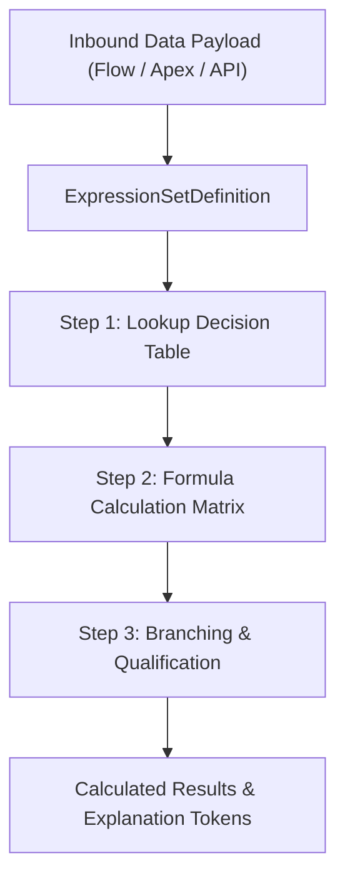

## Architectural Overview

`ExpressionSetDefinition` is the central metadata component of the Salesforce Business Rules Engine (BRE). Commonly deployed in Salesforce Industries—including Public Sector Solutions, Financial Services Cloud, Health Cloud, and Manufacturing Cloud—Expression Sets execute complex numerical calculations, decision matrices, conditional branching, and qualification rules at high throughput.

By replacing hardcoded Apex calculation engines and brittle nested IF statements with declarative Expression Sets, architects empower business analysts to maintain complex rate cards, eligibility formulas, and fee schedules in version control while reducing custom code maintenance overhead.



## Directory and File Conventions

`ExpressionSetDefinition` items reside in the `expressionSetDefinitions` folder within standard SFDX project repositories.

| Property | Value |
| :--- | :--- |
| **Metadata Type Name** | `ExpressionSetDefinition` |
| **SFDX Folder** | `force-app/main/default/expressionSetDefinitions/` |
| **File Suffix** | `.expressionSetDefinition-meta.xml` |
| **API Support** | Metadata API, Tooling API |

## Key Metadata Fields

The `ExpressionSetDefinition` schema defines rule containers and child execution versions:

| Field Name | Field Type | Required | Architectural Description |
| :--- | :--- | :--- | :--- |
| `name` | `string` | Yes | DeveloperName and unique identifier of the Expression Set. |
| `masterLabel` | `string` | Yes | Human-readable title displayed in Business Rules Engine builder. |
| `status` | `string` (Picklist) | Yes | Lifecycle status of the definition container: `Active` or `Draft`. |
| `versions` | `ExpressionSetVersion[]` | Yes | Child array of calculation steps, variables, and decision rules. |

> [!NOTE]
> Expression Sets support versioning. Multiple versions can be deployed, but only one version can be active at a time during execution.

## Declarative XML and Package Manifest Examples

Below is a declarative XML definition of a fee calculation Expression Set:

```xml title="force-app/main/default/expressionSetDefinitions/Permit_Fee_Calculator.expressionSetDefinition-meta.xml"
<?xml version="1.0" encoding="UTF-8"?>
<ExpressionSetDefinition xmlns="http://soap.sforce.com/2006/04/metadata">
    <masterLabel>Permit Fee Calculator</masterLabel>
    <name>Permit_Fee_Calculator</name>
    <status>Active</status>
</ExpressionSetDefinition>
```

### Manifest Definition (`package.xml`)

```xml title="manifest/package.xml"
<?xml version="1.0" encoding="UTF-8"?>
<Package xmlns="http://soap.sforce.com/2006/04/metadata">
    <types>
        <members>Permit_Fee_Calculator</members>
        <name>ExpressionSetDefinition</name>
    </types>
    <version>68.0</version>
</Package>
```

## CLI Retrieval and Deployment Commands

Retrieve and deploy with `sf` CLI commands:

```bash
# Retrieve ExpressionSetDefinition
sf project retrieve start --metadata ExpressionSetDefinition:Permit_Fee_Calculator

# Deploy ExpressionSetDefinition
sf project deploy start --metadata ExpressionSetDefinition:Permit_Fee_Calculator
```

## Architect Best Practices and Gotchas

- **Deploy Dependencies Upstream:** Ensure any `DecisionTable`, `ExpressionSetObjectAlias`, and `ExpressionSetMessageToken` referenced inside the expression steps are deployed before the Expression Set.
- **Deactivate Before Major Structural Edits:** In target production environments, active expression set versions cannot have variables removed. Deploy a new version number (e.g. `Version_2`) in `Draft` status, validate, and activate.
- **Apex and Flow Invocations:** When calling expression sets from [Flow](/docs/metadata/flow-metadata-type/) or [ApexClass](/docs/metadata/apex-class-metadata-type/), verify that the calling user has the `Run Business Rules Engine` permission assigned.

> [!TIP]
> Use Expression Sets to offload high-volume mathematical calculations and multi-tier rate lookups from transaction-bound Apex triggers to optimize CPU governor limits.
