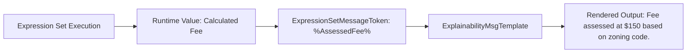

## Architectural Overview

`ExpressionSetMessageToken` manages variable placeholder definitions utilized by the Salesforce Business Rules Engine (BRE) and Explainability Service. When business rules calculate eligibility, tax liability, or risk scores, the engine generates narrative explanation strings that cite specific dynamic inputs—such as applicant age, credit score, or household income.

`ExpressionSetMessageToken` standardizes these dynamic tokens across the enterprise repository. Rather than hardcoding string concatenations inside rules, architects declare message tokens with typed definitions. At runtime, the Expression Set injects calculated runtime values into the tokens embedded inside `ExplainabilityMsgTemplate` components.



## Directory and File Conventions

`ExpressionSetMessageToken` metadata files are placed in the `expressionSetMessageTokens` directory in standard SFDX project repositories.

| Property | Value |
| :--- | :--- |
| **Metadata Type Name** | `ExpressionSetMessageToken` |
| **SFDX Folder** | `force-app/main/default/expressionSetMessageTokens/` |
| **File Suffix** | `.expressionSetMessageToken-meta.xml` |
| **API Support** | Metadata API, Tooling API |

## Key Metadata Fields

The `ExpressionSetMessageToken` metadata schema contains the following primary fields:

| Field Name | Field Type | Required | Architectural Description |
| :--- | :--- | :--- | :--- |
| `name` | `string` | Yes | DeveloperName and unique identifier of the message token. |
| `masterLabel` | `string` | Yes | Human-readable label displayed in the Expression Set builder. |
| `dataType` | `string` (Picklist) | Yes | Data type of the dynamic token: `Text`, `Number`, `Currency`, or `Boolean`. |
| `description` | `string` | No | Architectural description outlining how and where this token is evaluated. |

> [!NOTE]
> The `dataType` must match the data type of the Expression Set variable mapped to the token during rule configuration.

## Declarative XML and Package Manifest Examples

Below is a declarative XML definition of a currency-typed fee message token:

```xml title="force-app/main/default/expressionSetMessageTokens/Assessed_Fee_Token.expressionSetMessageToken-meta.xml"
<?xml version="1.0" encoding="UTF-8"?>
<ExpressionSetMessageToken xmlns="http://soap.sforce.com/2006/04/metadata">
    <dataType>Currency</dataType>
    <description>Token representing total calculated permit assessment fee.</description>
    <masterLabel>Assessed Fee Token</masterLabel>
    <name>Assessed_Fee_Token</name>
</ExpressionSetMessageToken>
```

### Manifest Definition (`package.xml`)

```xml title="manifest/package.xml"
<?xml version="1.0" encoding="UTF-8"?>
<Package xmlns="http://soap.sforce.com/2006/04/metadata">
    <types>
        <members>Assessed_Fee_Token</members>
        <name>ExpressionSetMessageToken</name>
    </types>
    <version>68.0</version>
</Package>
```

## CLI Retrieval and Deployment Commands

Retrieve and deploy with `sf` CLI commands:

```bash
# Retrieve message tokens
sf project retrieve start --metadata ExpressionSetMessageToken:Assessed_Fee_Token

# Deploy message tokens
sf project deploy start --metadata ExpressionSetMessageToken:Assessed_Fee_Token
```

## Architect Best Practices and Gotchas

- **Deployment Sequencing:** Always deploy `ExpressionSetMessageToken` definitions before deploying `ExplainabilityMsgTemplate` and `ExpressionSetDefinition` metadata that depend on them.
- **Type Consistency:** Mismatching token data types (e.g., binding a `Currency` token to a `Text` variable inside an Expression Set) will cause validation errors during rule activation.
- **Naming Conventions:** Adopt explicit naming prefixes (e.g., `Tok_CalculatedAmount`) to differentiate message tokens from internal Expression Set calculation variables.

> [!TIP]
> Centralize all enterprise message tokens in a shared foundation module to allow cross-team reuse between pricing, underwriting, and licensing rule sets.
