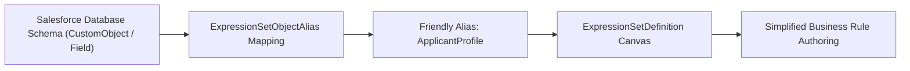

## Architectural Overview

`ExpressionSetObjectAlias` provides an abstraction layer between the underlying Salesforce relational database schema and the rule authoring canvas of the Business Rules Engine (BRE). In complex enterprise schemas, standard and custom SObjects often have cryptic API names, namespace prefixes, and technical custom field names (such as `Billing_Acc_Record_Type_Ext__c`).

By declaring an `ExpressionSetObjectAlias`, architects expose business-friendly object representations (such as `ApplicantAccount` or `PropertyAssessment`) directly to rules designers. When building calculation matrices and decision trees, business users interact with clear, intuitive data labels without risking accidental misconfiguration of technical schema properties.



## Directory and File Conventions

`ExpressionSetObjectAlias` metadata items are saved in the `expressionSetObjectAliases` directory in an SFDX source structure.

| Property | Value |
| :--- | :--- |
| **Metadata Type Name** | `ExpressionSetObjectAlias` |
| **SFDX Folder** | `force-app/main/default/expressionSetObjectAliases/` |
| **File Suffix** | `.expressionSetObjectAlias-meta.xml` |
| **API Support** | Metadata API, Tooling API |

## Key Metadata Fields

The `ExpressionSetObjectAlias` XML schema exposes mapping attributes:

| Field Name | Field Type | Required | Architectural Description |
| :--- | :--- | :--- | :--- |
| `name` | `string` | Yes | DeveloperName and unique identifier of the object alias. |
| `masterLabel` | `string` | Yes | Human-readable alias name presented in the rule builder UI. |
| `dataType` | `string` (Picklist) | Yes | Entity classification, typically `SObject`. |
| `sourceObject` | `string` | Yes | API name of the target database entity (e.g. `Account`, `Custom_Obj__c`). |

> [!NOTE]
> The target `sourceObject` and any mapped fields must exist and be deployed before activating the alias in destination orgs.

## Declarative XML and Package Manifest Examples

Below is a declarative XML definition mapping an account record to an applicant alias:

```xml title="force-app/main/default/expressionSetObjectAliases/Applicant_Account_Alias.expressionSetObjectAlias-meta.xml"
<?xml version="1.0" encoding="UTF-8"?>
<ExpressionSetObjectAlias xmlns="http://soap.sforce.com/2006/04/metadata">
    <dataType>SObject</dataType>
    <masterLabel>Applicant Account</masterLabel>
    <name>Applicant_Account_Alias</name>
    <sourceObject>Account</sourceObject>
</ExpressionSetObjectAlias>
```

### Manifest Definition (`package.xml`)

```xml title="manifest/package.xml"
<?xml version="1.0" encoding="UTF-8"?>
<Package xmlns="http://soap.sforce.com/2006/04/metadata">
    <types>
        <members>Applicant_Account_Alias</members>
        <name>ExpressionSetObjectAlias</name>
    </types>
    <version>68.0</version>
</Package>
```

## CLI Retrieval and Deployment Commands

Retrieve and deploy with `sf` CLI commands:

```bash
# Retrieve object alias metadata
sf project retrieve start --metadata ExpressionSetObjectAlias:Applicant_Account_Alias

# Deploy object alias metadata
sf project deploy start --metadata ExpressionSetObjectAlias:Applicant_Account_Alias
```

## Architect Best Practices and Gotchas

- **Deploy Upstream of Expression Sets:** Any `ExpressionSetDefinition` that references an object alias will fail validation if the alias does not exist. Always deploy aliases first or alongside the expression set.
- **Namespace Handling:** When deploying across packaging orgs and subscriber orgs, ensure managed package prefixes on custom objects are handled cleanly in alias definitions.
- **Field-Level Security:** Using an object alias does not bypass Salesforce field-level security (FLS) or object permissions; running users must still have appropriate schema access.

> [!TIP]
> Group [CustomObject](/docs/metadata/custom-object-metadata-type/) and related [CustomField](/docs/metadata/custom-field-metadata-type/) definitions in the same module as their `ExpressionSetObjectAlias` for cleaner repository boundaries.
