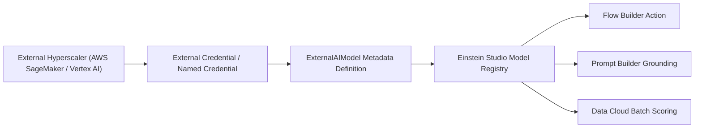

## Architectural Overview

`ExternalAIModel` is a cornerstone metadata type in Salesforce Einstein Studio and Data Cloud AI architectures. It implements the "Bring Your Own Model" (BYOM) pattern, allowing enterprise data science teams to register machine learning models hosted on external hyperscalers—such as Amazon SageMaker, Google Cloud Vertex AI, Databricks, and Microsoft Azure Machine Learning—directly into Salesforce.

Rather than migrating enterprise ML workflows into Salesforce or maintaining custom HTTP callout wrappers in Apex, `ExternalAIModel` standardizes authentication, request signing, schema mapping, and endpoint routing. Once deployed, business users and flow builders can invoke predictions in real-time or run high-throughput batch scoring across Data Cloud unified records.



## Directory and File Conventions

`ExternalAIModel` metadata definitions reside in the `externalAIModels` folder in an SFDX source structure.

| Property | Value |
| :--- | :--- |
| **Metadata Type Name** | `ExternalAIModel` |
| **SFDX Folder** | `force-app/main/default/externalAIModels/` |
| **File Suffix** | `.externalAIModel-meta.xml` |
| **API Support** | Metadata API, Tooling API |

## Key Metadata Fields

The `ExternalAIModel` schema defines model connectivity and runtime parameters:

| Field Name | Field Type | Required | Architectural Description |
| :--- | :--- | :--- | :--- |
| `name` | `string` | Yes | DeveloperName and unique identifier of the registered AI model. |
| `masterLabel` | `string` | Yes | Human-readable name displayed in Einstein Studio model rosters. |
| `modelProvider` | `string` (Picklist) | Yes | External platform provider: `AmazonSageMaker`, `GoogleVertexAI`, or `Databricks`. |
| `modelType` | `string` (Picklist) | Yes | Algorithm nature: `Regression`, `BinaryClassification`, or `Generative`. |
| `status` | `string` (Picklist) | Yes | Activation state: `Active`, `Draft`, or `Disabled`. |

> [!NOTE]
> External AI models require an associated Named Credential or External Credential configured in Salesforce to authenticate outbound inference requests securely.

## Declarative XML and Package Manifest Examples

Below is a declarative XML definition of an Amazon SageMaker churn prediction model:

```xml title="force-app/main/default/externalAIModels/Customer_Churn_SageMaker.externalAIModel-meta.xml"
<?xml version="1.0" encoding="UTF-8"?>
<ExternalAIModel xmlns="http://soap.sforce.com/2006/04/metadata">
    <masterLabel>Customer Churn Predictor</masterLabel>
    <modelProvider>AmazonSageMaker</modelProvider>
    <modelType>BinaryClassification</modelType>
    <name>Customer_Churn_SageMaker</name>
    <status>Active</status>
</ExternalAIModel>
```

### Manifest Definition (`package.xml`)

```xml title="manifest/package.xml"
<?xml version="1.0" encoding="UTF-8"?>
<Package xmlns="http://soap.sforce.com/2006/04/metadata">
    <types>
        <members>Customer_Churn_SageMaker</members>
        <name>ExternalAIModel</name>
    </types>
    <version>68.0</version>
</Package>
```

## CLI Retrieval and Deployment Commands

Retrieve and deploy with `sf` CLI commands:

```bash
# Retrieve external AI model metadata
sf project retrieve start --metadata ExternalAIModel:Customer_Churn_SageMaker

# Deploy external AI model metadata
sf project deploy start --metadata ExternalAIModel:Customer_Churn_SageMaker
```

## Architect Best Practices and Gotchas

- **Security and IAM Handshakes:** Ensure that the AWS IAM role or Google Cloud service account linked via [ConnectedApp](/docs/metadata/connected-app-metadata-type/) or Named Credential has minimal least-privilege permissions restricted only to model inference endpoints.
- **Payload Schema Validation:** Validate that the input tensor format and JSON serialization expected by the external endpoint match the field mappings defined in Einstein Studio.
- **Timeout and Resilience:** External model endpoints must respond within strict platform callout timeout windows (typically under 10 seconds for synchronous Flow actions). For heavier models, use Data Cloud asynchronous batch scoring.

> [!TIP]
> Combine external models with [Flow](/docs/metadata/flow-metadata-type/) orchestrations to automate case escalation or discount approvals based on real-time inference scores.
