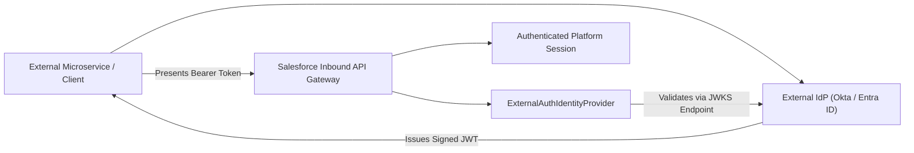

## Architectural Overview

`ExternalAuthIdentityProvider` represents the metadata structure used to register and validate external identity issuers and token authorities in modern Salesforce security architectures. With the introduction of External Client Apps (the next-generation successor to Connected Apps), organizations require flexible, decentralized authentication topologies capable of verifying JSON Web Tokens (JWTs) issued by third-party identity platforms like Okta, Microsoft Entra ID, PingFederate, and AWS Cognito.

By declaring an `ExternalAuthIdentityProvider`, architects configure trusted issuer URLs and JSON Web Key Sets (JWKS) endpoints. This enables external clients, microservices, and API gateways to present externally minted JWT bearer tokens that Salesforce validates cryptographically without requiring intermediate token exchange proxies.



## Directory and File Conventions

`ExternalAuthIdentityProvider` metadata records are stored in the `externalAuthIdentityProviders` folder in standard SFDX source layouts.

| Property | Value |
| :--- | :--- |
| **Metadata Type Name** | `ExternalAuthIdentityProvider` |
| **SFDX Folder** | `force-app/main/default/externalAuthIdentityProviders/` |
| **File Suffix** | `.externalAuthIdentityProvider-meta.xml` |
| **API Support** | Metadata API, Tooling API |

## Key Metadata Fields

The `ExternalAuthIdentityProvider` XML schema captures trusted identity specifications:

| Field Name | Field Type | Required | Architectural Description |
| :--- | :--- | :--- | :--- |
| `name` | `string` | Yes | DeveloperName and unique identifier of the identity provider. |
| `masterLabel` | `string` | Yes | Human-readable title displayed in identity administration settings. |
| `authProviderType` | `string` (Picklist) | Yes | Identity protocol type, such as `OpenIDConnect` or `OAuth2`. |
| `issuerUrl` | `string` | Yes | Canonical issuer URL (`iss` claim) expected within inbound JWT tokens. |
| `jwksUrl` | `string` | Yes | Public JWKS endpoint URL used by Salesforce to retrieve signing keys. |

> [!NOTE]
> The target `issuerUrl` and `jwksUrl` must be reachable over public HTTPS and comply with Salesforce outbound SSL certificate trust standards.

## Declarative XML and Package Manifest Examples

Below is a declarative XML definition of an Okta external authentication identity provider:

```xml title="force-app/main/default/externalAuthIdentityProviders/Okta_Corporate_IdP.externalAuthIdentityProvider-meta.xml"
<?xml version="1.0" encoding="UTF-8"?>
<ExternalAuthIdentityProvider xmlns="http://soap.sforce.com/2006/04/metadata">
    <authProviderType>OpenIDConnect</authProviderType>
    <issuerUrl>https://identity.example.com/oauth2/default</issuerUrl>
    <jwksUrl>https://identity.example.com/oauth2/default/v1/keys</jwksUrl>
    <masterLabel>Okta Corporate IdP</masterLabel>
    <name>Okta_Corporate_IdP</name>
</ExternalAuthIdentityProvider>
```

### Manifest Definition (`package.xml`)

```xml title="manifest/package.xml"
<?xml version="1.0" encoding="UTF-8"?>
<Package xmlns="http://soap.sforce.com/2006/04/metadata">
    <types>
        <members>Okta_Corporate_IdP</members>
        <name>ExternalAuthIdentityProvider</name>
    </types>
    <version>68.0</version>
</Package>
```

## CLI Retrieval and Deployment Commands

Retrieve and deploy with `sf` CLI commands:

```bash
# Retrieve external auth identity provider
sf project retrieve start --metadata ExternalAuthIdentityProvider:Okta_Corporate_IdP

# Deploy external auth identity provider
sf project deploy start --metadata ExternalAuthIdentityProvider:Okta_Corporate_IdP
```

## Architect Best Practices and Gotchas

- **Zero-Trust Token Validation:** Ensure external identity issuers sign tokens using asymmetric algorithms (RS256/ES256) and publish standard JWKS endpoints with regular key rotation.
- **External Client App Binding:** Deploy `ExternalAuthIdentityProvider` prior to deploying External Client App policies that reference external identity verification.
- **Audience Claim Verification:** Ensure that external microservices generate tokens containing the exact audience (`aud`) claim corresponding to your Salesforce organization or Connected App identifier.

> [!TIP]
> Transition legacy integrations using service account passwords or static [ConnectedApp](/docs/metadata/connected-app-metadata-type/) secrets to `ExternalAuthIdentityProvider` with short-lived JWT tokens for hardened security posture.
