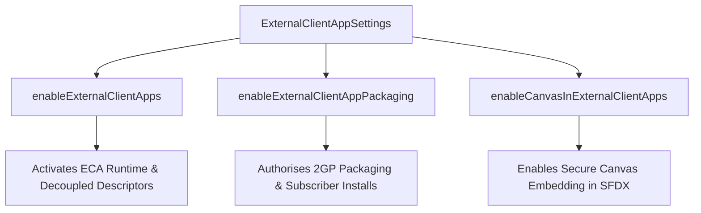

## Architectural Overview

The `ExternalClientAppSettings` metadata type represents the foundational org-level configuration that governs Salesforce External Client Apps (ECA). Historically, connected apps bundled developer secrets, consumer keys, and subscriber administration policies into a single monolithic XML artifact. This legacy design created profound security risks and packaging bottlenecks in enterprise second-generation packaging (2GP) workflows.

External Client Apps decouple developer-controlled integration definitions from subscriber-controlled security policies. `ExternalClientAppSettings` serves as the master switchboard across your enterprise environment. It activates the ECA runtime engine, enables canvas integration hosting, and authorises packaging pipelines to package decoupled ECA metadata descriptors.



Enterprise architects must treat `ExternalClientAppSettings` as an essential deployment prerequisite. In continuous delivery pipelines and ephemeral scratch org pools, any downstream deployment containing External Client App descriptors will fail immediately if the ECA platform subsystem has not been activated at the org level.

## Directory and File Conventions

In Salesforce DX project structures (`apiVersion` 68.0), `ExternalClientAppSettings` resides in the standard `settings` directory under the singular member name `ExternalClientApp`.

| Property | Value |
| :--- | :--- |
| **Metadata Type Name** | `Settings` (member: `ExternalClientApp`) / `ExternalClientAppSettings` |
| **SFDX Folder** | `force-app/main/default/settings/` |
| **File Name** | `ExternalClientApp.settings-meta.xml` |
| **Scratch Org Setting Key** | `externalClientAppSettings` |

## Key Metadata Fields

The `ExternalClientAppSettings` XML schema includes boolean toggles that control the lifecycle and scope of External Client Apps:

| Field Name | Field Type | Required | Architectural Description |
| :--- | :--- | :--- | :--- |
| `enableExternalClientApps` | `boolean` | No | Master flag that activates the External Client Apps runtime engine within the Salesforce tenant. |
| `enableExternalClientAppPackaging` | `boolean` | No | Permits creation, versioning, and distribution of 2GP managed and unlocked packages containing ECA metadata. |
| `enableCanvasInExternalClientApps` | `boolean` | No | Enables third-party web applications to be embedded via the External Client App Canvas framework. |
| `enableExternalClientAppOptIn` | `boolean` | No | Enforces explicit subscriber opt-in verification before third-party external client apps can execute against the org. |

## Declarative XML and Package Manifest Examples

Below is a production-hardened `ExternalClientApp.settings-meta.xml` configuration suitable for packaging pipelines and enterprise production environments:

```xml title="force-app/main/default/settings/ExternalClientApp.settings-meta.xml"
<?xml version="1.0" encoding="UTF-8"?>
<ExternalClientAppSettings xmlns="http://soap.sforce.com/2006/04/metadata">
    <enableCanvasInExternalClientApps>true</enableCanvasInExternalClientApps>
    <enableExternalClientAppPackaging>true</enableExternalClientAppPackaging>
    <enableExternalClientApps>true</enableExternalClientApps>
</ExternalClientAppSettings>
```

### Scratch Org Configuration (`project-scratch-def.json`)

To provision scratch orgs ready for External Client App development, enable the feature in your definition file:

```json title="config/project-scratch-def.json"
{
  "orgName": "External Client App Dev Org",
  "edition": "Developer",
  "features": ["EnablePRM"],
  "settings": {
    "externalClientAppSettings": {
      "enableExternalClientApps": true,
      "enableExternalClientAppPackaging": true,
      "enableCanvasInExternalClientApps": true
    }
  }
}
```

### Manifest Definition (`package.xml`)

```xml title="manifest/package.xml"
<?xml version="1.0" encoding="UTF-8"?>
<Package xmlns="http://soap.sforce.com/2006/04/metadata">
    <types>
        <members>ExternalClientApp</members>
        <name>Settings</name>
    </types>
    <version>68.0</version>
</Package>
```

## CLI Retrieval and Deployment Commands

Manage org-level External Client App settings using the modern Salesforce CLI (`sf`):

```bash
# Retrieve ExternalClientApp settings from the current target org
sf project retrieve start --metadata Settings:ExternalClientApp

# Deploy ExternalClientApp settings to an integration environment
sf project deploy start --metadata Settings:ExternalClientApp

# Preview deployment changes before executing deployment
sf project deploy preview --metadata Settings:ExternalClientApp
```

## Architect Best Practices and Gotchas

- **CI/CD Build Pipeline Sequencing:** Always deploy `ExternalClientApp.settings-meta.xml` in an early foundational pipeline wave. Attempting to deploy individual External Client App components (`ExtlClntAppOauthSettings`, `ExtlClntAppGlobalOauthSettings`) before activating `enableExternalClientApps` will trigger unrecoverable deployment errors.
- **Migration Strategy from Connected Apps:** Do not attempt in-place conversion of mission-critical Connected Apps. Instead, deploy new External Client Apps in parallel, assign test permission sets, validate OAuth token exchanges, and systematically deprecate the legacy Connected App.
- **Packaging Boundaries:** Setting `enableExternalClientAppPackaging` to `true` is mandatory in packaging orgs building second-generation packages (2GP). Without this setting enabled, package version creation commands (`sf package version create`) will fail when validating ECA metadata.

> [!NOTE]
> External Client Apps represent Salesforce's strategic standard for API integrations and canvas applications, replacing legacy Connected Apps for all modern packaging architectures.

> [!WARNING]
> Disabling `enableExternalClientApps` in an org with active external client app connections immediately revokes all OAuth sessions and breaks external system integrations.
