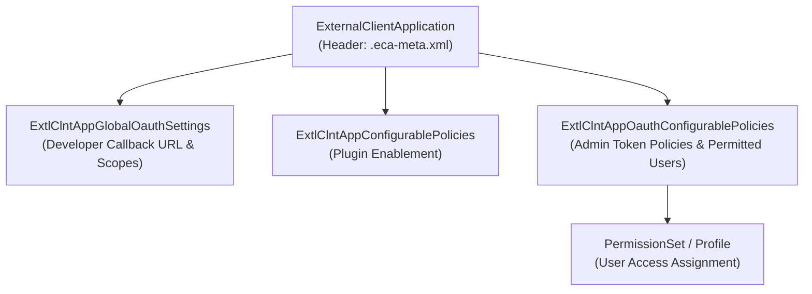

The `ExternalClientApplication` metadata type represents the header configuration of an External Client App—Salesforce's modern, next-generation architecture replacing legacy [ConnectedApp](/docs/metadata/connected-app-metadata-type/) metadata. Introduced in API version 61.0, External Client Apps solve the long-standing packaging, secret rotation, and subscriber policy conflicts of Connected Apps by cleanly separating **developer-owned global settings** from **admin-owned local policies**.

In Salesforce DX projects, `ExternalClientApplication` header files are stored in the `externalClientApps/` directory with the `.eca-meta.xml` suffix (`.eca` in Metadata API zip packages).



## Why ExternalClientApplication Matters to Architects

1. **First-Class 2GP Packaging Support**: Legacy Connected Apps could not be cleanly included in unlocked or managed Second-Generation Packages (2GP) without relying on fragile 1GP bridges. `ExternalClientApplication` is built natively for SFDX and 2GP packaging.
2. **Separation of Concerns**: ISVs and platform teams define immutable OAuth callback URLs and maximum scopes in global settings, while subscriber org administrators independently manage refresh token policies, IP restrictions, and [PermissionSet](/docs/metadata/permission-set-metadata-type/) assignments without causing metadata upgrade conflicts.
3. **Auditable Credential Lifecycle**: Consumer keys and secrets are never exposed in plain-text source control XML files, eliminating accidental credential leaks in Git repositories.

## Directory Structure and Companion Metadata Types

An External Client App is decomposed across multiple specialized metadata types inside the `externalClientApps/` (and corresponding policy/OAuth) directories:

| Metadata Type | File Suffix (SFDX) | Owner / Purpose |
|---|---|---|
| `ExternalClientApplication` | `.eca-meta.xml` | Header file defining contact email, label, `distributionState`, and `orgScopedExternalApp` |
| `ExtlClntAppGlobalOauthSettings` | `.ecaGlblOauth-meta.xml` | Developer-controlled OAuth settings (Callback URL, OAuth scopes, PKCE requirement) |
| `ExtlClntAppConfigurablePolicies` | `.ecaPlcy-meta.xml` | Master policy file enabling OAuth, SAML, or Notification plugins |
| `ExtlClntAppOauthConfigurablePolicies` | `.ecaOauthPlcy-meta.xml` | Admin-controlled OAuth policies (Permitted Users, IP relaxation, refresh token policy) |

## Key Metadata Fields

| Field | Type | Required | Description |
|---|---|---|---|
| `label` | `string` | Yes | User-friendly name displayed in the External Client App Manager |
| `contactEmail` | `string` | Yes | Support or security contact email for the application |
| `distributionState` | `ExtlClntAppDistributionStateValue` | Yes | Set to `Local` (non-distributed, single-org app) or `Packaged` (distributable across orgs) |
| `orgScopedExternalApp` | `string` | Yes | Format `00Dxxxxxxxxxxxx:AppDeveloperName` identifying the authoring org and app name |
| `description` | `string` | No | Architectural purpose and integration owner notes |
| `iconUrl` / `logoUrl` / `infoUrl` | `string` | No | Branding URLs for the app launcher and approval screens |
| `isProtected` | `boolean` | No | Protects the component inside a managed package namespace |

## Production-Grade XML Example

Below is a complete `ExternalClientApplication` header definition (`force-app/main/default/externalClientApps/ERP_Order_Sync_ECA.eca-meta.xml`) configured for multi-org packaging:

```xml
<?xml version="1.0" encoding="UTF-8"?>
<ExternalClientApplication xmlns="http://soap.sforce.com/2006/04/metadata">
    <contactEmail>integration-security@example.com</contactEmail>
    <contactPhone>+1-800-555-0199</contactPhone>
    <description>External Client Application for bidirectional ERP order synchronization via REST API.</description>
    <distributionState>Packaged</distributionState>
    <isProtected>false</isProtected>
    <label>ERP Order Sync ECA</label>
    <orgScopedExternalApp>00Dxx0000001gEREAY:ERP_Order_Sync_ECA</orgScopedExternalApp>
</ExternalClientApplication>
```

> [!WARNING]
> **Matching `orgScopedExternalApp` During Local Deployments**: When deploying an `ExternalClientApplication` with `distributionState` set to `Local` into a brand-new sandbox or scratch org, the `00D...` Organization ID prefix in `orgScopedExternalApp` must match the target org's 15/18-character Org ID if it is not deployed as a `Packaged` artifact. For multi-sandbox CI/CD pipelines, set `distributionState` to `Packaged` so subscriber orgs accept the source org's identifier cleanly.

## Querying External Client Apps with SOQL

You can audit installed and local External Client Applications and their active OAuth policies using SOQL and the Tooling API:

```sql
-- 1. List all External Client Applications in the org (Tooling API)
SELECT Id, DeveloperName, MasterLabel, ContactEmail, DistributionState, NamespacePrefix
FROM ExternalClientApplication
ORDER BY MasterLabel ASC

-- 2. Inspect active OAuth tokens issued to External Client Apps and Connected Apps
SELECT Id, AppName, UserId, UseCount, LastUsedDate, CreatedDate
FROM OauthToken
ORDER BY LastUsedDate DESC
LIMIT 50
```

## Retrieval and Deployment (`package.xml`)

To retrieve both the `ExternalClientApplication` header and its companion OAuth policy types, include all four types in your manifest:

```xml
<?xml version="1.0" encoding="UTF-8"?>
<Package xmlns="http://soap.sforce.com/2006/04/metadata">
    <types>
        <members>ERP_Order_Sync_ECA</members>
        <name>ExternalClientApplication</name>
    </types>
    <types>
        <members>*</members>
        <name>ExtlClntAppGlobalOauthSettings</name>
    </types>
    <types>
        <members>*</members>
        <name>ExtlClntAppConfigurablePolicies</name>
    </types>
    <types>
        <members>*</members>
        <name>ExtlClntAppOauthConfigurablePolicies</name>
    </types>
    <version>68.0</version>
</Package>
```

