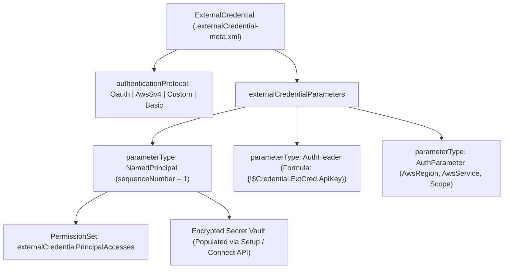

## Overview

The `ExternalCredential` metadata type (`externalCredentials/<Name>.externalCredential-meta.xml`), introduced in API version `56.0`, defines **how** Salesforce authenticates to an external system and **which principals** are permitted to initiate callouts. Linked from one or more [NamedCredential](/docs/metadata/named-credential-metadata-type/) definitions, an `ExternalCredential` separates authentication protocols (`Oauth`, `AwsSv4`, `Custom`, `Basic`, `Jwt`) and principal definitions (`NamedPrincipal`, `PerUserPrincipal`) from endpoint URLs.

Crucially, `ExternalCredential` metadata files in Git contain only **structural configuration** (protocol, AWS region/service, JWT claims, principal names, sequence numbers, and runtime header formulas)—never plaintext API keys or client secrets. Secrets are encrypted at rest inside Salesforce's credential vault and entered post-deployment via Setup or the Connect REST API (`/services/data/v68.0/named-credentials/external-credentials`).



As shown in the diagram above, `ExternalCredential` defines the `authenticationProtocol`, `NamedPrincipal` slots, and `AuthHeader` formula expressions in source control, while actual secret values live in the org's encrypted vault and access is gated by [PermissionSet](/docs/metadata/permission-set-metadata-type/) metadata.

## Prerequisites

- **Permissions:** "Customize Application" to deploy `ExternalCredential` metadata; "Manage Auth. Providers" and "Customize Application" to populate credential secrets in Setup.
- **Permission Set Grant:** Every principal (`NamedPrincipal` or `PerUserPrincipal`) must be enabled in a [PermissionSet](/docs/metadata/permission-set-metadata-type/) (`<externalCredentialPrincipalAccesses>`) or Profile assigned to the running user.
- **API Version:** Introduced in API version 56.0. Verified against API version `68.0` (Winter '27).

## Key `ExternalCredentialParameter` Types

| `parameterType` | Purpose & Required Sibling Fields |
| :--- | :--- |
| `NamedPrincipal` | Creates a shared credential slot (`parameterName` = Principal Name, `sequenceNumber` = priority `1..N`). |
| `PerUserPrincipal` | Creates a per-user credential slot (`parameterName` = Principal Name). |
| `AuthHeader` | Injects a runtime authentication header (`parameterName` = Header Name, `parameterValue` = Formula such as `{!$Credential.Stripe_Auth.SecretKey}`, `sequenceNumber` = header order). |
| `AuthParameter` | Protocol-specific settings such as `AwsRegion`, `AwsService`, `AwsAccountId`, or OAuth `Scope`. |
| `SigningCertificate` | References a certificate in Certificate and Key Management (`certificate` field) for JWT Bearer Flow or AWS STS RolesAnywhere. |
| `AdditionalRefreshStatusCode` | Triggers OAuth token refresh on custom HTTP status codes in addition to `401`. |

> [!TIP]
> When using `authenticationProtocol` = `Custom` (for API keys or custom Bearer tokens), use the `{!$Credential.ExternalCredName.PrincipalKeyName}` merge syntax inside an `AuthHeader` `parameterValue`. This injects the encrypted secret inside Salesforce's outbound HTTP proxy so the secret is never visible in Apex debug logs!

## Querying ExternalCredential via Tooling API

Query `ExternalCredential` and `ExternalCredentialParameter` using the **Tooling API** (`sf data query --use-tooling-api`).

### 1. List All External Credentials and Their Protocols (Tooling API)
```soql
SELECT Id, DeveloperName, MasterLabel, AuthenticationProtocol,
       Description, LastModifiedDate
FROM ExternalCredential
ORDER BY DeveloperName ASC
```

### 2. Inspect Principals, Auth Headers, and Parameters (Tooling API)
```soql
SELECT ExternalCredential.DeveloperName, ParameterName, ParameterType,
       ParameterValue, SequenceNumber, Certificate.DeveloperName
FROM ExternalCredentialParameter
ORDER BY ExternalCredential.DeveloperName ASC, SequenceNumber ASC
```

## Example

The following two examples show:
1. A **Custom Header API Key** `ExternalCredential` (`Stripe_Auth.externalCredential-meta.xml`) that injects a `Bearer {!$Credential.Stripe_Auth.ApiKey}` header.
2. An **AWS Signature Version 4 (`AwsSv4`)** `ExternalCredential` (`AWS_S3_Archive.externalCredential-meta.xml`) for signing S3 requests.

### 1. Custom API Key Bearer Header ExternalCredential
```xml title="force-app/main/default/externalCredentials/Stripe_Auth.externalCredential-meta.xml"
<?xml version="1.0" encoding="UTF-8"?>
<ExternalCredential xmlns="http://soap.sforce.com/2006/04/metadata">
    <authenticationProtocol>Custom</authenticationProtocol>
    <description>Authenticates Stripe API callouts using an encrypted Bearer API key header.</description>
    <externalCredentialParameters>
        <parameterGroup>NamedPrincipal</parameterGroup>
        <parameterName>NamedPrincipal</parameterName>
        <parameterType>NamedPrincipal</parameterType>
        <sequenceNumber>1</sequenceNumber>
    </externalCredentialParameters>
    <externalCredentialParameters>
        <parameterGroup>DefaultGroup</parameterGroup>
        <parameterName>Authorization</parameterName>
        <parameterType>AuthHeader</parameterType>
        <parameterValue>&apos;Bearer &apos; &amp; {!$Credential.Stripe_Auth.ApiKey}</parameterValue>
        <sequenceNumber>1</sequenceNumber>
    </externalCredentialParameters>
    <label>Stripe Auth</label>
</ExternalCredential>
```

### 2. AWS Signature Version 4 (`AwsSv4`) ExternalCredential
```xml title="force-app/main/default/externalCredentials/AWS_S3_Archive.externalCredential-meta.xml"
<?xml version="1.0" encoding="UTF-8"?>
<ExternalCredential xmlns="http://soap.sforce.com/2006/04/metadata">
    <authenticationProtocol>AwsSv4</authenticationProtocol>
    <description>Signs outbound S3 requests in us-east-1 using AWS Signature Version 4.</description>
    <externalCredentialParameters>
        <parameterName>S3ServiceAccount</parameterName>
        <parameterType>NamedPrincipal</parameterType>
        <sequenceNumber>1</sequenceNumber>
    </externalCredentialParameters>
    <externalCredentialParameters>
        <parameterName>AwsService</parameterName>
        <parameterType>AuthParameter</parameterType>
        <parameterValue>s3</parameterValue>
    </externalCredentialParameters>
    <externalCredentialParameters>
        <parameterName>AwsRegion</parameterName>
        <parameterType>AuthParameter</parameterType>
        <parameterValue>us-east-1</parameterValue>
    </externalCredentialParameters>
    <label>AWS S3 Archive</label>
</ExternalCredential>
```

## Limits and Gotchas

- **Post-Deployment Secret Population Required:** After deploying `Stripe_Auth.externalCredential-meta.xml` to a new org, callouts will fail until an administrator opens **Setup → Named Credentials → External Credentials → Stripe Auth**, clicks **New** under **Custom Headers / Principals**, and saves the `ApiKey` secret value.
- **Principal Naming in PermissionSet:** In [PermissionSet](/docs/metadata/permission-set-metadata-type/), the `<externalCredentialPrincipal>` value combines the `ExternalCredential` DeveloperName and the Principal's `parameterName` separated by a hyphen (`Stripe_Auth-NamedPrincipal` or `AWS_S3_Archive-S3ServiceAccount`).
- **`sequenceNumber` Required on `NamedPrincipal`:** Omitting `<sequenceNumber>` on a `NamedPrincipal` parameter causes a deployment error.

## Related Official Documentation

- [ExternalCredential Metadata API Reference](https://developer.salesforce.com/docs/atlas.en-us.api_meta.meta/api_meta/meta_externalcredential.htm): Complete XML specification for `ExternalCredential` and `ExternalCredentialParameter`.
- [Named Credentials Connect REST API](https://developer.salesforce.com/docs/atlas.en-us.chatterapi.meta/chatterapi/connect_resources_named_credentials.htm): Programmatically populating credential secrets after metadata deployment.

