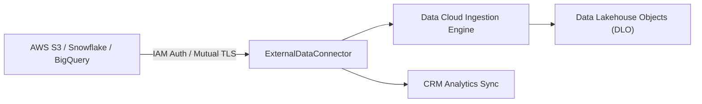

## Architectural Overview

`ExternalDataConnector` metadata represents the infrastructure boundary connecting Salesforce Data Cloud, CRM Analytics, and Salesforce Connect to external storage repositories and relational databases. In modern enterprise lakehouse architectures, ingesting massive datasets or executing zero-copy federated queries requires robust, auditable connectivity definitions.

Rather than storing hardcoded credentials inside batch jobs or custom code, `ExternalDataConnector` decouples connectivity metadata from pipeline logic. It standardises how Salesforce establishes TLS handshakes, authenticates via cloud IAM policies (such as AWS IAM role assumption or Azure Managed Identities), and governs data read throughput.



From an architectural governance perspective, `ExternalDataConnector` assets must be version-controlled and deployed across sandbox tiers before data transformation pipelines (`ExternalDataTranObject`) and data streams can be scheduled.

## Directory and File Conventions

`ExternalDataConnector` files follow standard SFDX directory conventions in the `externalDataConnectors` folder:

| Property | Value |
| :--- | :--- |
| **Metadata Type Name** | `ExternalDataConnector` |
| **SFDX Folder** | `force-app/main/default/externalDataConnectors/` |
| **File Suffix** | `.externalDataConnector-meta.xml` |
| **Packaging Support** | First-Generation and Second-Generation Managed Packages |

## Key Metadata Fields

The `ExternalDataConnector` schema specifies connection protocols, authentication types, and endpoint properties:

| Field Name | Field Type | Required | Architectural Description |
| :--- | :--- | :--- | :--- |
| `developerName` | `string` | Yes | Unique API name identifier for the connector instance. |
| `masterLabel` | `string` | Yes | Human-readable label displayed in Data Cloud and CRM Analytics setups. |
| `connectorType` | `string` | Yes | Target storage protocol (e.g., `S3`, `Snowflake`, `BigQuery`, `AzureBlob`). |
| `authType` | `string` | Yes | Authentication mechanism such as `AwsIamRole`, `NamedCredential`, or `OAuth`. |
| `connectionProperties` | `list` | No | Key-value pairs containing bucket ARNs, database warehouses, regions, or cluster hosts. |
| `description` | `string` | No | Architectural description capturing data ownership and environment tiers. |

## Declarative XML and Package Manifest Examples

Below is a declarative XML definition of an `ExternalDataConnector` linking Salesforce Data Cloud to an enterprise AWS S3 bucket:

```xml title="force-app/main/default/externalDataConnectors/Enterprise_DataLake_S3.externalDataConnector-meta.xml"
<?xml version="1.0" encoding="UTF-8"?>
<ExternalDataConnector xmlns="http://soap.sforce.com/2006/04/metadata">
    <developerName>Enterprise_DataLake_S3</developerName>
    <masterLabel>Enterprise DataLake S3</masterLabel>
    <connectorType>S3</connectorType>
    <authType>AwsIamRole</authType>
    <description>Federated S3 connector for enterprise customer event lakehouse</description>
    <connectionProperties>
        <propertyName>BucketName</propertyName>
        <propertyValue>prod-enterprise-customer-lakehouse</propertyValue>
    </connectionProperties>
    <connectionProperties>
        <propertyName>AwsRegion</propertyName>
        <propertyValue>us-east-1</propertyValue>
    </connectionProperties>
    <connectionProperties>
        <propertyName>RoleArn</propertyName>
        <propertyValue>arn:aws:iam::123456789012:role/SalesforceDataCloudIngestionRole</propertyValue>
    </connectionProperties>
</ExternalDataConnector>
```

### Package Manifest (`package.xml`)

```xml title="manifest/package.xml"
<?xml version="1.0" encoding="UTF-8"?>
<Package xmlns="http://soap.sforce.com/2006/04/metadata">
    <types>
        <members>Enterprise_DataLake_S3</members>
        <name>ExternalDataConnector</name>
    </types>
    <version>68.0</version>
</Package>
```

## CLI Retrieval and Deployment Commands

Retrieve and deploy `ExternalDataConnector` metadata using the Salesforce CLI:

```bash
# Retrieve a specific external data connector
sf project retrieve start --metadata ExternalDataConnector:Enterprise_DataLake_S3

# Deploy all external data connectors to target environment
sf project deploy start --metadata ExternalDataConnector

# Validate connector metadata without committing changes
sf project deploy start --metadata ExternalDataConnector --dry-run
```

## Architect Best Practices and Gotchas

- **Cross-Account Trust Policies:** When configuring AWS IAM Role authentication (`AwsIamRole`), Salesforce generates a dynamic external ID and tenant role ARN during initial connector verification in the UI. Ensure trust policies on the external cloud provider permit access from Salesforce Data Cloud IP ranges.
- **Environment Parity and Endpoint Drift:** Avoid hardcoding production bucket names or staging databases in version-controlled connector metadata. Use SFDX environment variables or token replacement scripts in CI/CD pipelines to swap bucket ARNs across dev, staging, and production orgs.
- **Dependency Hierarchy:** Downstream transformation objects (`ExternalDataTranObject`) and Data Model Objects (DMOs) directly reference `ExternalDataConnector`. If you attempt to delete or rename a connector without migrating downstream objects, deployments will be rejected.

> [!TIP]
> Prefer role-based federation (`AwsIamRole` or Azure Managed Identity) over static API keys to eliminate secret rotation overhead and comply with zero-trust architectural standards.

> [!WARNING]
> Renaming an `ExternalDataConnector` API name is a destructive change that breaks all associated automated ingestion schedules and federated CRM Analytics lenses.
