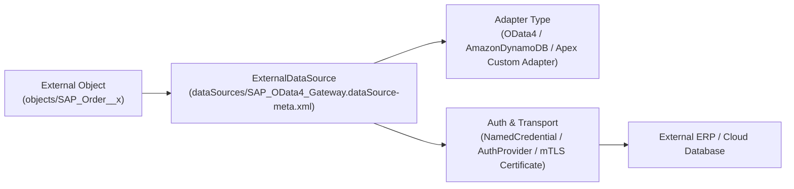

## Why the `ExternalDataSource` Metadata Type Powers Zero-Copy Data Virtualization

When your enterprise stores tens of millions of historical ERP orders, shipping invoices, or IoT telemetry rows in SAP, Snowflake, Amazon DynamoDB, or Amazon Athena, replicating that data into Salesforce storage is expensive and brittle.

**`ExternalDataSource`** (`dataSources/<Name>.dataSource-meta.xml`) configures **Salesforce Connect** so External Objects ([CustomObject](/docs/metadata/custom-object-metadata-type/) ending in `__x`) can query, relate, and optionally update external data in real time on demand.



---

## Key Metadata Fields on `ExternalDataSource`

| Field | Type | Required | Description |
|---|---|---|---|
| `label` | `string` | Yes | Display name of the External Data Source in Setup and List Views. |
| `type` | `ExternalDataSourceType` | Yes | Adapter type: `OData4`, `OData`, `SfdcOrg`, `AmazonDynamoDB`, `AmazonAthena`, `ContentHubSharepointOffice365`, `ContentHubGDrive`, or custom `DataSource.Provider` Apex adapter. |
| `endpoint` | `string` | No | Target URL or `callout:<NamedCredentialName>` URI. |
| `namedCredential` | `string` | No | Developer name of the backing [NamedCredential](/docs/metadata/named-credential-metadata-type/) (used by `AmazonDynamoDB` and `AmazonAthena` adapters). |
| `principalType` | `ExternalPrincipalType` | Yes | `NamedUser`, `PerUser`, `Anonymous`, or `NamedCustomPrincipal`. |
| `protocol` | `AuthenticationProtocol` | Yes | `Oauth`, `Password`, or `NoAuthentication`. |
| `isWritable` | `boolean` | No | Enables DML (`create`, `update`, `delete`) on child `__x` External Objects. Defaults to `false`. |
| `customConfiguration` | `string` | No | JSON configuration string for adapter-specific settings (such as pagination, CSRF protection, search, and timeout seconds). |
| `customHttpHeaders` | `CustomHttpHeader[]` | No | *(API v43.0+)* Formula-driven HTTP headers sent with every OData 2.0/4.0 request. |

---

## Real-World XML Example (`dataSources/SAP_ERP_OData4.dataSource-meta.xml`)

```xml
<?xml version="1.0" encoding="UTF-8"?>
<ExternalDataSource xmlns="http://soap.sforce.com/2006/04/metadata">
    <customConfiguration>{&quot;pagination&quot;:&quot;SERVER&quot;,&quot;compatibility&quot;:&quot;DEFAULT&quot;,&quot;csrfProtection&quot;:false,&quot;timeout&quot;:30,&quot;searchEnabled&quot;:true,&quot;format&quot;:&quot;JSON&quot;}</customConfiguration>
    <customHttpHeaders>
        <description>Passes the logged-in user division to SAP OData gateway</description>
        <headerFieldName>X-SFDC-User-Division</headerFieldName>
        <headerFieldValue>$User.Division</headerFieldValue>
    </customHttpHeaders>
    <endpoint>callout:SAP_S4HANA_OData_NC/sap/opu/odata4/sap/api_sales_order/srvd_a2x</endpoint>
    <isWritable>true</isWritable>
    <label>SAP ERP OData 4.0</label>
    <principalType>NamedUser</principalType>
    <protocol>NoAuthentication</protocol>
    <type>OData4</type>
</ExternalDataSource>
```

---

## Querying `ExternalDataSource` via SOQL

You can audit all configured External Data Sources and their endpoints in standard SOQL:

```sql
SELECT Id, DeveloperName, MasterLabel, Type, Endpoint,
       PrincipalType, Protocol, IsWritable, AuthProvider.DeveloperName,
       LargeIconId, LastModifiedDate
FROM ExternalDataSource
ORDER BY DeveloperName ASC
```

---

## Senior Architect Best Practices

> [!TIP]
> **Delegate Authentication to `callout:<NamedCredential>`:** Notice in the example above that `<endpoint>` uses `callout:SAP_S4HANA_OData_NC/...` while `<protocol>` on the `ExternalDataSource` is set to `NoAuthentication`. This allows the [NamedCredential](/docs/metadata/named-credential-metadata-type/) and [ExternalCredential](/docs/metadata/external-credential-metadata-type/) to handle OAuth 2.0 token refresh, mutual TLS, and per-environment URL switching cleanly without re-authenticating the `ExternalDataSource` after every deployment!

