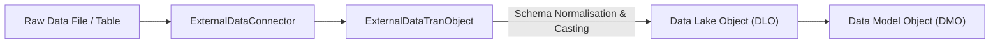

## Architectural Overview

`ExternalDataTranObject` (External Data Transformation / Transfer Object) metadata defines the schema contracts, staging layouts, and transformation mappings applied to datasets ingested through an `ExternalDataConnector`. In big data pipelines, raw data extracted from cloud object storage (e.g., S3 Parquet or Snowflake tables) cannot be mapped directly into business domains without structural validation.

The `ExternalDataTranObject` acts as an intermediary translation layer. It establishes field data types, nullability rules, date-time formats, and field-level transformations before incoming data reaches Data Lake Objects (DLO) or CRM Analytics datasets.



In automated DevOps lifecycles, maintaining `ExternalDataTranObject` definitions under source control guarantees that data pipeline schema changes are versioned, code-reviewed, and synchronized across development, test, and production environments.

## Directory and File Conventions

`ExternalDataTranObject` files are located in the `externalDataTranObjects` directory within your Salesforce DX repository:

| Property | Value |
| :--- | :--- |
| **Metadata Type Name** | `ExternalDataTranObject` |
| **SFDX Folder** | `force-app/main/default/externalDataTranObjects/` |
| **File Suffix** | `.externalDataTranObject-meta.xml` |
| **API Version** | 68.0 |

## Key Metadata Fields

The `ExternalDataTranObject` XML schema contains attributes governing source-to-target entity bindings and data transformation rules:

| Field Name | Field Type | Required | Architectural Description |
| :--- | :--- | :--- | :--- |
| `developerName` | `string` | Yes | Unique programmatic identifier for the transformation object. |
| `masterLabel` | `string` | Yes | UI label for the schema mapping in Data Cloud and CRM Analytics. |
| `externalDataConnector` | `string` | Yes | Foreign key reference to the parent `ExternalDataConnector` API name. |
| `sourceObjectName` | `string` | Yes | Name of the source file, table, or entity in the external cloud system. |
| `targetObjectName` | `string` | No | Target staging object or Data Lake Object receiving the transformed stream. |
| `description` | `string` | No | Architectural documentation describing the schema transform logic. |

## Declarative XML and Package Manifest Examples

Below is a declarative XML definition of an `ExternalDataTranObject` mapping telemetry log events into Salesforce Data Cloud:

```xml title="force-app/main/default/externalDataTranObjects/Telemetry_Events_Tran.externalDataTranObject-meta.xml"
<?xml version="1.0" encoding="UTF-8"?>
<ExternalDataTranObject xmlns="http://soap.sforce.com/2006/04/metadata">
    <developerName>Telemetry_Events_Tran</developerName>
    <masterLabel>Telemetry Events Transformation</masterLabel>
    <externalDataConnector>Enterprise_DataLake_S3</externalDataConnector>
    <sourceObjectName>device_telemetry_stream</sourceObjectName>
    <targetObjectName>Telemetry_Event_DLO</targetObjectName>
    <description>Transforms raw IoT telemetry parquet streams into structured Data Lake Objects</description>
</ExternalDataTranObject>
```

### Package Manifest (`package.xml`)

```xml title="manifest/package.xml"
<?xml version="1.0" encoding="UTF-8"?>
<Package xmlns="http://soap.sforce.com/2006/04/metadata">
    <types>
        <members>Telemetry_Events_Tran</members>
        <name>ExternalDataTranObject</name>
    </types>
    <version>68.0</version>
</Package>
```

## CLI Retrieval and Deployment Commands

Manage `ExternalDataTranObject` metadata through the Salesforce CLI:

```bash
# Retrieve a specific transformation object
sf project retrieve start --metadata ExternalDataTranObject:Telemetry_Events_Tran

# Deploy all transformation objects to target sandbox
sf project deploy start --metadata ExternalDataTranObject

# Validate deployment dependencies before deploying
sf project deploy start --metadata ExternalDataTranObject --dry-run
```

## Architect Best Practices and Gotchas

- **Deployment Order Enforcement:** `ExternalDataTranObject` has a hard runtime dependency on `ExternalDataConnector`. CI/CD automation must validate that the corresponding connector exists in the destination org before attempting to deploy transformation objects.
- **Handling Remote Schema Drift:** If columns in the external database or Parquet schema change (e.g., a field is removed or type-widened), the `ExternalDataTranObject` schema must be updated and deployed concurrently with the external pipeline changes to avoid sync failures.
- **Data Type Casting Considerations:** Ensure date and timestamp formats specified in the transformation object match the ISO 8601 representation used by external source files. Format mismatches result in silent null records or dropped ingestion batches.

> [!NOTE]
> Modifying an `ExternalDataTranObject` schema does not alter historical records already stored in Data Lake Objects; it only affects newly ingested batches.

> [!WARNING]
> Deleting an `ExternalDataTranObject` that is actively referenced by running Data Cloud data streams will cause immediate stream execution failures.
