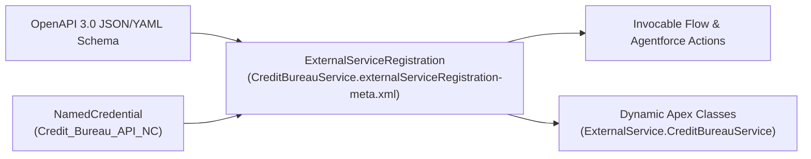

## Why `ExternalServiceRegistration` Bridges OpenAPI, Flow, Agentforce, and Apex

Writing boilerplate `HttpRequest` builders and `JSON.deserialize()` wrapper classes in Apex for every third-party REST endpoint is tedious and difficult to govern. **`ExternalServiceRegistration`** (`externalServiceRegistrations/<Name>.externalServiceRegistration-meta.xml`) ingests a standard **OpenAPI 2.0 (Swagger)** or **OpenAPI 3.0** specification and binds it to a [NamedCredential](/docs/metadata/named-credential-metadata-type/).

Once deployed, the platform automatically generates:
1. **Declarative Invocable Actions** available in **Flow Builder** and **Agentforce** ([GenAiFunction](/docs/metadata/genai-function-metadata-type/)).
2. **Strongly Typed Dynamic `ExternalService.<ServiceName>` Apex Classes** for synchronous and asynchronous Apex callouts.



---

## Key Metadata Fields on `ExternalServiceRegistration`

| Field | Type | Required | Description |
|---|---|---|---|
| `label` | `string` | Yes | Display name of the External Service in Setup. |
| `namedCredentialReference` | `string` | No | *(API v57.0+)* Developer name of the backing [NamedCredential](/docs/metadata/named-credential-metadata-type/) (supersedes legacy `namedCredential`). |
| `schemaType` | `string` | No | `OpenApi` or `OpenApi3`. |
| `schema` | `string` | No | The full OpenAPI 2.0 or 3.0 specification serialized as an XML-escaped JSON or YAML string. |
| `status` | `string` | Yes | `complete` (validates spec and generates actions/classes) or `incomplete`. |
| `operations` | `ExternalServiceOperation[]` | No | Lists individual `operationId` entries from the OpenAPI spec and whether each is `active` (`true`/`false`). |
| `registrationProviderType` | `ExternalServiceRegistrationProviderType` | No | *(API v66.0+)* Source of the spec: `Custom`, `SchemaInferred` (Flow HTTP Callout), `Anypoint`, `MuleSoft`, `Heroku`, `ApexRest`, `AgentToAgent`, etc. |
| `systemVersion` | `int` | No | Read-only internal compiler version (`9` is current, supporting OpenAPI enums, discriminators, and async Apex callbacks). |

---

## Real-World XML Example (`externalServiceRegistrations/StripePaymentService.externalServiceRegistration-meta.xml`)

```xml
<?xml version="1.0" encoding="UTF-8"?>
<ExternalServiceRegistration xmlns="http://soap.sforce.com/2006/04/metadata">
    <description>OpenAPI 3.0 External Service for creating and checking customer payment intents.</description>
    <label>StripePaymentService</label>
    <namedCredentialReference>Stripe_API_Gateway_NC</namedCredentialReference>
    <operations>
        <active>true</active>
        <name>getPaymentStatus</name>
    </operations>
    <registrationProviderType>Custom</registrationProviderType>
    <schema>{&quot;openapi&quot;:&quot;3.0.1&quot;,&quot;info&quot;:{&quot;title&quot;:&quot;Payment API&quot;,&quot;version&quot;:&quot;1.0.0&quot;},&quot;paths&quot;:{&quot;/v1/payments/{paymentId}&quot;:{&quot;get&quot;:{&quot;operationId&quot;:&quot;getPaymentStatus&quot;,&quot;parameters&quot;:[{&quot;name&quot;:&quot;paymentId&quot;,&quot;in&quot;:&quot;path&quot;,&quot;required&quot;:true,&quot;schema&quot;:{&quot;type&quot;:&quot;string&quot;}}],&quot;responses&quot;:{&quot;200&quot;:{&quot;description&quot;:&quot;OK&quot;,&quot;content&quot;:{&quot;application/json&quot;:{&quot;schema&quot;:{&quot;type&quot;:&quot;object&quot;,&quot;properties&quot;:{&quot;status&quot;:{&quot;type&quot;:&quot;string&quot;},&quot;amount&quot;:{&quot;type&quot;:&quot;integer&quot;}}}}}}}}}}}</schema>
    <schemaType>OpenApi3</schemaType>
    <status>Complete</status>
    <systemVersion>9</systemVersion>
</ExternalServiceRegistration>
```

---

## Querying `ExternalServiceRegistration` via Tooling API

```sql
SELECT Id, DeveloperName, MasterLabel, Status, SchemaType,
       SystemVersion, RegistrationProviderType, NamedCredentialReference,
       LastModifiedDate
FROM ExternalServiceRegistration
ORDER BY DeveloperName ASC
```

*(Execute this query against the **Tooling API**.)*

---

## Senior Architect Best Practices & Gotchas

> [!WARNING]
> **Include `ExternalServiceRegistration` When Deploying Flows with HTTP Callouts:** Whenever an admin uses the **Create HTTP Callout** button inside Flow Builder, Salesforce generates both a `Flow` change **and** a new `ExternalServiceRegistration` component. If your CI/CD commit includes only the `Flow` without its `ExternalServiceRegistration` and `NamedCredential`, the Flow deployment will fail with an unresolved invocable action error!
