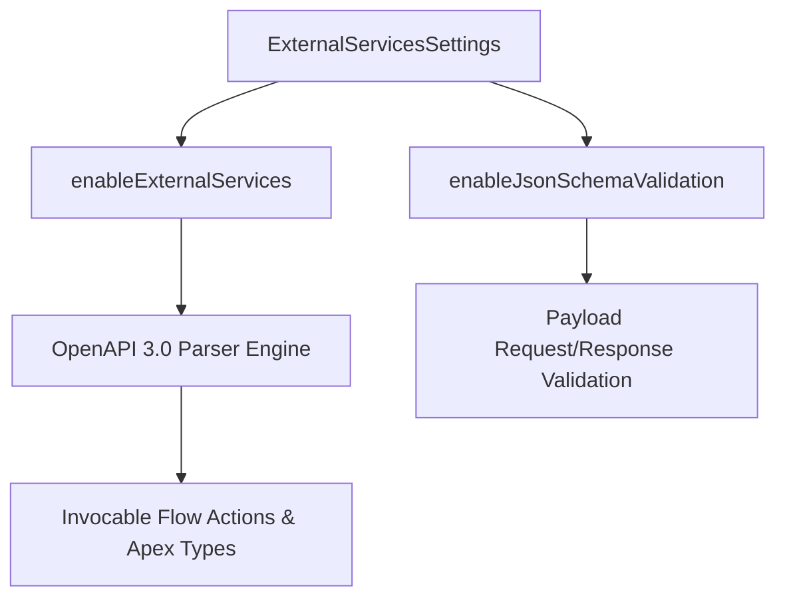

## Architectural Overview

`ExternalServicesSettings` is an org-level configuration metadata type that controls the execution environment for Salesforce External Services. External Services bridges declarative business logic and RESTful microservices by transforming OpenAPI (Swagger 2.0 or OpenAPI 3.0) and JSON Schema specifications into native, invocable Flow actions and Apex-callable classes without requiring custom Apex HTTP callout code.

At an enterprise architectural level, `ExternalServicesSettings` enforces governance over API contract compliance. It activates schema parsing engines, enforces runtime payload validation, and ensures that outbound REST integrations respect Salesforce transactional limits and governor boundaries.



Configuring `ExternalServicesSettings` as part of your core org definition guarantees that scratch orgs and developer sandboxes are immediately capable of compiling Flows and Apex classes that depend on registered External Services.

## Directory and File Conventions

`ExternalServicesSettings` follows the standard Salesforce DX Settings structure:

| Property | Value |
| :--- | :--- |
| **Metadata Type Name** | `Settings` (member: `ExternalServices`) / `ExternalServicesSettings` |
| **SFDX Folder** | `force-app/main/default/settings/` |
| **File Name** | `ExternalServices.settings-meta.xml` |
| **Scratch Org Setting Key** | `externalServicesSettings` |

## Key Metadata Fields

The `ExternalServicesSettings` metadata type exposes administrative flags controlling schema ingestion and validation:

| Field Name | Field Type | Required | Architectural Description |
| :--- | :--- | :--- | :--- |
| `enableExternalServices` | `boolean` | No | Master toggle that enables the Salesforce External Services engine across the tenant. |
| `enableJsonSchemaValidation` | `boolean` | No | Enforces strict JSON Schema validation on outgoing request and incoming response payloads. |
| `enableEnhancedExternalServices` | `boolean` | No | Activates enhanced schema ingestion supporting deeply nested objects, arrays, and polymorphic responses. |

## Declarative XML and Package Manifest Examples

Below is a declarative XML definition of `ExternalServices.settings-meta.xml` configured for an enterprise integration architecture:

```xml title="force-app/main/default/settings/ExternalServices.settings-meta.xml"
<?xml version="1.0" encoding="UTF-8"?>
<ExternalServicesSettings xmlns="http://soap.sforce.com/2006/04/metadata">
    <enableEnhancedExternalServices>true</enableEnhancedExternalServices>
    <enableExternalServices>true</enableExternalServices>
    <enableJsonSchemaValidation>true</enableJsonSchemaValidation>
</ExternalServicesSettings>
```

### Scratch Org Configuration (`project-scratch-def.json`)

```json title="config/project-scratch-def.json"
{
  "orgName": "External Services Dev Scratch Org",
  "edition": "Developer",
  "settings": {
    "externalServicesSettings": {
      "enableExternalServices": true,
      "enableEnhancedExternalServices": true,
      "enableJsonSchemaValidation": true
    }
  }
}
```

### Package Manifest (`package.xml`)

```xml title="manifest/package.xml"
<?xml version="1.0" encoding="UTF-8"?>
<Package xmlns="http://soap.sforce.com/2006/04/metadata">
    <types>
        <members>ExternalServices</members>
        <name>Settings</name>
    </types>
    <version>68.0</version>
</Package>
```

## CLI Retrieval and Deployment Commands

Use the Salesforce CLI to retrieve and deploy `ExternalServicesSettings`:

```bash
# Retrieve External Services settings from the org
sf project retrieve start --metadata Settings:ExternalServices

# Deploy External Services settings to a target environment
sf project deploy start --metadata Settings:ExternalServices

# Deploy settings as part of a foundational CI/CD build wave
sf project deploy start --source-dir force-app/main/default/settings
```

## Architect Best Practices and Gotchas

- **Payload Validation Impacts on Flow Performance:** Enabling `enableJsonSchemaValidation` causes Salesforce to validate complex JSON payloads synchronously against the OpenAPI schema. For high-volume microservice callouts in trigger contexts, benchmark callout latency to ensure response times remain within acceptable thresholds.
- **Prerequisite for Invocable Actions:** If an Apex class or Flow references an external service action (e.g., `ExternalService.PaymentGateway.processPayment`), deploying that code to an org where `enableExternalServices` is false will trigger compile-time missing type errors.
- **Named Credentials Pairing:** External Services depend on Named Credentials for endpoint URLs and authentication headers. Always deploy Named Credentials and External Services registrations in coordinated deployment waves.

> [!TIP]
> Always enable `enableEnhancedExternalServices` in modern orgs to support complex OpenAPI 3.0 features like `$ref` pointers and nested object schemas.

> [!WARNING]
> Disabling `enableExternalServices` in an active environment will invalidate all active Flows that contain External Service invocable action nodes.
