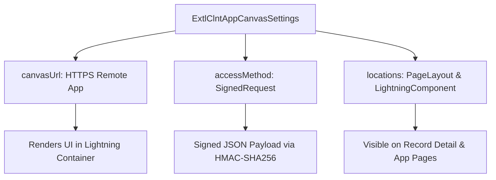

## Architectural Overview

`ExtlClntAppCanvasSettings` metadata configures the Canvas integration layer within the Salesforce External Client App (ECA) framework. Canvas enables enterprise software architects to embed external web applications (such as Node.js, Java, or React portals running on AWS, Azure, or GCP) directly inside the Salesforce Lightning Experience UI without requiring custom iframes or brittle front-end integration hacks.

In the legacy Connected App model, Canvas configuration was tightly coupled with OAuth secrets and subscriber access policies. `ExtlClntAppCanvasSettings` isolates canvas display properties—including the target secure endpoint URL, visual display locations, and the cryptographic access method (Signed Request or OAuth)—into a modular, packageable metadata unit.



This decoupled architecture allows Independent Software Vendors (ISVs) and enterprise architects to update the canvas endpoint or lifecycle configuration in development without disrupting local subscriber org security policies.

## Directory and File Conventions

`ExtlClntAppCanvasSettings` metadata is organized within the `extlClntAppCanvasSettings` or parent `externalClientApps` directory:

| Property | Value |
| :--- | :--- |
| **Metadata Type Name** | `ExtlClntAppCanvasSettings` |
| **SFDX Folder** | `force-app/main/default/extlClntAppCanvasSettings/` |
| **File Suffix** | `.canvas-meta.xml` or `.extlClntAppCanvasSettings-meta.xml` |
| **Packaging Support** | Managed 2GP, Unlocked Packages |

## Key Metadata Fields

The `ExtlClntAppCanvasSettings` schema specifies connection protocols, endpoints, and UI placement targets:

| Field Name | Field Type | Required | Architectural Description |
| :--- | :--- | :--- | :--- |
| `canvasUrl` | `string` | Yes | Secured HTTPS endpoint URL that serves the external canvas application. |
| `accessMethod` | `string` | Yes | Authentication handshake protocol: `SignedRequest` or `OAuth`. |
| `samlInitiationMethod` | `string` | No | Method for initiating SAML SSO handshakes if SAML authentication is utilized. |
| `locations` | `list` | No | UI placement locations (e.g., `PageLayout`, `Publisher`, `Chatter`, `Visualforce`). |
| `options` | `string` | No | Additional canvas flags such as resize options and personal canvas enablement. |

## Declarative XML and Package Manifest Examples

Below is a declarative XML definition of `ExtlClntAppCanvasSettings` embedding a secure ERP order portal into Salesforce:

```xml title="force-app/main/default/extlClntAppCanvasSettings/ERP_Order_Portal.canvas-meta.xml"
<?xml version="1.0" encoding="UTF-8"?>
<ExtlClntAppCanvasSettings xmlns="http://soap.sforce.com/2006/04/metadata">
    <canvasUrl>https://portal.enterprise-erp.internal/canvas/orders</canvasUrl>
    <accessMethod>SignedRequest</accessMethod>
    <locations>PageLayout</locations>
    <locations>Visualforce</locations>
    <options>HideHeader,HideShare</options>
</ExtlClntAppCanvasSettings>
```

### Package Manifest (`package.xml`)

```xml title="manifest/package.xml"
<?xml version="1.0" encoding="UTF-8"?>
<Package xmlns="http://soap.sforce.com/2006/04/metadata">
    <types>
        <members>ERP_Order_Portal</members>
        <name>ExtlClntAppCanvasSettings</name>
    </types>
    <version>68.0</version>
</Package>
```

## CLI Retrieval and Deployment Commands

Manage canvas settings using the Salesforce CLI:

```bash
# Retrieve ExtlClntAppCanvasSettings metadata
sf project retrieve start --metadata ExtlClntAppCanvasSettings:ERP_Order_Portal

# Deploy canvas settings to target staging sandbox
sf project deploy start --metadata ExtlClntAppCanvasSettings

# Retrieve all external client app subcomponents concurrently
sf project retrieve start --metadata "ExtlClntAppCanvasSettings,ExtlClntAppOauthSettings"
```

## Architect Best Practices and Gotchas

- **Strict HTTPS Enforcement:** The `canvasUrl` must point to an endpoint secured with a trusted public SSL/TLS certificate. Self-signed certificates are rejected by modern web browsers when embedded inside Lightning Experience iframe sandboxes.
- **Signed Request Secret Distribution:** When choosing `SignedRequest`, the external backend web application must verify the HMAC-SHA256 signature using the consumer secret. In External Client Apps, the consumer secret is governed securely via global OAuth settings rather than exposed in client metadata.
- **Lightning Locker and CSP Considerations:** Ensure the external web domain specified in `canvasUrl` is registered as a trusted CSP (Content Security Policy) site in Salesforce Setup to prevent browser cross-origin frame blocking.

> [!NOTE]
> Setting `accessMethod` to `SignedRequest` delivers maximum performance by eliminating the OAuth redirect handshake during initial page render.

> [!WARNING]
> Changing `canvasUrl` in production affects all embedded instances immediately; always perform blue-green deployments on the external hosting platform to maintain uptime.
