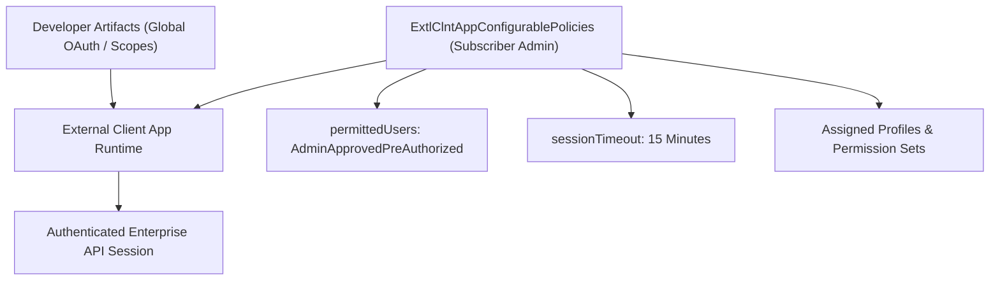

## Architectural Overview

`ExtlClntAppConfigurablePolicies` represents the administrative policy domain within the Salesforce External Client App (ECA) architecture. In classical Connected App configurations, administrator access policies—such as user assignment restrictions, session timeouts, and IP relaxation rules—were co-located inside the same file as developer OAuth parameters and redirect URLs. Consequently, vendor package updates routinely overwrote subscriber security customizations.

The External Client App model introduces a clean separation of responsibilities. While ISVs and developers author integration endpoints and OAuth scopes, subscriber org administrators retain sovereign control via `ExtlClntAppConfigurablePolicies`. This metadata type allows security architects to mandate admin-approved user access, designate specific Permission Sets and Profiles, and enforce strict session timeouts.



By decoupling governance from development, enterprise security teams can check policy files into their tenant-specific repository and automate continuous policy validation without colliding with packaged vendor metadata.

## Directory and File Conventions

`ExtlClntAppConfigurablePolicies` metadata resides within the `extlClntAppConfigurablePolicies` folder:

| Property | Value |
| :--- | :--- |
| **Metadata Type Name** | `ExtlClntAppConfigurablePolicies` |
| **SFDX Folder** | `force-app/main/default/extlClntAppConfigurablePolicies/` |
| **File Suffix** | `.policies-meta.xml` or `.extlClntAppConfigurablePolicies-meta.xml` |
| **Packaging Scope** | Subscriber Managed / Unlocked Packaging |

## Key Metadata Fields

The `ExtlClntAppConfigurablePolicies` schema defines access control rules and session lifecycle parameters:

| Field Name | Field Type | Required | Architectural Description |
| :--- | :--- | :--- | :--- |
| `permittedUsers` | `string` | Yes | Access mode: `AdminApprovedPreAuthorized` or `AllUsersMaySelfAuthorize`. |
| `sessionTimeout` | `integer` | No | Inactive session duration limit before re-authentication is mandated (in minutes). |
| `profileAccess` | `list` | No | References to standard or custom Profile API names authorized to access the application. |
| `permissionSetAccess` | `list` | No | References to Permission Set API names pre-authorized for the application. |
| `isCanvasEnabled` | `boolean` | No | Administrative override allowing or disabling Canvas rendering within subscriber layouts. |

## Declarative XML and Package Manifest Examples

Below is a declarative XML file configuring zero-trust access policies for an External Client App:

```xml title="force-app/main/default/extlClntAppConfigurablePolicies/Enterprise_Data_Sync.policies-meta.xml"
<?xml version="1.0" encoding="UTF-8"?>
<ExtlClntAppConfigurablePolicies xmlns="http://soap.sforce.com/2006/04/metadata">
    <permittedUsers>AdminApprovedPreAuthorized</permittedUsers>
    <sessionTimeout>15</sessionTimeout>
    <permissionSetAccess>
        <permissionSet>Enterprise_Integration_Users</permissionSet>
    </permissionSetAccess>
    <isCanvasEnabled>true</isCanvasEnabled>
</ExtlClntAppConfigurablePolicies>
```

### Package Manifest (`package.xml`)

```xml title="manifest/package.xml"
<?xml version="1.0" encoding="UTF-8"?>
<Package xmlns="http://soap.sforce.com/2006/04/metadata">
    <types>
        <members>Enterprise_Data_Sync</members>
        <name>ExtlClntAppConfigurablePolicies</name>
    </types>
    <version>68.0</version>
</Package>
```

## CLI Retrieval and Deployment Commands

Manage configurable policy files using modern `sf` CLI commands:

```bash
# Retrieve configurable policies for a designated External Client App
sf project retrieve start --metadata ExtlClntAppConfigurablePolicies:Enterprise_Data_Sync

# Deploy security policies to production environment
sf project deploy start --metadata ExtlClntAppConfigurablePolicies:Enterprise_Data_Sync

# Retrieve all configurable policies across all registered client apps
sf project retrieve start --metadata ExtlClntAppConfigurablePolicies
```

## Architect Best Practices and Gotchas

- **Zero-Trust Access Control:** Always specify `permittedUsers` as `AdminApprovedPreAuthorized`. Permitting `AllUsersMaySelfAuthorize` allows any licensed user in your tenant to grant third-party OAuth access without IT oversight.
- **Permission Sets Over Profiles:** Architect user access by binding `permissionSetAccess` rather than hardcoding legacy profiles. Permission sets facilitate granular access auditing and modular permission assignment across personas.
- **Deployment Dependencies:** Ensure all referenced Permission Sets exist in the destination org prior to deploying `ExtlClntAppConfigurablePolicies`. Deploying policies referencing non-existent permission sets causes immediate validation failures.

> [!TIP]
> Use automated static analysis in CI/CD pull requests to verify that `permittedUsers` is never committed as `AllUsersMaySelfAuthorize` in production branches.

> [!WARNING]
> Switching `permittedUsers` from `AllUsersMaySelfAuthorize` to `AdminApprovedPreAuthorized` immediately invalidates active sessions for users without explicit Permission Set assignments.
